# Maps

All maps are rendered from the real Everon island (terrain, coast, roads and buildings). **North is up.**
Every name is the **in-game map label** from the pack. The numbers on a map match the table under it.
Places in red are **off the public map**: you find them by asking around.

## Saint-Philippe

The whole village, from the dock in the north to the wheat field in the south.

<!-- map:town -->
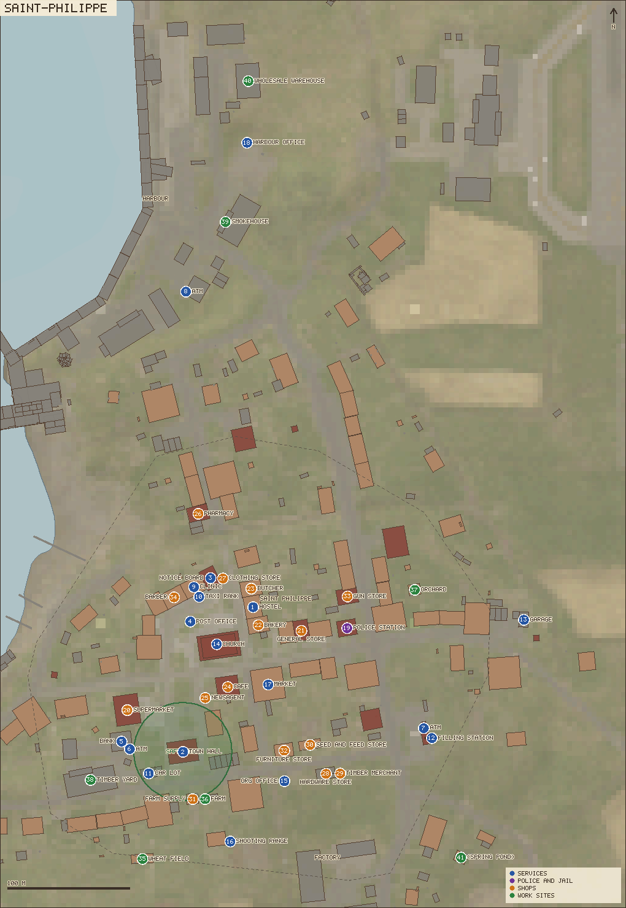

Closer in, the centre of town:

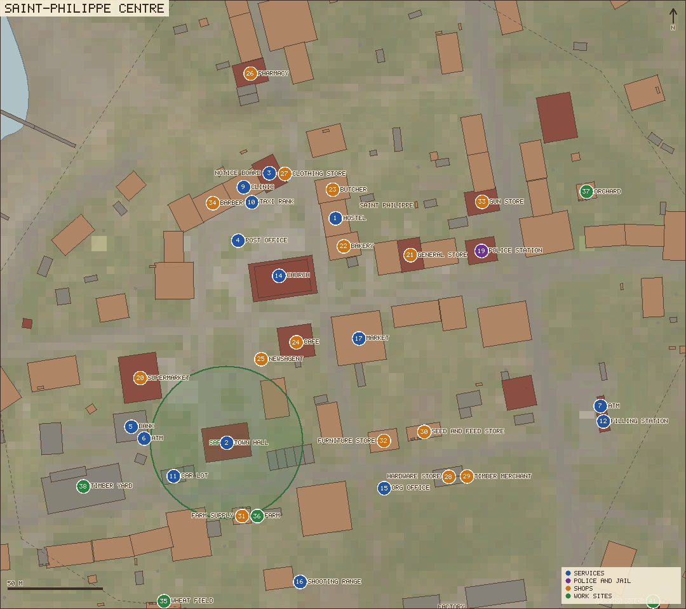

| # | Place (in-game name) | Kind | What you do here |
|---|---|---|---|
| 1 | Hostel | Services | Where a new character wakes. Safe zone around it. |
| 2 | Registry clerk: ID cards | Services | Town hall: ID card, driving licence, the arrival quest. |
| 3 | Notice board | Services | The town board: every place in town, with a waypoint button. |
| 4 | Parcel depot (post office) | Services | Sign up for courier work, take parcels. |
| 5 | Bank | Services | Teller for deposits and withdrawals. |
| 6 | ATM (by the bank) | Services | Cash machine on the bank wall. |
| 7 | ATM (east side) | Services | Cash machine near the filling station. |
| 8 | ATM (harbour) | Services | Cash machine on the dock. |
| 9 | Clinic (hospital) | Services | Medic duty desk, hospital till, where you wake after dying. |
| 10 | Taxi rank | Services | Start a taxi run. |
| 11 | Car lot | Services | Buy a car. Impound desk beside it. |
| 12 | Filling station | Services | Pumps and the fuel kiosk. |
| 13 | Garage | Services | Mechanic: car parts and repair kits. |
| 14 | Church | Services | The village church. |
| 15 | Organization office | Services | Register or join an organization. |
| 16 | Shooting range | Services | Three target lanes. |
| 17 | Market | Services | Market stall trader. |
| 18 | Harbour Office | Services | The harbour master. |
| 19 | Police station | Police and jail | Duty desk, armoury, wanted board, jail cell. |
| 20 | Supermarket | Shops | Food and drink. |
| 21 | General store | Shops | Tinned food, seeds, drinks, miner's till. |
| 22 | Bakery | Shops | Bread, baguettes, croissants. |
| 23 | Butcher | Shops | Ham, saucisson, canned and dried meat. |
| 24 | Cafe | Shops | Drinks and snacks. Chess table next door. |
| 25 | Newsagent | Shops | Tourist map, newspaper, postcards. |
| 26 | Pharmacy | Shops | Aspirin, gauze, tourniquets. |
| 27 | Clothing store | Shops | Clothes, hats, jackets. |
| 28 | Hardware store | Shops | Axe, shovel, planks, cement, radio, repair kit. |
| 29 | Timber merchant | Shops | Sells your planks and hardwood boards. |
| 30 | Seed and feed store | Shops | Fishing rod, bait, seeds. |
| 31 | Farm supply | Shops | The reaper and beehive kit. |
| 32 | Furniture store | Shops | Furniture for your home. |
| 33 | Gun store | Shops | Firearm permit, pistols, rifles, ammo. |
| 34 | Barber | Shops | Haircut. |
| 35 | Wheat field | Work sites | Harvest contracts and the weighbridge. |
| 36 | Farm | Work sites | Vegetable plots, beehives, honey kitchen. |
| 37 | Orchard | Work sites | Farmer job desk and apple trees. |
| 38 | Timber yard (Scierie) | Work sites | Lumberjack job desk and sawmill. |
| 39 | Smokehouse | Work sites | Smoke your fish. |
| 40 | Wholesale warehouse | Work sites | Buys bulk goods at a falling price. |
| 41 | Fishing spot (Spring Pond) | Work sites | Fish from the jetty. |
<!-- /map -->

## The island

Saint-Philippe is in the north. The other towns are scenery for now. Work sites and hideouts are numbered.

<!-- map:island -->
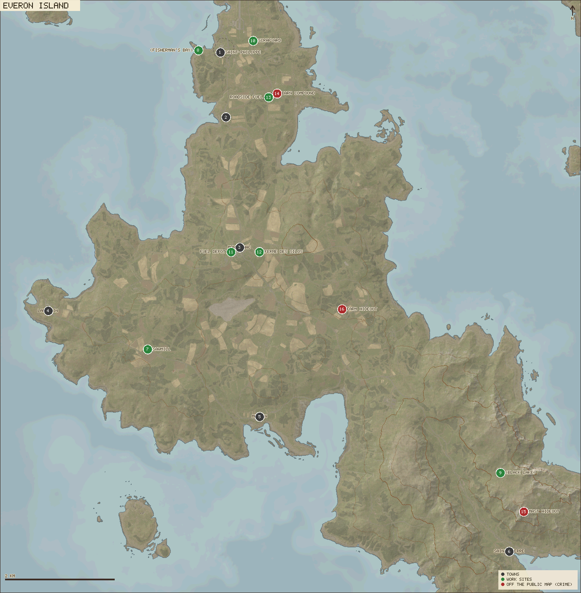

| # | Place (in-game name) | Distance from Saint-Philippe | What is there |
|---|---|---|---|
| 1 | Saint-Philippe | - | Spawn, shops, police, clinic, bank, homes. Everything starts here. |
| 2 | Meaux | 1.2 km | Village on the road south. Nothing built for players yet. |
| 3 | Montignac | 3.6 km | Town with a notice board at the fuel depot. No shops yet. |
| 4 | Lamentin | 5.7 km | Western town. Scenery only. |
| 5 | Morton | 6.7 km | Northern town. Scenery only. |
| 6 | Saint Pierre | 10.5 km | Far north-east town. Scenery only. |
| 7 | Sawmill (Scierie) | 5.6 km | The island sawmill: lumberjack desk, two saws, boards. |
| 8 | Fishing spot (Fisherman's Bay) | 0.4 km | Sheltered cove with a bench and lantern. Gaspard tells you about it. |
| 9 | Fishing spot (Black Lake) | 9.2 km | A lake shore far to the north-east. |
| 10 | Scrapyard (Casse) | 0.6 km | Scrap piles and the recycler bench. |
| 11 | Fuel depot | 3.7 km | Collective-farm fuel depot. Closed to players for now. |
| 12 | Ferme des Silos | 3.8 km | Roadside farm with a payphone. |
| 13 | Fuel station (roadside) | 1.2 km | Roadside fuel stop with a payphone. |
| 14 | Barn compound | 1.2 km | Chop yard and the moonshine still barn. |
| 15 | Contested ground | 10.1 km | Hilltop mast: a hideout organizations fight over. |
| 16 | Contested ground (farm) | 5.2 km | Farm compound: a second hideout. |
<!-- /map -->

## Homes and plots for sale

<!-- map:homes -->
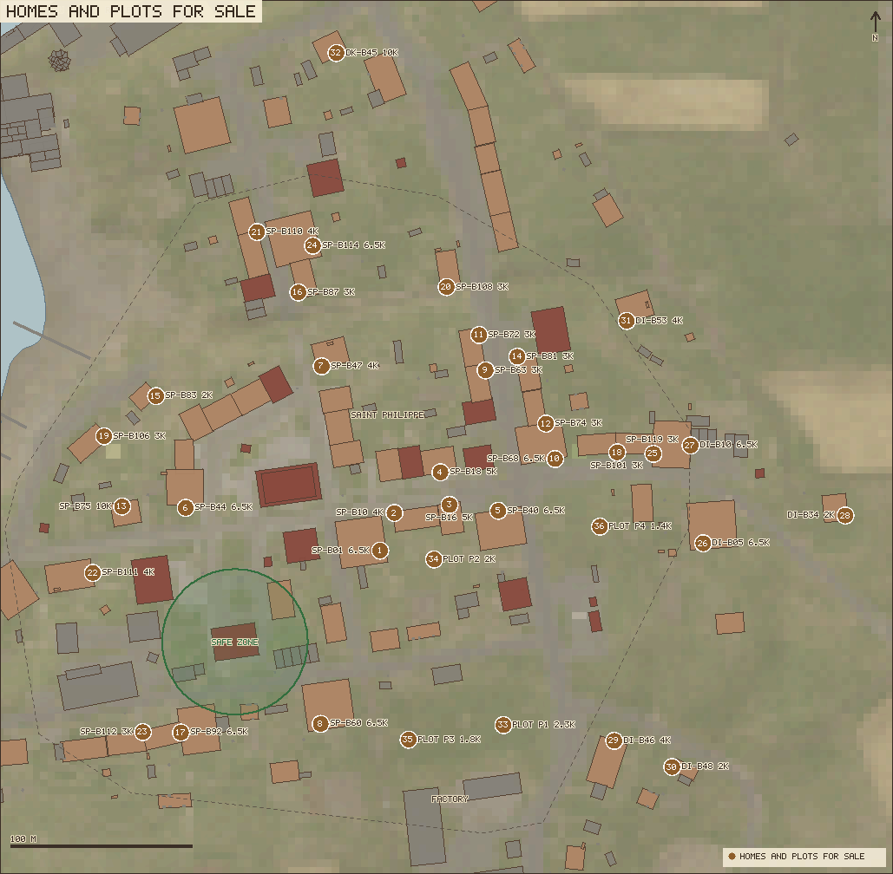

The label on the map is the home's code and its alpha price in thousands. Prices are the alpha price (50 percent of the list).

| # | Home | Tier | List price | Alpha price |
|---|---|---|---|---|
| 1 | SP-B01 | Farmhouse | $13,000 | **$6,500** |
| 2 | SP-B10 | Family house | $8,000 | **$4,000** |
| 3 | SP-B16 | Town house | $10,000 | **$5,000** |
| 4 | SP-B18 | Town house | $10,000 | **$5,000** |
| 5 | SP-B40 | Farmhouse | $13,000 | **$6,500** |
| 6 | SP-B44 | Farmhouse | $13,000 | **$6,500** |
| 7 | SP-B47 | Family house | $8,000 | **$4,000** |
| 8 | SP-B60 | Farmhouse | $13,000 | **$6,500** |
| 9 | SP-B63 | Village house | $6,000 | **$3,000** |
| 10 | SP-B68 | Farmhouse | $13,000 | **$6,500** |
| 11 | SP-B72 | Village house | $6,000 | **$3,000** |
| 12 | SP-B74 | Village house | $6,000 | **$3,000** |
| 13 | SP-B75 | Villa | $20,000 | **$10,000** |
| 14 | SP-B81 | Village house | $6,000 | **$3,000** |
| 15 | SP-B83 | Cottage | $4,000 | **$2,000** |
| 16 | SP-B87 | Village house | $6,000 | **$3,000** |
| 17 | SP-B92 | Farmhouse | $13,000 | **$6,500** |
| 18 | SP-B101 | Village house | $6,000 | **$3,000** |
| 19 | SP-B106 | Village house | $6,000 | **$3,000** |
| 20 | SP-B108 | Village house | $6,000 | **$3,000** |
| 21 | SP-B110 | Family house | $8,000 | **$4,000** |
| 22 | SP-B111 | Family house | $8,000 | **$4,000** |
| 23 | SP-B112 | Village house | $6,000 | **$3,000** |
| 24 | SP-B114 | Farmhouse | $13,000 | **$6,500** |
| 25 | SP-B119 | Village house | $6,000 | **$3,000** |
| 26 | DI-B05 | Farmhouse | $13,000 | **$6,500** |
| 27 | DI-B10 | Farmhouse | $13,000 | **$6,500** |
| 28 | DI-B34 | Cottage | $4,000 | **$2,000** |
| 29 | DI-B46 | Family house | $8,000 | **$4,000** |
| 30 | DI-B48 | Cottage | $4,000 | **$2,000** |
| 31 | DI-B53 | Family house | $8,000 | **$4,000** |
| 32 | DK-B45 | Villa | $20,000 | **$10,000** |

| # | Plot | List price | Alpha price |
|---|---|---|---|
| 33 | Plot P1 | $4,500 | **$2,250** |
| 34 | Plot P2 | $4,000 | **$2,000** |
| 35 | Plot P3 | $3,500 | **$1,750** |
| 36 | Plot P4 | $2,800 | **$1,400** |
<!-- /map -->

## Crime and police: Saint-Philippe

<!-- map:crime -->
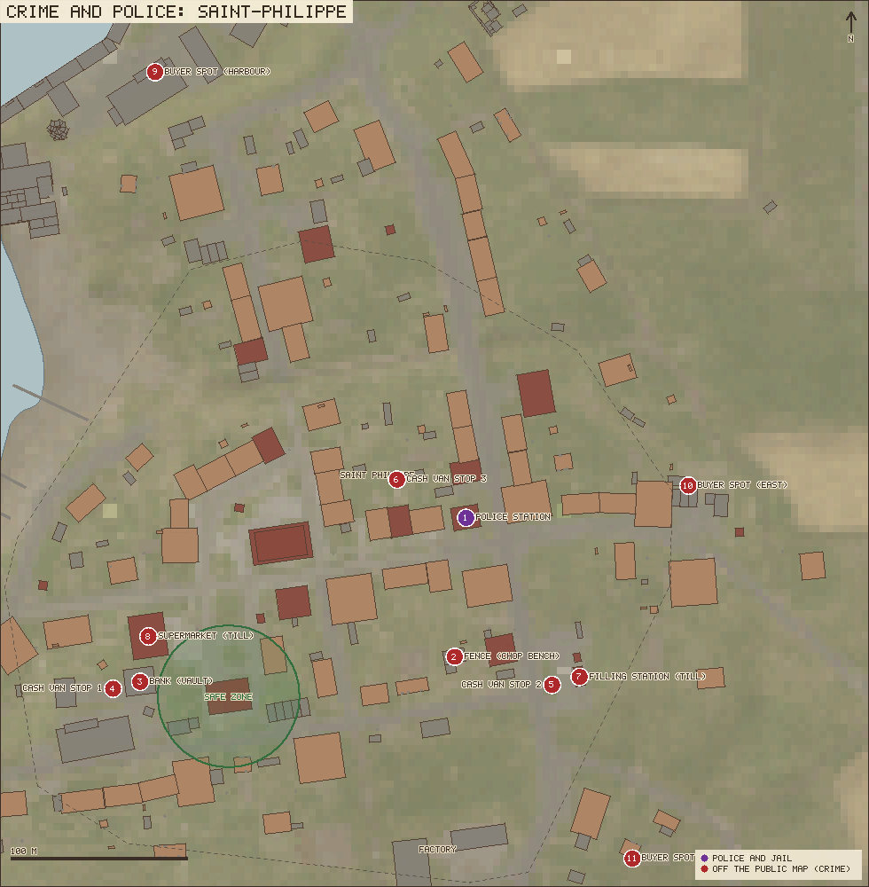

| # | Place | Why you care |
|---|---|---|
| 1 | Police station | Robbers want it far away. Officers want it close. |
| 2 | Fence (chop bench) | Fence, lockpicks, drills. Chop stolen cars. |
| 3 | Bank (vault) | Bank heist: staff door, vault, getaway. |
| 4 | Cash van stop 1 | The cash van parks here for 5 minutes at a time. |
| 5 | Cash van stop 2 | Next stop on the van's schedule. |
| 6 | Cash van stop 3 | Next stop on the van's schedule. |
| 7 | Filling station (till) | Hold up the attendant for 150. |
| 8 | Supermarket (till) | Till robbery, 120 to 180. |
| 9 | Buyer spot (harbour) | Where a buyer takes goods that cannot be sold in a shop. |
| 10 | Buyer spot (east) | Same, east side. |
| 11 | Buyer spot (north-west) | Same, west side. |
<!-- /map -->

**Alarms on the in-game map.** When a till, the bank vault, the clinic cabinet or the armoury is robbed, its alarm shows on **everyone's** map: the place's badge gets a **pulsing red ring with a "!"** while the robbery is on (about three minutes from the alarm), then turns **grey** for fifteen minutes ("Robbed recently"). Hover the badge to read when the alarm went off.

## Job areas, closer in

### Fields, timber yard and the range
<!-- map:inset:farm-timber -->
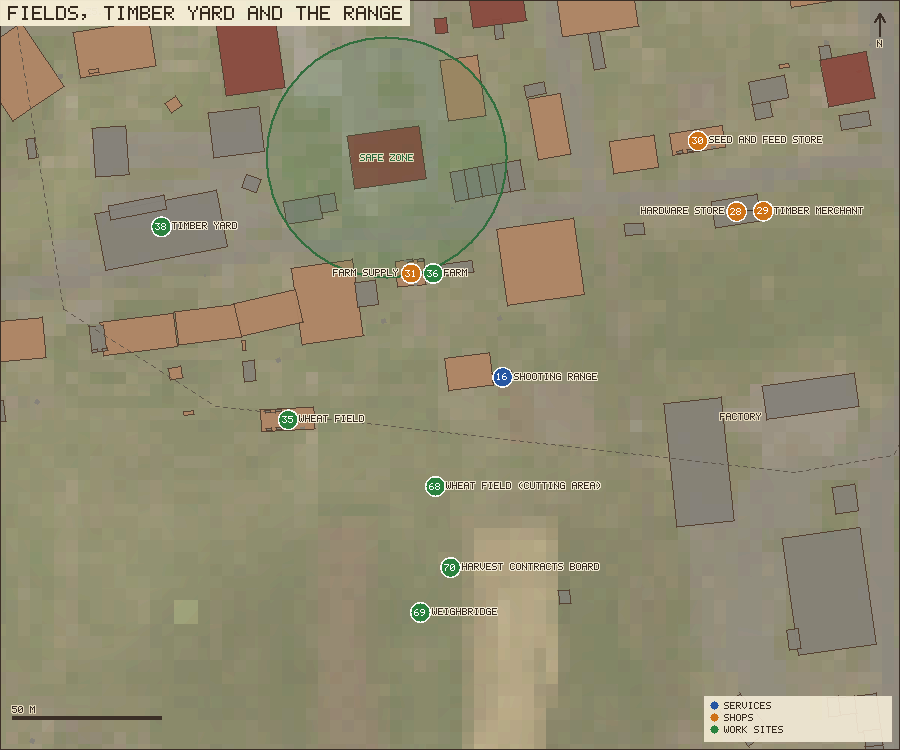

| # | Place | What |
|---|---|---|
| 16 | Shooting range | Three target lanes. |
| 28 | Hardware store | Axe, shovel, planks, cement, radio, repair kit. |
| 29 | Timber merchant | Sells your planks and hardwood boards. |
| 30 | Seed and feed store | Fishing rod, bait, seeds. |
| 31 | Farm supply | The reaper and beehive kit. |
| 35 | Wheat field | Harvest contracts and the weighbridge. |
| 36 | Farm | Vegetable plots, beehives, honey kitchen. |
| 38 | Timber yard (Scierie) | Lumberjack job desk and sawmill. |
| 68 | Wheat field (cutting area) | The ripe wheat you cut with the reaper. |
| 69 | Weighbridge | Unload the reaper hopper here: Sell grain or Bag grain. |
| 70 | Harvest contracts board | Post, take and return harvest contracts. |
<!-- /map -->
### Everon sawmill
<!-- map:inset:sawmill -->
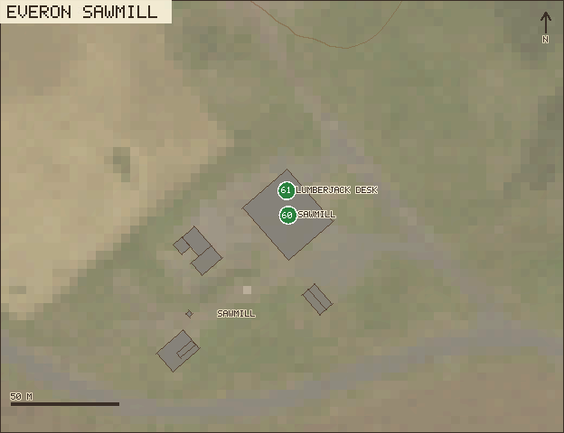

| # | Place | What |
|---|---|---|
| 60 | Sawmill (Scierie) | Lumberjack desk and two saws inside the hall. |
| 61 | Lumberjack desk | Sign on as a lumberjack. |
<!-- /map -->
### Spring Pond
<!-- map:inset:pond -->
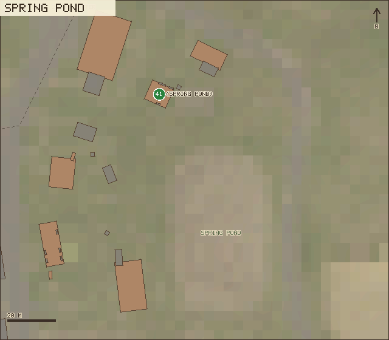

| # | Place | What |
|---|---|---|
| 41 | Fishing spot (Spring Pond) | Fish from the jetty. |
<!-- /map -->
### Fisherman's Bay
<!-- map:inset:bay -->
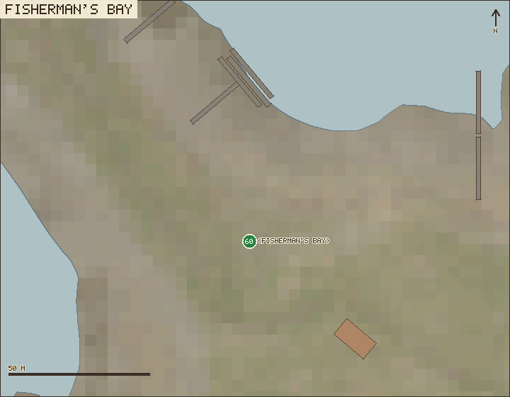

| # | Place | What |
|---|---|---|
| 60 | Fishing spot (Fisherman's Bay) | Sheltered cove: mackerel, bass and more. |
<!-- /map -->
### Black Lake
<!-- map:inset:lake -->
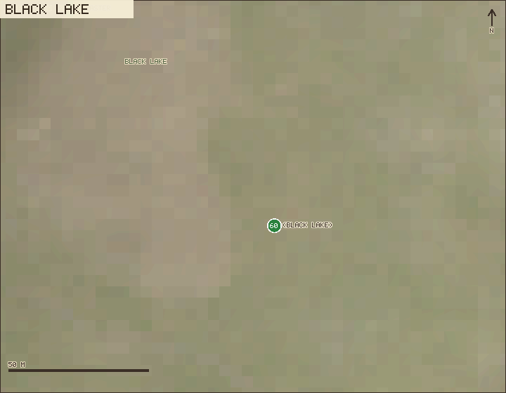

| # | Place | What |
|---|---|---|
| 60 | Fishing spot (Black Lake) | Quiet lake shore with a bench and a lantern. |
<!-- /map -->
### Harbour and dock
<!-- map:inset:harbour -->
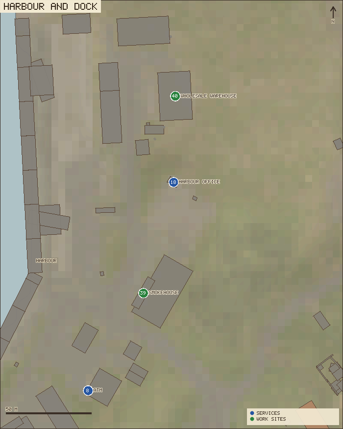

| # | Place | What |
|---|---|---|
| 8 | ATM (harbour) | Cash machine on the dock. |
| 18 | Harbour Office | The harbour master. |
| 39 | Smokehouse | Smoke your fish. |
| 40 | Wholesale warehouse | Buys bulk goods at a falling price. |
<!-- /map -->
### Scrapyard
<!-- map:inset:scrapyard -->
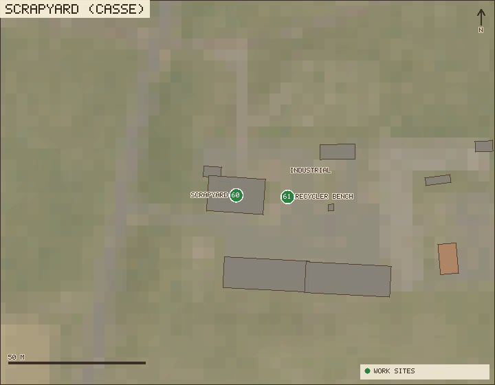

| # | Place | What |
|---|---|---|
| 60 | Scrapyard (Casse) | Search the scrap piles; the recycler bench is in the yard. |
| 61 | Recycler bench | Break car parts and scrap into metal. |
<!-- /map -->
### Barn compound
<!-- map:inset:barn -->
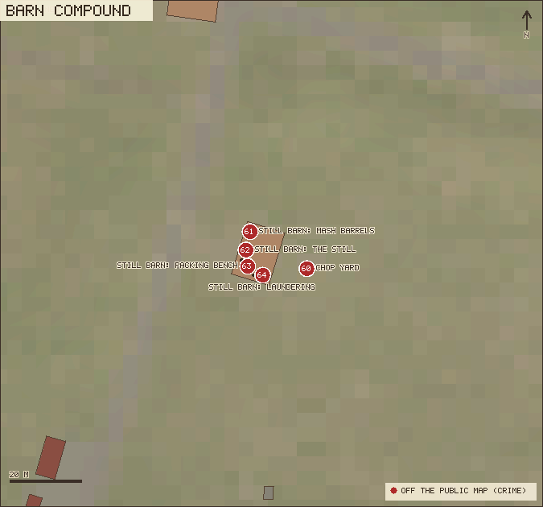

| # | Place | What |
|---|---|---|
| 60 | Chop yard | Chop stolen cars (a back-country bench). |
| 61 | Still barn: mash barrels | Mash plums and cabbage. |
| 62 | Still barn: the still | Distill the mash into moonshine. |
| 63 | Still barn: packing bench | Pack bottles into crates. |
| 64 | Still barn: laundering | Wash marked cash, keep 65 percent. |
<!-- /map -->
