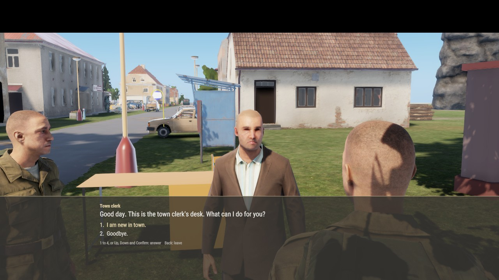
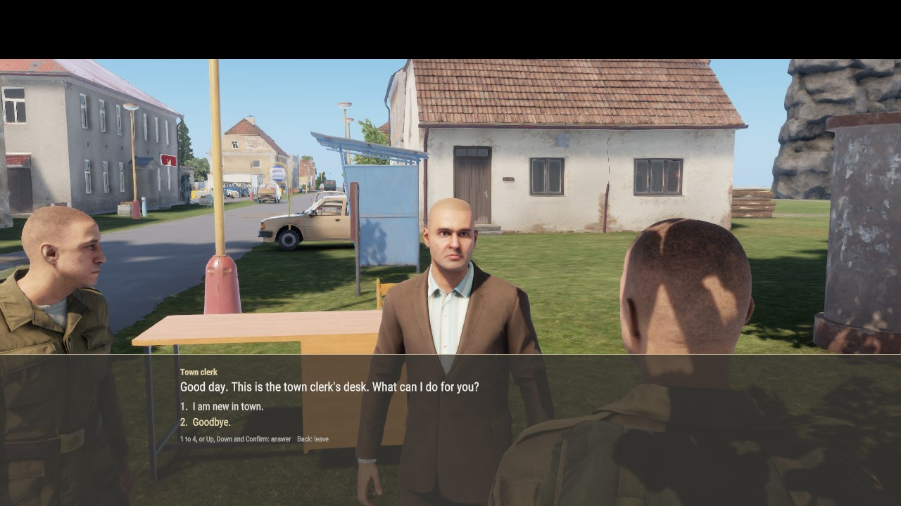
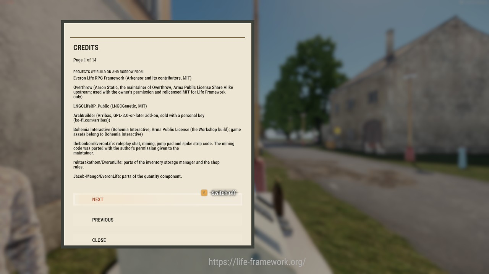

# M3 sign-off: agent run, 2026-11-15

The lead's agent ran [the M3 sign-off checklist](m3-signoff.md) with the test harness, on `origin/main` at `3820dca00d` (PR #1676, the held-ground test fix, was already merged). Sessions, tests and e2e runs went through the pool, which placed all of them on lf-cloud (never pinned). Every session was closed straight after use.

This report gives evidence; it does not sign anything off. The lead reads it, then runs `tools\cli playtest verdicts` on the ticked copy. The agent ran no `verdicts`, applied no labels and ran no `promote`.

- Ticked copy, in the format `playtest verdicts` reads: [m3-signoff-agent-checklist-2026-11-15.md](m3-signoff-agent-checklist-2026-11-15.md) (also at `tmp/playtest/checklist-m3-agent.md` in the `m3-playtest-run` worktree). PASS ticks the front box, FAIL ticks `fail [x]`, MANUAL leaves both boxes empty. Each line carries a `> note:` with its evidence.
- Raw evidence (logs, sheet text, pictures): `tmp/playtest/ev/` and `tmp/logs/` in the `Life-Framework-ws-m3-playtest-run` worktree. Pictures used in the bugs are in `website/public/docs-images/m3-agent-run-2026-11-15/`.

## Summary

| | Lines | Issues |
|---|---|---|
| PASS | 57 (6 smoke + 51 issue lines) | 53 |
| FAIL | 2 | 3 (#957, #1109, #962) |
| MANUAL | 32 | 35 |
| **Total** | **91** (6 smoke + 85 issue lines) | **91** |

**The smoke list passes (S1 to S6),** on a dedicated playtest-mission server with two clients and a real stop, `-loadSessionSave` and reload (`save loaded: version 34`).

**The one feature failure is the override model's `remove` for vehicles** (#1741): with `presets/m3-override-model-boot.json` as the owner config, the UAZ 469 is still offered at the lot, and the server sells it. That fails #957/#1109 and #962.

## Bugs filed

| Issue | What | Label | Blocks |
|---|---|---|---|
| [#1741](https://github.com/Life-Framework/Life-Framework/issues/1741) | Owner config: `vehicles` `op: remove` on the base GUID is accepted with no rejection line, yet the car is still listed and sold | bug, m3 | #957, #1109, #962 |
| [#1715](https://github.com/Life-Framework/Life-Framework/issues/1715) | Dialogue: Up after Down does not move reply focus back, so confirm picks Goodbye; `dialogue-proof` (PASS on 2026-11-14, #1237) fails. Voiced-line counters read 0, which may only be the lf-cloud session having no sound | bug, **regression**, m3 | the `dialogue-proof` evidence cited by #957/#1109 |
| [#1738](https://github.com/Life-Framework/Life-Framework/issues/1738) | Credits sheet: a world prompt ("F Switch off") draws over it, and CLOSE is clipped at 720p | bug | nothing (polish; #481 passes) |
| [#1699](https://github.com/Life-Framework/Life-Framework/issues/1699) | Pool: a session routed to lf-cloud only knows 2 session lanes (the synced `pool.json` `local` entry), so it loops "lost the race for a lane" while lf-cloud has room | bug (tooling) | nothing; it cost pool time |
| [#1700](https://github.com/Life-Framework/Life-Framework/issues/1700) | Pool: the fixed 30 s boot budget kills `test --world CoreOnEveron` before the server is ready | bug (tooling) | reproducing the #1047/#1077 evidence |

## MANUAL items (35 issues on 32 lines)

Each needs a person, or a step the harness could not reach in this pass. The reason is on the line's note.

- **Needs a person by nature** (looks, audio, a real menu, a real Steam account, language, Workbench, desk decisions): #374 (main-menu list, local host), #1128, #755, #966, #964 [LOOK]; #323 (audio, Workbench view); #958 (German client); #691 (two real Steam accounts and a restart); #1077, #1047 (Workbench play); #751, #752, #375, #369, #291, #289, #296 #967 (desk and maintainer decisions).
- **Blocked on the Workshop upload (#370):** #109, #1004, #290 #292, #295, #370 #371.
- **Harness could reach, not driven in this pass:** #754 (promotion needs a senior officer or an hour on duty, plus a kit re-draw), #693 (rate limit partly driven, see its row; 8 more steps), #1074 (unlisted join and an economy-off late joiner), #750 (org invite and join PASS; the rights entries are not readable through `look`), #283 (impound restart and the out-of-range price).
- **Roll-ups that wait on the above:** #1005 (#957 fails), #223, #226, #684, #746.

## Findings about the checklist and the harness

- **#962's two steps cannot run as written.** No world places a `clothing_rack` outlet (only `LF_ItemCatalogue.conf` and a test name it), and robbery is not one of the ticket form's five offences. The robbery patch is accepted (`crime: owner config read 3 fields, rejected 1`, the one rejection is `test-missing`). A future checklist should read the fine where robbery is charged.
- **#1108's "police menu lists the ranks"** has no screen to read: clocking in opens no sheet. The `patrol` removal refusal at boot, and an officer clocking in at rank 0, stand in for it.
- **#322's spot-check is stale:** `tools\cli host status` reports the last real host, from 2026-11-10 and core only. It is not a failure; every run in this pass loaded `LifeFramework,LF_Everon1989`.
- **Rate limit (#693):** ten Pay clicks in 4.7 s bought 6 apples in 1.86 s before the refusal. `LF_RateLimit` is a fixed window (4 per 2000 ms), so a burst that straddles a window boundary can buy up to 8. That matches the code; the checklist's "the first 4 buys go through" is the single-window case.
- **Sessions on lf-cloud boot the bare `Everon1989Town` world** for `session up` without `--mission`, and log `no SCR_PersistenceSystem at game start`, which `debug-log-triage.md` lists as expected for a bare world.
- **Harness gaps:** after `session restart`, `session identity` reports no identity for either client; a client added with `session join` cannot `session rejoin`; `downed-proof` waits out a bleed-out with no harness command, so the pool closes it at 3 minutes idle while another job queues (it needs a `session lease`). The registration form rejects a name with a digit (`Pat1`) with a clear `RegError` line; that is correct, and it cost one retry.
- **Sound:** the lf-cloud sessions have no audio, so `cuffs-proof`'s click probe and the dialogue voice counters read 0 there. Re-check both on a machine with sound before treating them as bugs.

## Runs in this pass

| Run | Result | Evidence |
|---|---|---|
| `tools\cli validate --all` | 250 checks, 0 failed | `tmp/logs/validate-20261115-132940.log` |
| `validate-release-ready --strict`, `config-check` (bad, example, pack section), `pack check LF_Everon1989`, `example-zip` (draft, `--final`), `upgrade-page`, `release 0.1.0` dry run, `config-harness --stage all`, `npm test` in website/ | as expected (see the rows) | `tmp/playtest/ev/*.txt` |
| `test --no-build --tier all` | 567/567, lf-cloud | `tmp/logs/test-20261115-133218.log` |
| `test --no-build --tier all --core-only` | 567/567, pack hidden | `tmp/logs/test-20261115-133359.log` |
| `test --tier fast --world Worlds/CoreOnEveron/CoreOnEveron.ent` | TIMEOUT at the 30 s boot budget, twice (#1700) | `tmp/logs/test-20261115-133500.log`, `...133629.log` |
| `wt e2e` | pass 1 and 2 48/48; vehicle-state, held-ground, playtime and job-XP rows applied | `tmp/logs/wt-e2e-20261115-133738.log` |
| `wt e2e --content-ids` / `--cash-swap` / `--pre-move 502ebf39 --mission playtest` | OK / OK / OK | `tmp/logs/wt-e2e-20261115-133928.log`, `...134034.log`, `...150841.log` |
| `config-harness --stage boot` | 11/11 PASS (one lf-cloud ssh timeout, PASS on retry) | `tmp/playtest/ev/config-harness-boot*.txt` |
| Session, 1 client, full: `config-harness-proof`, `credits-proof`, `quarry-proof`, `live-reload-proof` | PASS (12 fixtures) / PASS / PASS / PASS | `tmp/playtest/ev/remote-*.log`, `credits_1.png` |
| Session, 1 client, seeded config: `config-stream-proof` | PASS | `tmp/playtest/ev/remote-config-stream-proof.log` |
| Session, 2 clients, full, roster 1: `dialogue-proof`, `cuffs-proof`, `disconnect-proof` | FAIL (#1715) / cuff flow OK, sound probe 0 / PASS | `tmp/playtest/ev/remote-*.log`, `dialogue/` |
| Session, playtest mission, 2 clients, roster 2: `rejoin-proof`, smoke S1 to S5 (`session restart`), shop spam | PASS / PASS / see #693 | `tmp/playtest/ev/playtest-boot1-console.log`, `playtest-boot2-console.log` |
| Session, 2 clients: `downed-proof` (late joiner) | late-join read PASS (S6); later steps cut by the pool's idle close | `tmp/playtest/ev/remote-downed-proof.log` |
| Sessions, 1 client: playtest mission and `template-core-only`, the board and form text | PASS (#325, #297) | harness `ui text` output in the rows |
| Session, 2 clients: `org` | PASS | `tmp/playtest/ev/remote-org.log` |
| Session, 2 clients, roster 2, `m3-override-model-boot` as `config.json`: lot, gather, safe zone, ticket form | lot FAIL (#1741); gather, zones, police PASS | `tmp/playtest/ev/override-*.txt`, `override-session-console.log` |

## Per issue

| Issue | Line | Block | Verdict | Evidence and notes |
|---|---|---|---|---|
| **S1** | Boot. `tools\cli playtest` (or `host start` and join) reaches the world with no `SCRIPT (E)` and no `VME:` in the server console log (`tools\cli logs "SCRIPT \(E\)\|VME:"` is empty). | Smoke list | **PASS** | Playtest-mission dedicated server via `session up --mission playtest` on lf-cloud: server console.log has no `SCRIPT (E)` and no `VME:` (tmp/playtest/ev/playtest-boot1-console.log). Harness session, not `tools\cli playtest`; the launcher itself was not run. |
| **S2** | Join. A fresh profile signs the registration form and spawns in town with a character, cash, and the HUD. A second client joins the running server and spawns too. | Smoke list | **PASS** | Two clients signed form R-89 and spawned on the square with $20,000 cash (`character registered for player 1` / `player 2`, harness `state`). The HUD was not looked at (lowspec). |
| **S3** | Save. Take an item and some cash (apple from the general store, a bank deposit), then wait for or force the autosave; the server log names the save and no persistence error. | Smoke list | **PASS** | `[LFDebug:Persistence] save completed (SHUTDOWN)`, no persistence error, after harness `apples` on client 1. Forced by the shutdown, not the autosave timer; no bank deposit was made. |
| **S4** | Restart. Stop the dedicated server cleanly and start it with `-loadSessionSave`: the world loads, no `Unable to find`, no `Wrong GUID/name`. | Smoke list | **PASS** | `session restart` (stop file, SHUTDOWN save, `-loadSessionSave`): `save loaded: version 34`, `applied 2 account`, `applied 5 carried snapshot(s)`, 0 `Unable to find`, 0 `Wrong GUID` (playtest-boot2-console.log). |
| **S5** | Reload. Rejoin after the restart: same character, same cash, same item and bank balance as before the restart. | Smoke list | **PASS** | After the restart both clients spawn with no new form; cash 20000, bank 1000000, parked plates US_FB_3589 / CG_YP_4465 and police duty unchanged. The apple was not checked by item (state has no inventory field). |
| **S6** | Late joiner. With the first player mid-action (a half-grown plot, a downed or wanted player), a second client joins late and sees the same state, not a blank or default one. | Smoke list | **PASS** | `session downed-proof`: client 3 joins after client 2 is downed and reads `player=2 downed=1 life=INCAPACITATED` (remote-downed-proof.log line 41). The proof's later steps died when the pool closed the session at 3 min idle. |
| [#374](https://github.com/Life-Framework/Life-Framework/issues/374) | M3-Release: Flagship mission is hostable and playable solo as a local game | Solo walk | **MANUAL** | Main-menu scenario list and a local listen host: the harness boots straight into `-server`. |
| [#325](https://github.com/Life-Framework/Life-Framework/issues/325) | M3-Addons: Split the string table into core keys and pack flavour | Solo walk | **PASS** | Harness read, both states: flagship (`session up --mission playtest`) board `Welcome to Everon, Town Board`, form `Civil Registry of Everon, Form R-89`; core only (`--mission template-core-only`, pack not loaded) board `Notice`, form `Civil Registry, Form R-89`, 0 raw `#LF-` keys on the sheet. |
| [#1128](https://github.com/Life-Framework/Life-Framework/issues/1128) | M3-Packs: move the remaining hard prefab paths onto prefab slots | Solo walk | **MANUAL** | [LOOK] only the look is left; prefab-slot WORLD tests passed in the 567/567 suite. |
| [#754](https://github.com/Life-Framework/Life-Framework/issues/754) | M3-Spec: Police career schema: ranks, pay and qualifications as config | Solo walk | **MANUAL** | Not run by the harness: promotion needs a senior officer or 3600 s on duty, a kit re-draw and a .conf edit; no proof verb covers it. |
| [#755](https://github.com/Life-Framework/Life-Framework/issues/755) | M3-Spec: Zone rule sets as data: lawless, event and safe overrides per zone | Solo walk | **MANUAL** | [LOOK] tag and toasts. `quarry-proof` PASS this run (normal, lawless, safe); the safe zone refused a shot on the square in two sessions. |
| [#1077](https://github.com/Life-Framework/Life-Framework/issues/1077) | M3-Config: Member initializers beat .conf values on LF_ZoneRuleSet (pack overlays would be ignored) | Solo walk | **MANUAL** | Workbench play on CoreOnEveron. The re-run of the CoreOnEveron suite was killed by the pool's fixed 30 s boot budget (#1700), so the 242/242 evidence is not reproduced today. |
| [#1047](https://github.com/Life-Framework/Life-Framework/issues/1047) | M3-Packs: Core boots on vanilla Everon; a system with no place logs once and stays off | Solo walk | **MANUAL** | Workbench play in DebugWorld (shoot a building). Same #1700 note as #1077. |
| [#693](https://github.com/Life-Framework/Life-Framework/issues/693) | M3-Patterns: Every client request is checked on the server: an audit and a lint | Solo walk | **MANUAL** | Partly driven: 10 Pay clicks in 4.7 s on lf-cloud bought 6 apples in 1.86 s, then the slip read `One order at a time. Give the till a moment.` and the server logged `shop trade refused: player 2 is over the PURCHASE limit (4 per 2000 ms)`. Six (not four) fits the fixed window straddling a boundary. The other 8 steps (PR #824, #834) were not run. |
| [#966](https://github.com/Life-Framework/Life-Framework/issues/966) | M3-Packs: Packs override the UI theme (colours, fonts, paper texture) | Solo walk | **MANUAL** | [LOOK] pack theme overlay on a dedicated server, read by a person. |
| [#323](https://github.com/Life-Framework/Life-Framework/issues/323) | M3-Addons: Move pack resources into LF_Everon1989 in batches | Solo walk | **MANUAL** | Audio walk and the Workbench layer view. The pickaxe step was not run. |
| [#964](https://github.com/Life-Framework/Life-Framework/issues/964) | M3-Packs: Prefab slots: systems ask config for the prefab, packs swap the look | Two players | **MANUAL** | [LOOK] the swapped wrist model. `cuffs-proof` on 2 clients: cuff (`cuffed=1`) and uncuff (`cuffed=0`) work with the shipped model; its click-sound probe read 0 because the lf-cloud session has no sound. |
| [#1074](https://github.com/Life-Framework/Life-Framework/issues/1074) | M3-Packs: Switch the economy systems (Banking, ATM, Shop, Trader, Jobs, Level, License, Whitelist, Organiza... | Two players | **MANUAL** | Unlisted-account join with Whitelist off and a late joiner with all economy switches off were not driven. `client-system-off` and `m3-systems-off-boot` fixtures PASS this run. |
| [#958](https://github.com/Life-Framework/Life-Framework/issues/958) | M3-Addons: Terms layer: packs and owners rename the framework's terms, in every language | Two players | **MANUAL** | German client and the English toast reads; the harness cannot switch client language. Term fixtures (currency, sheriff-gang, language match/other) PASS this run. |
| [#750](https://github.com/Life-Framework/Life-Framework/issues/750) | M3-Spec: Organisation ranks with rights bits and a persisted conflict record | Two players | **MANUAL** | `session org` PASS this run: founded AlleyKings, face-to-face invite and join, the gate opens for the member. The rights entries (no Remove/Promote/Demote for B, no Withdraw) are not readable through `look` (class names only). |
| [#957](https://github.com/Life-Framework/Life-Framework/issues/957) [#1109](https://github.com/Life-Framework/Life-Framework/issues/1109) | M3-Addons: Content packs add, replace and patch NPC dialogue by id | Dedicated server | **FAIL** | With m3-override-model-boot as config.json the lot shows S105 $1,500 (patch OK) but still offers the UAZ 469 at $2,500 and the server sells it (`purchased {C8B16ABCA57679A2}...UAZ469`). Filed #1741. The boot lines are right; `live-reload-proof` PASS (reload dialogue). |
| [#962](https://github.com/Life-Framework/Life-Framework/issues/962) | M3-Packs: One override model for all content: add, replace, patch and remove by id | Dedicated server | **FAIL** | Remove by id fails for vehicles (#1741). The two listed steps cannot run as written: no world places a `clothing_rack` outlet, and robbery is not one of the ticket form's five offences (the crime patch was accepted: `crime: owner config read 3 fields, rejected 1`). |
| [#1106](https://github.com/Life-Framework/Life-Framework/issues/1106) | M3-Packs: Jobs lists on the override model (tracks, xpAwards, licenceGates) | Dedicated server | **PASS** | Override config, one gather at Farm_SeedCrate: `+9 FARMER xp ... from gather`, then `jobs.tracks.GHOST: patch names an id no lower layer has` and `jobs: owner config read 7 fields, rejected 1` on first use. |
| [#1108](https://github.com/Life-Framework/Life-Framework/issues/1108) | M3-Packs: Police, organizations, zones, licences and systems lists on the override model | Dedicated server | **PASS** | Override config: `zones.ruleSets.SAFE: a zone rule set cannot be removed` on first zone use; the safe zone still refused 1000 damage; `police.ranks.patrol: a shipped rank cannot be removed` at boot and an officer clocks in at rank 0. There is no police menu sheet listing ranks to read. |
| [#283](https://github.com/Life-Framework/Life-Framework/issues/283) | M3-Config: Vehicles, zones, and persistence sections read through the config service | Dedicated server | **MANUAL** | Not run: the impound override needs a restart with an impounded S105, and the 2,000,000 refusal a config edit. The base-price patch reaching the lot and the charge is shown in the #1741 run. |
| [#691](https://github.com/Life-Framework/Life-Framework/issues/691) | M3-Patterns: Disconnect rules: cuffed, downed, wanted or jailed players | Dedicated server | **MANUAL** | `session disconnect-proof` PASS this run (jailed with wanted+1, died, cuffs back, sentence waited offline, rejoin into the cell). Left: two real Steam accounts and the restart pass. |
| [#751](https://github.com/Life-Framework/Life-Framework/issues/751) | M3-Spec: Held ground: hold time, points and member minimum on the hideout record | Desk | **MANUAL** | Desk: the maintainer answers the spec's open questions. |
| [#752](https://github.com/Life-Framework/Life-Framework/issues/752) | M3-Spec: Vehicle record fields: garage slot, tow state, inspection date, hidden compartment, cargo tuning | Desk | **MANUAL** | Desk: the maintainer answers the spec's open questions. |
| [#291](https://github.com/Life-Framework/Life-Framework/issues/291) | M3-Docs: Config reference pages generated from the schema | Desk | **MANUAL** | [LOOK] phone-width check on the Pages preview. |
| [#375](https://github.com/Life-Framework/Life-Framework/issues/375) | M3-Release: Separate branding and narrative for core and Everon 1989 | Desk | **MANUAL** | Branding and narrative sign-off by the maintainer. |
| [#369](https://github.com/Life-Framework/Life-Framework/issues/369) | M3-Release: tools\cli release stamps versions, gates, and tags | Desk | **MANUAL** | The `.gproj` Version question and the real `--confirm` and tag push. The dry run printed the 12-step plan and refused on a non-main branch, as designed (tmp/playtest/ev/release-dry.txt); `release-cli-selftest` PASS. |
| [#289](https://github.com/Life-Framework/Life-Framework/issues/289) | M3-Generator: Generator presets: flagship 1989, small server, hardcore economy | Desk | **MANUAL** | [LOOK] clicking presets on /config. `configgen-selftest` OK; the three preset boot fixtures PASS this run. |
| [#296](https://github.com/Life-Framework/Life-Framework/issues/296) [#967](https://github.com/Life-Framework/Life-Framework/issues/967) | M3-Example: Release download built from the template | Desk | **MANUAL** | Licence tone read, and the final zip waits on #370. `example-zip` writes the draft; `--final` exits 1 naming `mods.pack.modId` (both this run). |
| [#109](https://github.com/Life-Framework/Life-Framework/issues/109) | M1: M1-24 Playtest release: guide, Workshop, showcase | Blocked until the Workshop upload | **MANUAL** | Blocked on the Workshop upload (#370). |
| [#1004](https://github.com/Life-Framework/Life-Framework/issues/1004) | M3 chapter: Your town in five minutes | Blocked until the Workshop upload | **MANUAL** | Blocked on the Workshop upload (#370). |
| [#290](https://github.com/Life-Framework/Life-Framework/issues/290) [#292](https://github.com/Life-Framework/Life-Framework/issues/292) | M3-Docs: Install guide from zero to a joinable server | Blocked until the Workshop upload | **MANUAL** | Blocked on #370 and a person who did not write the pages. |
| [#295](https://github.com/Life-Framework/Life-Framework/issues/295) | M3-Example: Example server template under server/ boots core and pack | Blocked until the Workshop upload | **MANUAL** | Blocked on the Workshop mods (#370). |
| [#370](https://github.com/Life-Framework/Life-Framework/issues/370) [#371](https://github.com/Life-Framework/Life-Framework/issues/371) | M3-Release: First Workshop upload of core and pack (maintainer) | Blocked until the Workshop upload | **MANUAL** | Maintainer's first upload (#370). |
| [#1216](https://github.com/Life-Framework/Life-Framework/issues/1216) | M3-Reshape: vehiclestate sidecar payload (#752a build) | Appendix: agent-proven | **PASS** | `wt e2e` pass 2 logs `applied 1 of 1 vehicle state row(s)` (and 3 of 3); the playtest session restart logs `save loaded: version 34`. The impound-desk spot-check was not walked. |
| [#1045](https://github.com/Life-Framework/Life-Framework/issues/1045) | M3-Packs: Map independence: cash van route, money bag and dispatch console find places by component | Appendix: agent-proven | **PASS** | WORLD `places/cash-van`, `places/bank-bag`, `places/dispatch` green in `test --tier all` 567/567 this run. |
| [#1073](https://github.com/Life-Framework/Life-Framework/issues/1073) | M3-Packs: Bank vault, heist and rob kit robbery obey the Robbery switch | Appendix: agent-proven | **PASS** | `LF_Test_SystemsWorld` / `LF_Test_SystemsEconomy` green in the suite; boot fixture `m3-systems-off-boot` PASS this run. |
| [#1005](https://github.com/Life-Framework/Life-Framework/issues/1005) | M3 chapter: Make it yours | Appendix: agent-proven | **MANUAL** | Spot-check rule: tick when #964, #966, #957 and #958 pass. #957 FAILS (#1741); the others are MANUAL. 12 client fixtures PASS this run. |
| [#322](https://github.com/Life-Framework/Life-Framework/issues/322) | M3-Addons: Load the LF_Everon1989 pack in build, test, serve and playtest | Appendix: agent-proven | **PASS** | Every test, e2e and session run this pass loaded `LifeFramework,LF_Everon1989`. `host status` still shows the 2026-11-10 core-only host (never restarted since), so the named spot-check is stale, not failed. |
| [#223](https://github.com/Life-Framework/Life-Framework/issues/223) | M3 epic: Two addons in one repo (LifeFramework core + LF_Everon1989 pack) | Appendix: agent-proven | **MANUAL** | Roll-up: #323 is still MANUAL. |
| [#226](https://github.com/Life-Framework/Life-Framework/issues/226) | M3 epic: Owner docs (install, config reference, add a job or shop) | Appendix: agent-proven | **MANUAL** | Roll-up: #290, #291 and #292 are still MANUAL. |
| [#684](https://github.com/Life-Framework/Life-Framework/issues/684) | M3 epic: Patterns to adopt before the framework release (from Altis Life) | Appendix: agent-proven | **MANUAL** | Roll-up: #691 and #693 are still MANUAL. |
| [#746](https://github.com/Life-Framework/Life-Framework/issues/746) | M3 epic: Record shapes and shared pieces before the framework release | Appendix: agent-proven | **MANUAL** | Roll-up: #750, #751 and #752 are still MANUAL. |
| [#287](https://github.com/Life-Framework/Life-Framework/issues/287) [#288](https://github.com/Life-Framework/Life-Framework/issues/288) | M3-Generator: Generator validates with config-check's rules and exports only a valid file | Appendix: agent-proven | **PASS** | `npm test` in website/ (`configgen-selftest: OK`) this run. |
| [#294](https://github.com/Life-Framework/Life-Framework/issues/294) | M3-Docs: Upgrade page per release | Appendix: agent-proven | **PASS** | `upgrade-page-selftest` PASS; `upgrade-page HEAD~40 HEAD --version 0.1.0` printed a filled page (tmp/playtest/ev/upgrade-page.txt). |
| [#299](https://github.com/Life-Framework/Life-Framework/issues/299) | M3-Harness: Harness boots a dedicated server per fixture | Appendix: agent-proven | **PASS** | `config-harness --stage boot`: 11 of 11 fixtures PASS on fresh dedicated servers (hardcore-economy after one lf-cloud ssh timeout, PASS on `--only`). |
| [#963](https://github.com/Life-Framework/Life-Framework/issues/963) | M3-Packs: Pack manifest with a core version range, and a declared public surface | Appendix: agent-proven | **PASS** | LOGIC `packs/manifest` green in the suite. |
| [#297](https://github.com/Life-Framework/Life-Framework/issues/297) | M3-Example: The template boots with the pack swapped out | Appendix: agent-proven | **PASS** | `session up --mission template-core-only`: ready, 1 client joined, registered and read the core-neutral board. |
| [#327](https://github.com/Life-Framework/Life-Framework/issues/327) | M3-Addons: wt e2e loads a save made before the move | Appendix: agent-proven | **PASS** | `wt e2e --pre-move 502ebf39 --mission playtest`: pass1 exit 0, pass2 48/48, `e2e shutdown save loaded` (tmp/logs/wt-e2e-20261115-150841.log). |
| [#277](https://github.com/Life-Framework/Life-Framework/issues/277) | M3-Config: Inventory every config attribute and hard-coded constant | Appendix: agent-proven | **PASS** | `config-constants-selftest` and `validate-config-constants` PASS in `validate --all`. |
| [#280](https://github.com/Life-Framework/Life-Framework/issues/280) | M3-Config: Generate config.schema.json from the config classes | Appendix: agent-proven | **PASS** | `config-schema-selftest` and `validate-config-schema` PASS. |
| [#281](https://github.com/Life-Framework/Life-Framework/issues/281) | M3-Config: tools\cli config-check validates an owner file offline | Appendix: agent-proven | **PASS** | `config-check-selftest` PASS; `config-check bad.json` 8 errors, 4 warnings; the example 0/0. |
| [#284](https://github.com/Life-Framework/Life-Framework/issues/284) | M3-Config: Move hard-coded tuning constants onto config classes | Appendix: agent-proven | **PASS** | WORLD `config/constantsBatch1` green in the suite. |
| [#298](https://github.com/Life-Framework/Life-Framework/issues/298) | M3-Harness: Harness fixtures and the parse and validate stages | Appendix: agent-proven | **PASS** | `config-harness --stage all`: 38 fixtures parse and validate OK; selftest PASS. |
| [#300](https://github.com/Life-Framework/Life-Framework/issues/300) | M3-Harness: Harness joins a client and checks a client-visible value | Appendix: agent-proven | **PASS** | `session config-harness-proof`: 12 fixtures PASS, each owner value read on the client. |
| [#301](https://github.com/Life-Framework/Life-Framework/issues/301) | M3-Harness: Config harness runs in wt gate and before every release | Appendix: agent-proven | **PASS** | `validate-config-harness` PASS in `validate --all`; parse, validate, boot and client stages all ran this pass. |
| [#303](https://github.com/Life-Framework/Life-Framework/issues/303) | M3-Upgrade: Config migrations run at boot after a backup | Appendix: agent-proven | **PASS** | LOGIC `config/migration-chain` and `config/migration-file` green in the suite. |
| [#304](https://github.com/Life-Framework/Life-Framework/issues/304) | M3-Upgrade: config-check reports which migrations would run | Appendix: agent-proven | **PASS** | `config-check docs/config/config.example.json --no-loops` prints `schemaVersion 1 is this build's; none needed`. |
| [#326](https://github.com/Life-Framework/Life-Framework/issues/326) | M3-Addons: The core boots DebugWorld and passes the suite without the pack | Appendix: agent-proven | **PASS** | `test --tier all --core-only`: 567/567, `-addons LifeFramework`, pack hidden from `-addonsDir`. |
| [#553](https://github.com/Life-Framework/Life-Framework/issues/553) | M3-Config: Packs add namespaced config sections merged into the schema | Appendix: agent-proven | **PASS** | `config-check` on `{"everon1989":{"festivalDay":9}}`: `above the maximum 7`; LOGIC `config/pack-section` green. |
| [#481](https://github.com/Life-Framework/Life-Framework/issues/481) | In-game credits screen | Appendix: agent-proven | **PASS** | `session credits-proof` (full profile): the screen opens, page 1 of 14 matches docs/credits.md's first section. Look issues filed as #1738 (a world prompt over the sheet, CLOSE clipped). |
| [#690](https://github.com/Life-Framework/Life-Framework/issues/690) | M3-Patterns: World cleanup service for abandoned vehicles, dropped items and bodies | Appendix: agent-proven | **PASS** | WORLD `cleanup/sweep` and PERSISTENCE `cleanup/persist` green. |
| [#367](https://github.com/Life-Framework/Life-Framework/issues/367) | M3-Release: Fix Workshop item names and version scheme | Appendix: agent-proven | **PASS** | `validate-release-ready --strict`: OK, 0 warnings. |
| [#686](https://github.com/Life-Framework/Life-Framework/issues/686) | M3-Patterns: No-profit-loop check across every price in config | Appendix: agent-proven | **PASS** | `profit-loop-selftest` and `validate-profit-loops` PASS. |
| [#688](https://github.com/Life-Framework/Life-Framework/issues/688) | M3-Patterns: Vehicle prices: one base price and per-action multipliers | Appendix: agent-proven | **PASS** | `client-economy-override` PASS; the override run's lot showed the patched S105 $1,500. |
| [#368](https://github.com/Life-Framework/Life-Framework/issues/368) | M3-Release: validate-release-ready checks both addons for publishing | Appendix: agent-proven | **PASS** | `release-ready-selftest` PASS. |
| [#822](https://github.com/Life-Framework/Life-Framework/issues/822) | M3: validate-annex-fixtures stops new tests depending on village entities | Appendix: agent-proven | **PASS** | `annex-fixtures-selftest` and `validate-annex-fixtures` PASS. |
| [#761](https://github.com/Life-Framework/Life-Framework/issues/761) | M3-Spec: One record-shape pass before the persistent launch, with append-only save versions | Appendix: agent-proven | **PASS** | `record-shapes-selftest` and `validate-record-shapes` PASS. |
| [#969](https://github.com/Life-Framework/Life-Framework/issues/969) | M3-Packs: pack check and an explain view of the merged config | Appendix: agent-proven | **PASS** | `pack check LF_Everon1989: OK`; `pack-check-selftest` PASS. |
| [#1075](https://github.com/Life-Framework/Life-Framework/issues/1075) | M3-Packs: Switch the world-resource systems (Gathering, Mining, Processing, Resources, Chains, Hideouts, Ho... | Appendix: agent-proven | **PASS** | WORLD `systems/world-resources`, `systems/world-places`, PERSISTENCE `systems/keep-data` green; `m3-systems-off-boot` PASS. |
| [#1076](https://github.com/Life-Framework/Life-Framework/issues/1076) | M3-Packs: Switch the service systems (Comms phones, Chat, Medic, Police, Crime, Investigation, Vehicles, Ve... | Appendix: agent-proven | **PASS** | `LF_Test_SystemsServices` green; `m3-systems-off-boot` PASS. |
| [#960](https://github.com/Life-Framework/Life-Framework/issues/960) | M3-Packs: Every system can be turned on or off from config | Appendix: agent-proven | **PASS** | WORLD `systems/world-gates`, PERSISTENCE `systems/keep-data` green; e2e pass1/pass2 OK; `m3-systems-off-boot` PASS. |
| [#961](https://github.com/Life-Framework/Life-Framework/issues/961) | M3-Packs: Map independence: systems find their places by component, never by coordinates or names | Appendix: agent-proven | **PASS** | WORLD `places/*` and `places/unnamed-door` green. |
| [#1130](https://github.com/Life-Framework/Life-Framework/issues/1130) | M3-Packs: cash slot swap after a save leaves old stacks uncounted | Appendix: agent-proven | **PASS** | `wt e2e --cash-swap`: `237 cash counted after the swap` over a real restart. |
| [#689](https://github.com/Life-Framework/Life-Framework/issues/689) | M3-Patterns: Persistence switches per field for server owners | Appendix: agent-proven | **PASS** | PERSISTENCE `persistence/switches` green, and `wt e2e` pass 2 48/48 after a real restart. The dedicated `persist-switches` e2e was not re-run. |
| [#1046](https://github.com/Life-Framework/Life-Framework/issues/1046) | M3-Packs: validate-map-independence: no coordinates, entity or place names in core script | Appendix: agent-proven | **PASS** | `validate-map-independence` and its selftest PASS; WORLD `places/org-hideout` green. |
| [#278](https://github.com/Life-Framework/Life-Framework/issues/278) | M3-Config: Config service merges config.json over shipped defaults, starting with shops | Appendix: agent-proven | **PASS** | Client fixture `client-bad-field` and boot fixture `m3-bad-field-boot` PASS this run. |
| [#279](https://github.com/Life-Framework/Life-Framework/issues/279) [#302](https://github.com/Life-Framework/Life-Framework/issues/302) | M3-Config: A bad config field falls back to its default; the server stays up | Appendix: agent-proven | **PASS** | Boot fixtures `m3-bad-field-boot` and `schema-too-new` PASS this run. |
| [#282](https://github.com/Life-Framework/Life-Framework/issues/282) | M3-Config: Jobs, crime, and licences sections read through the config service | Appendix: agent-proven | **PASS** | Boot fixture `epic-224-boot` and client fixture `epic-224-client` PASS. |
| [#285](https://github.com/Life-Framework/Life-Framework/issues/285) | M3-Config: Clients receive config values through a versioned stream | Appendix: agent-proven | **PASS** | `session config-stream-proof`: $17 on join, $23 after `/configreload`, $23 for a late joiner, shipped again without config.json. |
| [#692](https://github.com/Life-Framework/Life-Framework/issues/692) | M3-Patterns: Playtime per account and per job | Appendix: agent-proven | **PASS** | `wt e2e` pass 2: `applied 2 of 2 playtime row(s)`; PERSISTENCE `account/playtime` green. |
| [#749](https://github.com/Life-Framework/Life-Framework/issues/749) | M3-Spec: Skills on job levels: one XP track per job, unlock gates per level | Appendix: agent-proven | **PASS** | PERSISTENCE `JobLevelsPersist`, WORLD `jobs/job-level-sync` green; e2e `applied 4 of 4 job xp row(s)`. |
| [#965](https://github.com/Life-Framework/Life-Framework/issues/965) | M3-Packs: Saves keep content by stable id, with an alias table for renames | Appendix: agent-proven | **PASS** | `wt e2e --content-ids`: alias used, missing content held, then restored over three boots. |
| [#293](https://github.com/Life-Framework/Life-Framework/issues/293) | M3-Docs: Walkthrough: add a shop with prefabs and config only | Appendix: agent-proven | **PASS** | Client fixture `owner-add-shop` PASS in `config-harness-proof`. |
| [#685](https://github.com/Life-Framework/Life-Framework/issues/685) | M3-Patterns: Crime catalog: typed crime codes behind wanted, fines and jail | Appendix: agent-proven | **PASS** | LOGIC `crime/catalog-backcompat` and `crime/catalog-owner` green. |
| [#286](https://github.com/Life-Framework/Life-Framework/issues/286) | M3-Generator: Generator page renders a form from config.schema.json | Appendix: agent-proven | **PASS** | `configgen-selftest` OK. |
| [#372](https://github.com/Life-Framework/Life-Framework/issues/372) | M3-Release: Release process doc for updates and rollback | Appendix: agent-proven | **PASS** | docs/release-process.md and docs/upgrades/ (0.1.0, README, TEMPLATE) present; `validate-runbook-*` PASS. The site pages were not opened. |
