# Playtest town parity round 2: the rows round 1 could not reach (#4679)

The follow-up to [round 1](2026-11-25-playtest-town.md) (TP-8, #4480). Round 1 left rows 3, 5, 7, 8, 10, 15, 16, 18, 19,
20 and 21 unwalked or partial. This round walks them on the playtest town (`LF_PlaytestTown`) with two clients and
grades each against the [gap list](../../roadmap/playtest-town-parity.md). It fixes nothing.

## Setup

| | |
|---|---|
| Build | `origin/main` at c415341d (worktree `ws/playtest-town-r2`), harness build (`-scrDefine LF_HARNESS`), mission `LF_PlaytestTown`, dedicated server. Includes #4688 (island start money), #4689 (clerk side), the dialogue `phase=choosing` rule |
| Session | `session up --mission playtest --clients 2 --profile full --res 1280x720`, about 62 minutes, closed with `session down` straight after; every picture was converted to a jpg in this folder before the close |
| Date | 2026-11-24 |
| Clients | Client 1 "Ada Newcomer" and client 2 "Bea Newcomer", both fresh profiles: rules quiz, form R-89, then the beats below. Client 2 signed in after client 1 had already changed the world (a car handed out, apples picked and pressed), then left and rejoined once |
| Pictures | `website/public/docs-images/playtest-town-2026-11-24-r2/` (`c1_*` client 1, `c2_*` client 2) |

## Method limits

- **The pool was loaded.** Three other sessions and a Workbench ran at the same time (CPU 100%, 4 GB free). A command
  took 5 to 15 s to answer and a picture 15 to 60 s, so the harness client was starved: the white trees and the
  low frame rate in the pictures are that (the #4682 chrome pigeons were the same cause), not a material.
  The wall-clock times below say nothing about a real client.
- **The harness teleports.** `layer`, `stand` and `use` put the body at the object. A real player adds the walk, so the
  real-player estimate adds it.
- **No digit key.** The harness can send `MenuUp`, `MenuDown`, `MenuSelect` and `MenuBack`, not `LF_Keypad<n>`. The clerk
  conversation stops at its third node (below), so the papers, the welcome pack and everything F2 gates behind them
  were not reached.
- **A starved client answers `no_session`** when a command misses its time; the driver retried the read-only verbs. A
  `layer` whose `look` raced a stand reported "not offered" once at the garage; a direct `use` showed the row was there.
- Sound is off (`-noSound`): `has no sound` lines in the client log are the session, not the game.

## Summary

Estimated times are for a real player on foot, reading each sheet once.

| Beat | Rows | Session | Real player (est.) | Result |
|---|---|---|---|---|
| Quiz, form R-89, start money | 20 | 2 min | 2 min | pass: cash $100, bank $2,000, as the island |
| Clerk conversation | 5 | 12 min | 3 min | **stuck at the third node** (major, #4725) |
| Garage counter, starter car | 7 | 1 min | 2 min | pass |
| Orchard, three apples, press | 8 | 2 min | 4 min | pass |
| Iron ore rocks | 10 | 1 min | 2 min | pass (strike), nuggets not picked up |
| Clothing counter | 15 | 1 min | 1 min | pass |
| General store and gun counter | 16 | 2 min | 3 min | pass |
| Pharmacy counter | 16 | 1 min | 1 min | partial: a generic shopkeeper talk, no counter sheet |
| Map and POIs | 18 | 2 min | 1 min | pass, with a VME every frame (#4726) |
| Run chains | 19 | not walked | not estimated | filed (#4725): the run list is behind the clerk's papers |
| F2 "what to do next" | 20 | 1 min | 1 min | partial: opens, empty until the papers (#4725) |
| Jail yard, timer, bail phone, door | 21, 22 | 2 min | 3 min | partial: yard and bail pass, door is a breach prop |
| Client 2 on its own, then rejoin | all | 12 min | n/a | pass, one minor (below) |

## Top issues

1. **The clerk conversation cannot be finished by the harness** (major, #4725). `welcome_room` shows `phase=choosing`
   and four `MenuSelect` presses do nothing (no `picked reply` on the server); `MenuDown` then `MenuSelect` says goodbye.
   There is no digit key to send. Rows 5, 19 and the F2 rows stay open until a hand check or #4683 (b).
2. **The map throws a VME every frame while it is open** (major, #4726): `NULL pointer to instance`,
   `SCR_MapMarkerManagerComponent.OnMapOpen`, 249 lines in one session. The map draws; personal marks cannot work
   in the town's game mode.
3. **The clerk still sends the player to a hostel that does not exist** (row 6, #4676). Node `welcome_room`: "You sleep
   at the hostel tonight. The dormitory is upstairs." The HUD hint no longer says it (#4678); the dialogue does.
4. **The pharmacist and the gun clerk speak the generic shopkeeper lines** ("Take what you need from the shelves and
   pay at the till", "How do I pay? / What do you sell?"), and the pharmacy shelves are bare. The gun counter and the
   general store counter sheets are right (minor).
5. **A late joiner can open on the floor** (minor, one sighting): the first state after the rejoin read
   `life=INCAPACITATED ragdoll=1` and the first picture is the camera at floor level; the next read was
   `ALIVE`, `ragdoll=0`.

## Graded rows

Grades as in round 1: blocker, major, minor, polish. Row numbers are the gap list's.

### Row 3, boards: still partial
The square board passed in round 1. No per-stop bus board was walked this round (no entity list shows one); the stops
answer with the fare action. Not re-graded.

### Row 5, clerk and welcome pack: not verified, major (#4725; also #4677)
`layer Quest_Clerk LF_QuestAction w` opens the dialogue from the customer side: "Good day. This is the town clerk's
desk. What can I do for you?" (#4689 works). With `phase=choosing` the first two `MenuSelect` presses pick
(`greet`, then `welcome_papers`, both logged by the server). At `welcome_room` ("1. Go on, please." / "0. Goodbye")
four presses were ignored and a second talk did the same. `idcard=none quests=none cash=100` afterwards. The
conversation text reads fine and the camera frames both heads. The welcome pack was not seen.

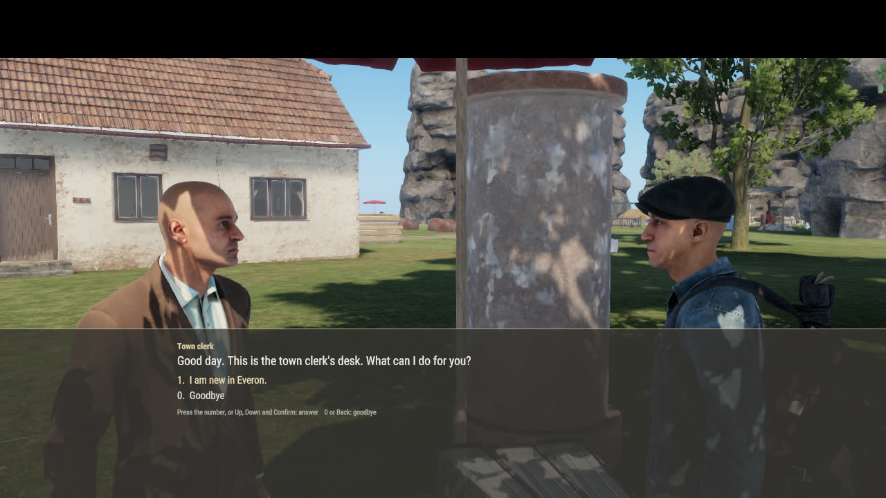

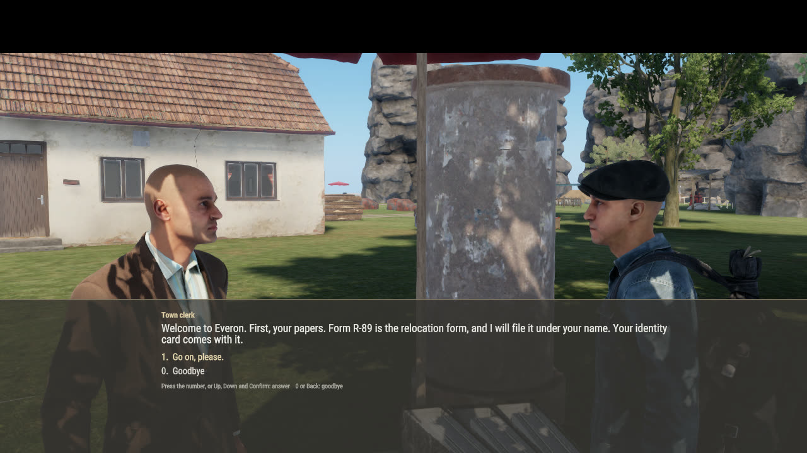
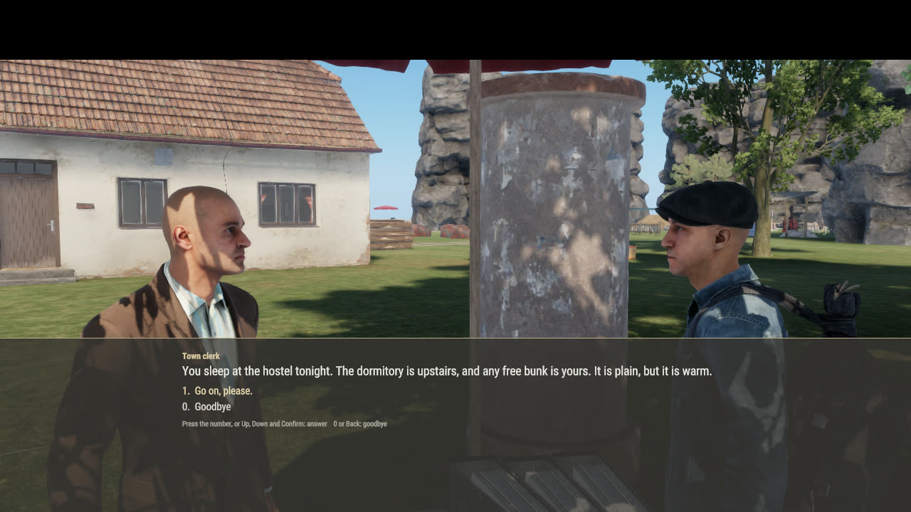

### Row 6, hostel: unchanged, #4676
The clerk's third line is the hostel line (picture above). The spawn HUD now reads "Next: New in town" with the clerk
waypoint "21 m" and no hostel text.

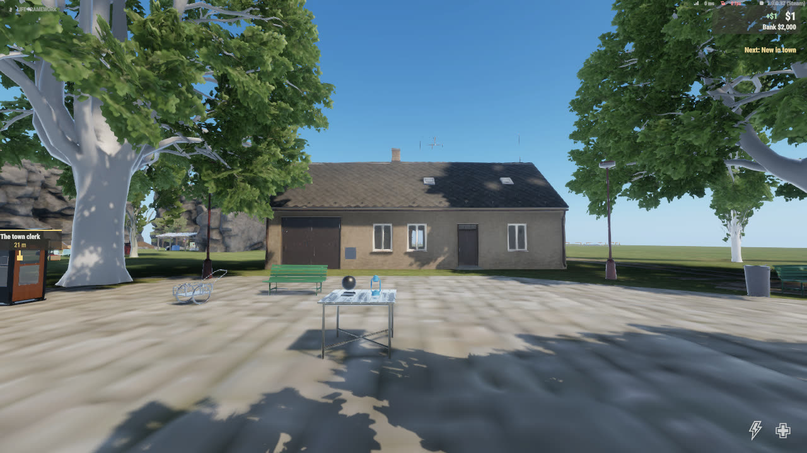

### Row 7, starter car and garage counter: pass
The garage counter's list reads "Retrieve vehicle" first, then "Store vehicle" and "Read the garage ledger". Retrieve
took the stored car out (`garage=1` to `garage=0`) and a note card reads "Your car, plate TT MR 6424, is out on the
lot. Its hazard lights are blinking and a marker sits over it for 30 seconds." The marker says "Your car 15 m".

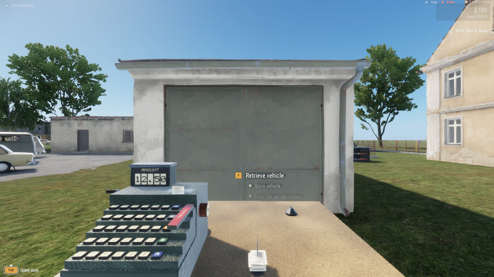
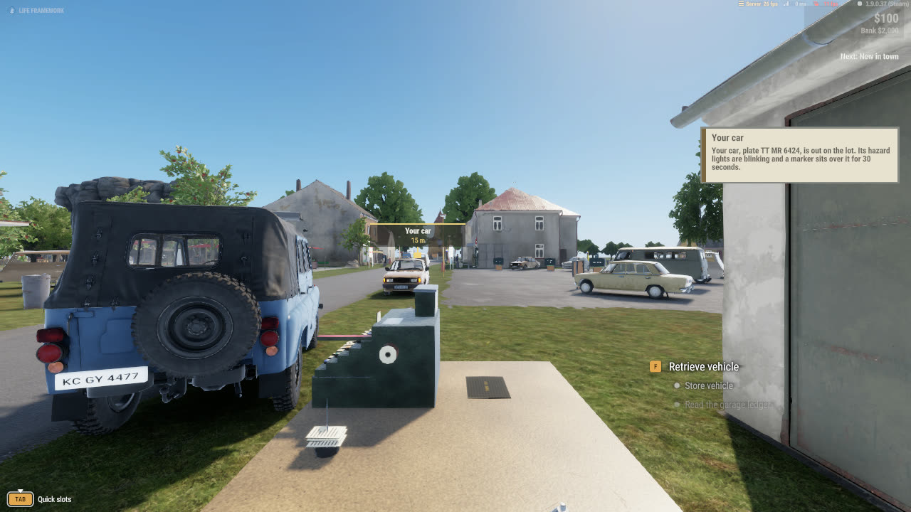

### Row 8, orchard and press: pass (round 1's "Needs Apple" is cleared)
Three `LF_GatherAction` rows gave one apple each (`carries Apple` 1, 2, 3; each toast "Apple x1, The trader pays $5
for Apple"). The press then made `Apple Juice x1` and the three apples were gone. The prompt "Needs Apple" in the
picture is the press after that: the recipe is 3 apples for 1 juice, and round 1 had pressed after two.

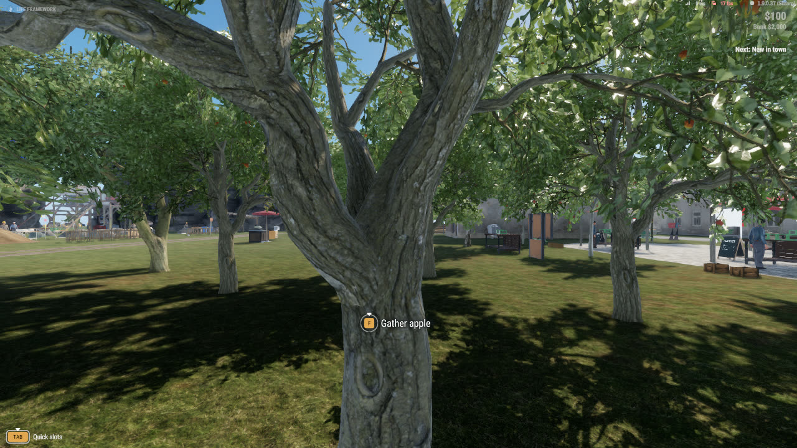
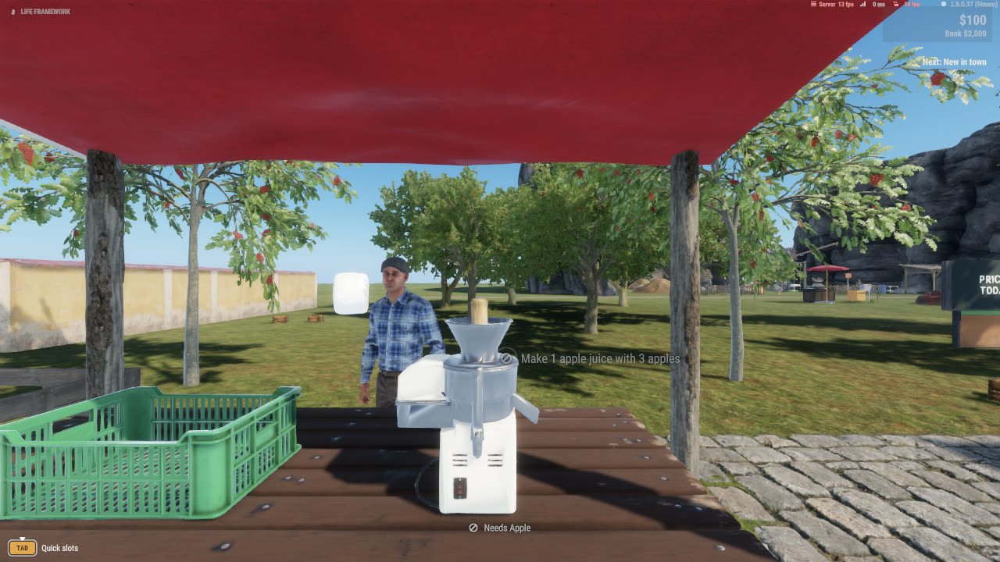

### Row 10, iron ore rocks: pass
With the pickaxe from the stand equipped, four `CharacterMelee` strikes on `IronOre_Debug` logged
`rock hit for 20: piece 1/5 at 0/60 damage, dropped 4` and the next hits `20/60`. The nuggets lie on the ground; they
were not picked up (`carries IronNugget` read `not_carried`), so the pickup and the furnace were not re-walked
(furnace passed in round 1).

### Row 15, clothing counter: pass
The counter's `LF_ShopAction` opens "Clothing store" ("Cash in hand: $100", Raincoat - Green $60, Jean Jacket $45, an
order slip with Pay cash). Client 2 bought the Backpack mannequin: cash 100 to 70.

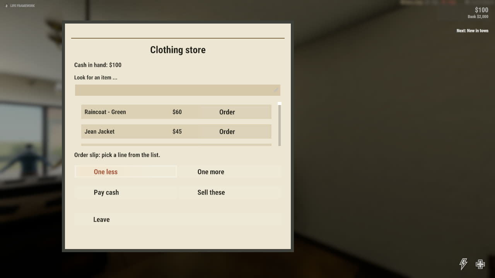
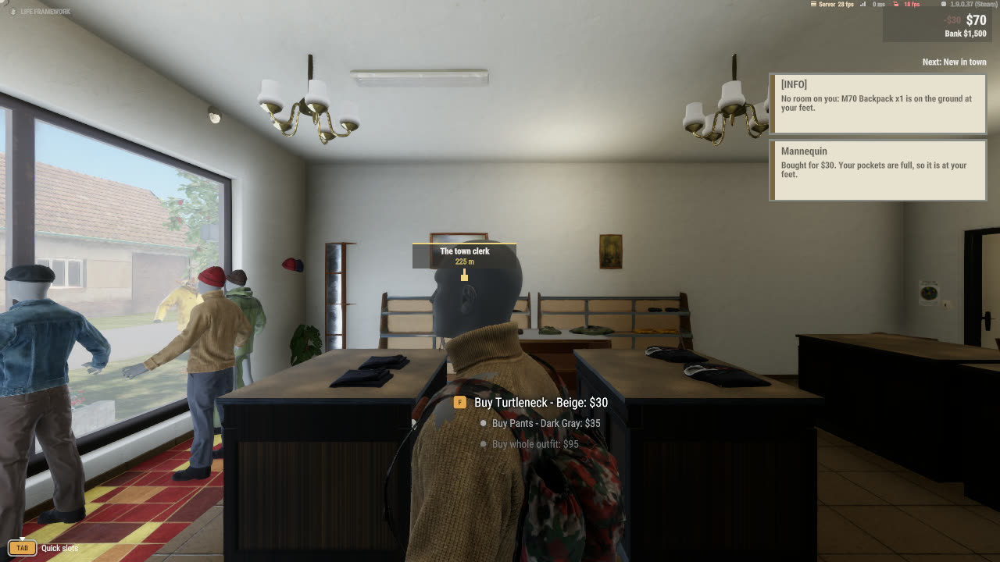

### Row 16, shop counters: partial
- **General store**: "General store" sheet, Apple $8, Cabbage $8, and the back-room hint ("Try the back room at the head
  of the cobbled alley, east of the square. Knock, and bring cash."). Pass.
- **Gun counter**: "Gun counter" sheet, Firearm permit $250, PM $350. Pass. The gun clerk talk is the generic shopkeeper
  (picture).
- **Pharmacy**: the pharmacist opens a "Shopkeeper" talk ("Good day. Take what you need from the shelves and pay at the
  till.") and the shelves behind are bare. No pharmacy counter sheet was reached. Minor.

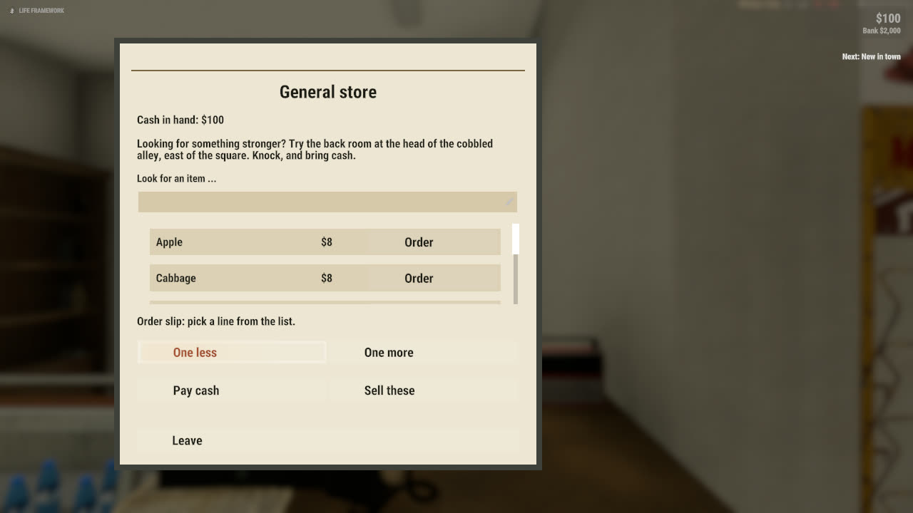
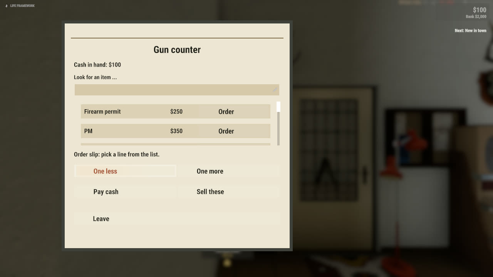
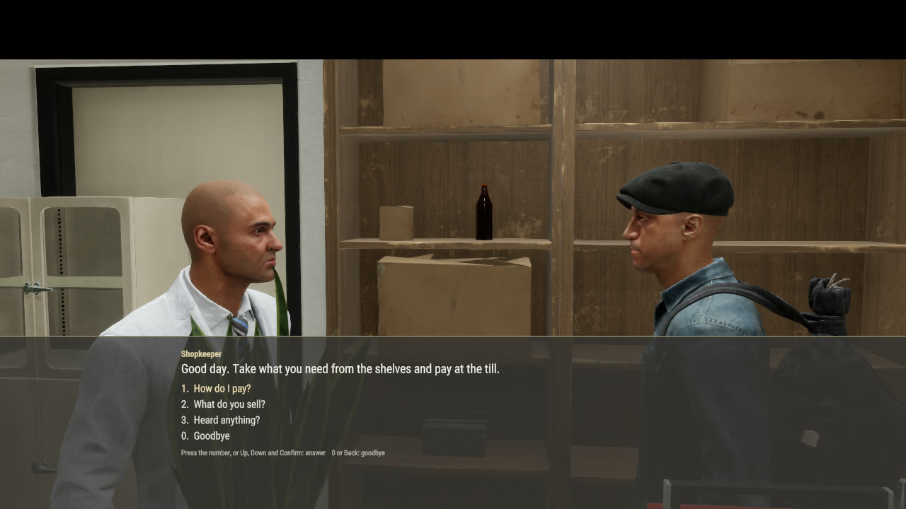
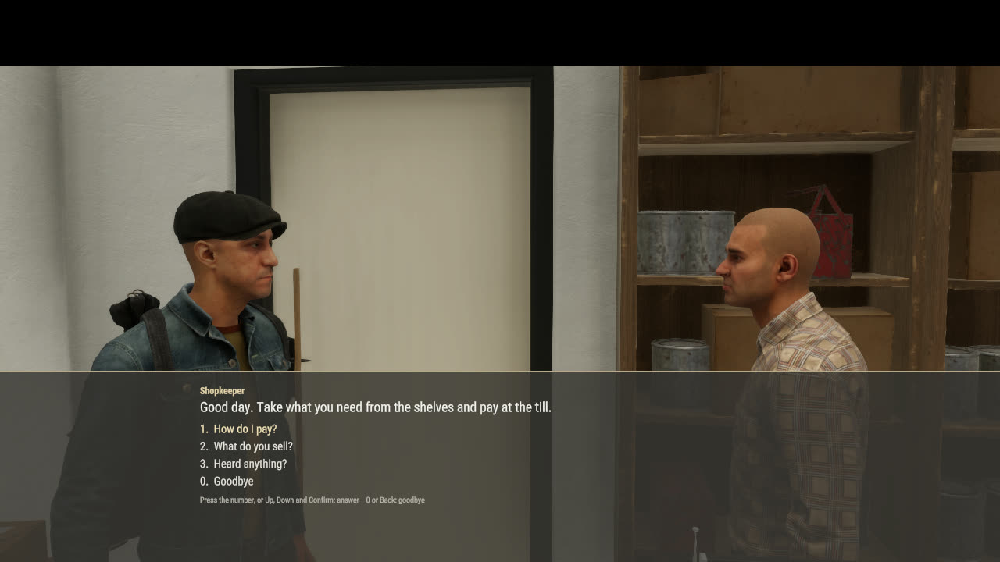

### Row 18, map POIs: pass, with a VME (#4726)
`map open` shows the paper map. At 565 m across it lists the town: bus stops, the post offices, the clerk marker with
"The town clerk, 238 m", the orchard apple, the pickaxe at the mine, the clinic cross, the gun, a safe-zone ring and
a "No police" ring, with a legend (Civic, Shops, Work, Law, Health, Travel, Alarm, Job run). Zoomed to 64 m the post
office and bus stops are separate icons. Every frame while the map was open logged the marker-manager VME.

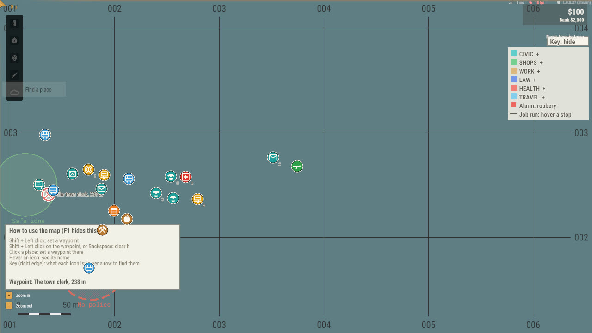
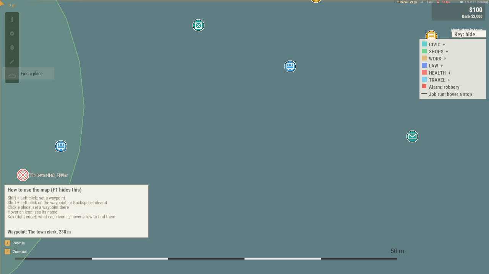

### Row 19, run chains: not walked (#4725)
The map legend has "Job run: hover a stop" and the apple and pickaxe icons stand, but the run list and the guide steps
come through F2, which is empty until the papers (below). The town overlay keeps `apples` and `postal`; no run line
was read.

### Row 20, guide, HUD and F2: partial
Start money is right: cash $100, bank $2,000 on both clients, the same as the island. The pinned line reads "Next: New
in town". F2 opens on "What to do next" and says "First get your papers from the clerk: the waypoint shows the way.
Work opens up after that." (`activities state`: `rows=0`). The welcome sheet did not open by itself (#4645).

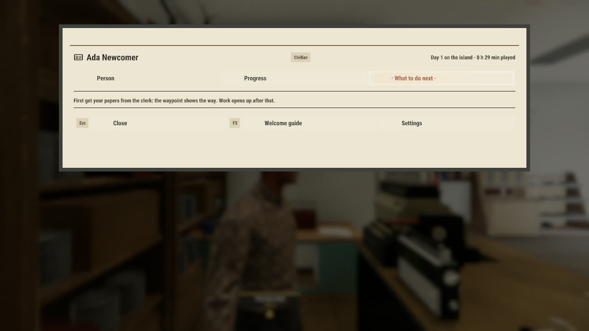

### Row 21, jail doors: partial (minor)
`Sign_DebugJailMe` jailed client 2 (`jail=55`, "Jail: 0:55 left" on the HUD, toast `#LF-Jail_SlipHand`). The yard is a
walled grass square with a laundry basket and a bucket. `Roadmap_Jail_Door` offers only `LF_BreachArmAction` and
`LF_BreachRepairAction` (a civilian gets `cannot_perform`); it is a grille frame in the wall, not a cell door a player
walks through. The island's four doors and a cell door are not matched.

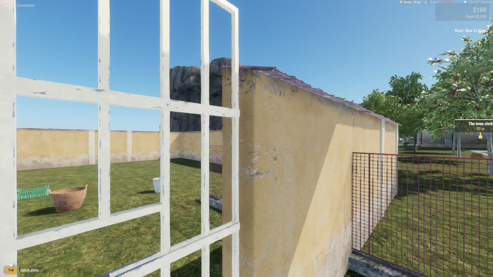
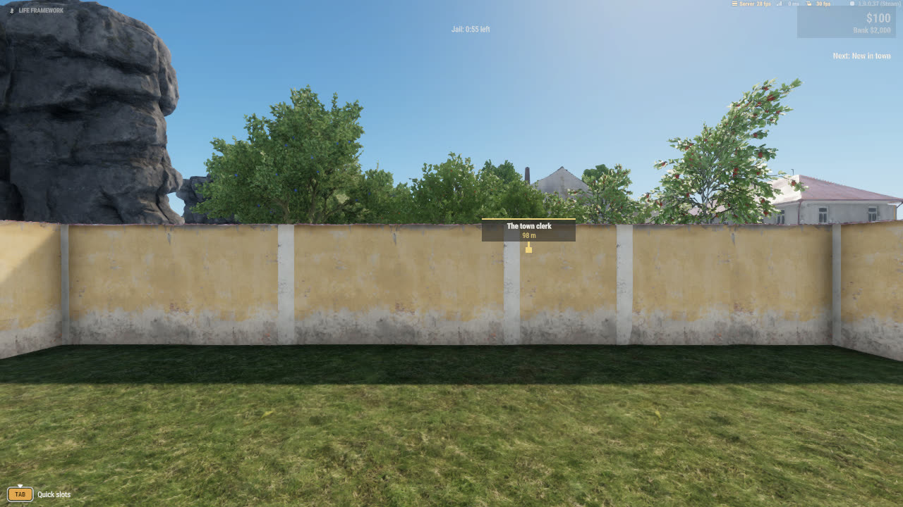

### Row 22, bail phone: pass (again)
`LF_JailBailAction` on the desk phone paid $500 from the bank (2,000 to 1,500) and released client 2
(`jail=0`, toast `#EL-Jail_Released`).

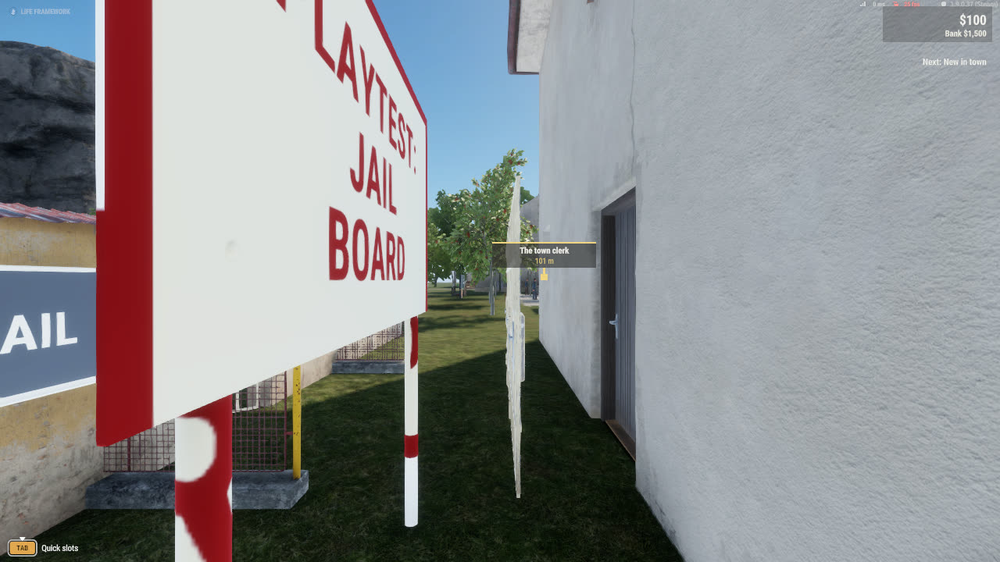

### Client 2 on its own, and the late join
- **Arrival**: client 2 passed the quiz and form after client 1 had a car out and juice made. State on arrival
  `cash=100 bank=2000`, its own starter car id (`parked=EL_GT_8697`, client 1 has `MH_EU_1455`), spawn at the hub.
- **Its own route**: jail, bail, the clothing mannequin purchase (above), each from its own character with its own
  cash. Nothing of client 1's state leaked in (client 1's cash stayed 100 while client 2 spent).
- **Rejoin** (`session rejoin 2`): "joined late", same account identity, new player id 3. Cash 70 and bank 1,500
  survived, the character came back at the clothing counter, and `peers` listed client 1 at the mine and a downed
  patient at the hospital. The first state read said `life=INCAPACITATED ragdoll=1` and the first picture is at floor
  level; the next read said `ALIVE`. One sighting, so minor and "retest".
- Not seen: client 1's car or apples from client 2's camera (no picture of it).

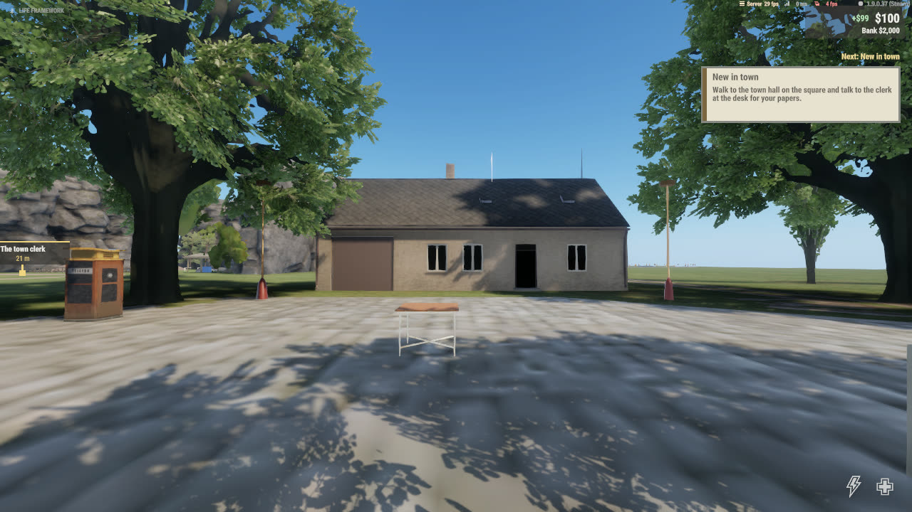
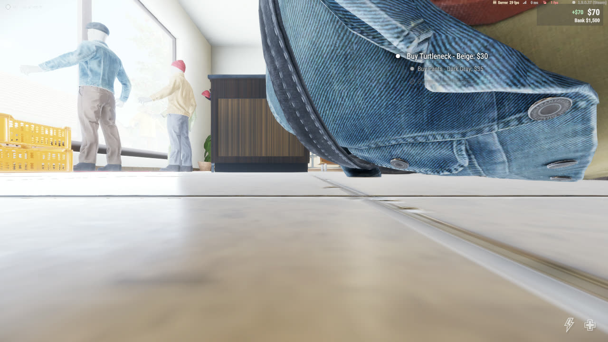

## Counts

| Result | Rows |
|---|---|
| Pass now | 7, 8, 10, 15, 18 (and 22 again) |
| Partial | 16 (pharmacy), 19, 20 (F2), 21 |
| Unchanged | 3 (per-stop boards), 4 (#4680), 5 (#4725), 6 (#4676), 17 (TP-10) |

Blockers 0. Majors 2 new: #4725 (the clerk chain cannot be finished by the harness; rows 5, 19, 20) and #4726 (the map
VME). Minors: the generic shopkeeper at the pharmacy and gun store, the breach-only jail door, the late-join first
frame. The hostel line in the clerk dialogue joins #4676. No French word was seen; no pop-up stood where an object
should answer.

## Server and client log lines worth a look

- Client 1: 249 `NULL pointer to instance` in `SCR_MapMarkerManagerComponent.OnMapOpen` (#4726); two
  `Support station exists with range but no 'SCR_SupportStationManagerComponent'` per client (known, harmless,
  [triage](../../debug-log-triage.md)).
- Both clients: `sign traders` and `sign coalmans-brow-buyer: style 'chalk' ... is not in LF_SignStyles.conf; legacy face drawn`
  (also in the island round), and several `workwear_counter ... issuePrefab = "" is empty` config lines.
- Server: `npc loiter ... has no character controller` several times, `Residents timetable refused` for
  `example_shopkeeper` and `example_neighbour`, `whitelist file missing, police faction closed` (the playtest town runs
  with the police closed).
