# Playtest town parity round: hours 0 to 2 (TP-8, #4480)

The parity check of chapter 7 of [the 0.3.0 plan](../../roadmap/next-release-0.3.0.md). Two fresh clients on the
playtest town (`LF_PlaytestTown`) walk the onboarding route as a new player would on the island, and every row of
the [gap list](../../roadmap/playtest-town-parity.md) (rows 1 to 22) passes or becomes a fix card. This card fixes
nothing.

## Setup

| | |
|---|---|
| Build | `main` at 8101ae49 (worktree `slice-4480`), harness build (`-scrDefine LF_HARNESS`), mission `LF_PlaytestTown`, dedicated server |
| Session | `session up --mission playtest --clients 2 --profile full` (1280 x 720 pictures), closed with `session down` straight after |
| Date | 2026-11-24 (file named for the day the plan books the round) |
| Walked | Client 1, a fresh profile: rules quiz, form R-89, then every beat below with the harness (`layer <entity> <action>` stands the body at the object and performs the action, then a UI shot) |

## Method limits

- **Client 2 joined but was not walked.** The pool had another session queued behind this one (the island playtest,
  #4179) and the card's call budget was spent on client 1. Nothing here says anything about a second player or a late
  joiner. #4679 asks for it.
- **The harness teleports.** A beat that needs a walk (the 150 m postal stop, the mine road) has a session time of
  seconds; the estimated real-player time below adds the walk and the reading.
- **Not reachable by harness:** the map screen (`input MapOpen` is refused, "Menu actions only") and F2 "what to do
  next" have no verb, so rows 18, 19 and the F2 half of row 20 are not walked. `look` never draws sign faces
  (#3075), so sign text is read from the opened sign sheets, not the placed boards (#4295 was closed as not a bug:
  the boards read fine in a game client).
- A `layer` action does not prove the timed ones (gather, smelt) complete; a result of `cannot_perform` after it is
  read as "refused with a reason", not as a pass.

## Summary

Estimated times are for a real player walking the route, reading each sheet once.

| Beat | Rows | Session | Real player (est.) | Result |
|---|---|---|---|---|
| Quiz and form R-89 | 20 | 1 min | 2 min | pass (note 1) |
| Spawn and first hint | 6 | 9 s | 1 min | **fail** (major) |
| Clerk and welcome pack | 5 | 9 s | 2 min | **fail** (major) |
| Rules sign, registry sign, town board | 3, 20 | 20 s | 2 min | pass |
| ATM at the square | 1 | 8 s | 1 min | pass |
| Bus stop at the square | 2 | 6 s | 2 min | pass |
| Car lot and price signs | 7 | 12 s | 3 min | partial |
| Orchard and apple press | 8 | 25 s | 5 min | partial |
| Market price board, stall, trader | 9 | 20 s | 3 min | pass |
| Mine desk, supply till, furnace, buyer | 10, 11, 12, 13 | 50 s | 8 min | pass (note 2) |
| Postal run | 14 | 40 s | 6 min | pass |
| Clothing mannequins and counter | 15 | 15 s | 3 min | partial |
| Jail yard and bail phone | 21, 22 | 12 s | 2 min | bail phone pass, doors not walked |
| F3 guide | 20 | 5 s | 2 min | pass (hostel text, see top issues) |
| Map POIs, runs, F2 | 18, 19, 20 | not walked | not estimated | filed |

The route, as far as it was walked, costs a real player about 40 minutes. The first reward (a $65 postal run) lands
inside 15 minutes, so the wait rule holds.

## Top issues

1. **No hostel (row 6, major, #4676).** The player spawns on the square and the HUD and F3 tell them to "walk south
   from the hostel". There is none.
2. **Clerk welcome pack not seen (row 5, major, #4677).** No conversation opened from the clerk's own spot, cash did
   not move, no pack.
3. **Starting money is $20,000 and $1,000,000 (major, #4678).** The island starts at $100 and $1,000; every price on
   the route is noise against that.
4. **Several rows were not reachable this round (major, #4679):** map POIs, runs, F2, the jail doors, the shop
   counters, the starter car handout, the apple yield, the clothing counter, and client 2.
5. **Minor and polish (#4680):** no taxi rank, `ATM_Debug` still standing, a duplicated Pickaxe row, "iron ore"
   against "Iron Nugget", a Czech "HOSTINEC" sign on the square.

## Graded rows

Grades: blocker (cannot continue), major (lost, a bug, a wrong word, or a pop-up where an object should answer),
minor, polish. Row numbers are the gap list's.

### Row 1, ATM kiosks: pass
Three `LF_ATM` kiosks answer (`Town_ATM_Square`, `_Bank`, `_Fuel`). The quick action moved $20 from bank to cash
(`cash=20020 bank=999980`). Minor (#4680): `ATM_Debug` still stands; the kiosk face is a plain dark slab.

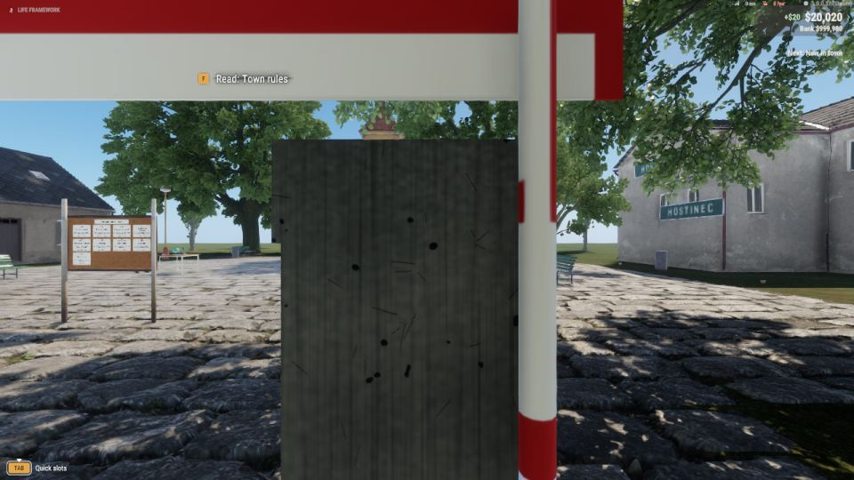

### Row 2, bus stops: pass
Seven `Town_BusStop_*` entities stand. At the square the action paid the fare and a toast read "Ticket paid ($15).
The bus comes in 20 s; wait at the stop." Pole and board model show. Not walked: the other six stops.

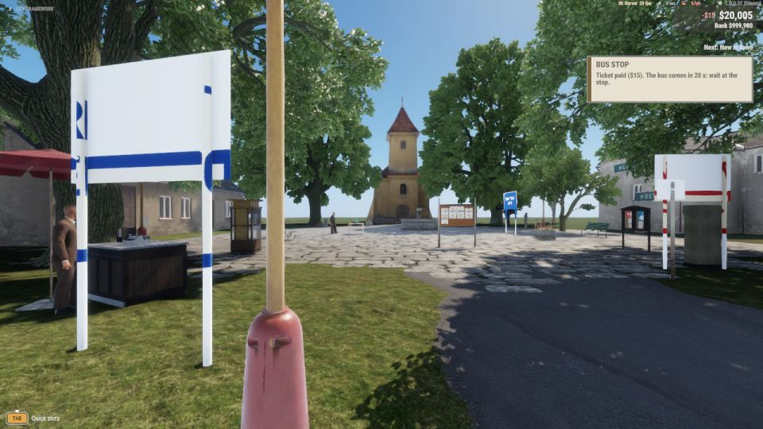

### Row 3, boards: pass (square board), per-stop boards not walked
The square board opens "Couriers wanted"; its "Where" says "Post office, 33 m east", a real place, with a Set
waypoint button. The rules sign ("Town rules") and the registry sign ("Registry office") read.

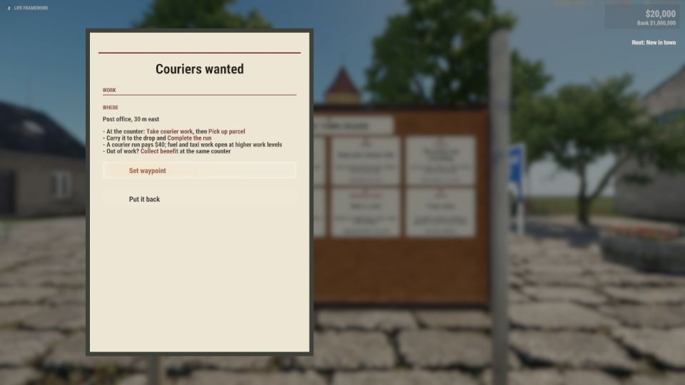

### Row 4, taxi rank: fail, minor (#4680)
No taxi rank entity in the town; only the legacy `Roadmap_Job_TaxiPad`.

### Row 5, clerk and welcome pack: fail, major (#4677)
`layer Quest_Clerk LF_QuestAction` stood at the clerk but offered only `LF_SignReadAction@Sign_Registry`. Three
pictures show no conversation, and cash stayed $20,000. `LF_QuestAction` was offered at the registry sign 2.6 m
away, so the action exists; a player standing at the clerk may meet the same gap.

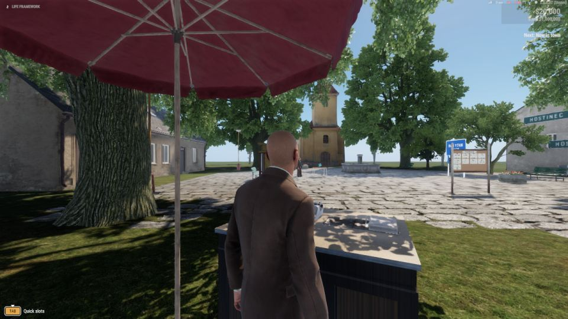

### Row 6, hostel: fail, major (#4676)
Spawn is at the spawn hub on the square. No `LF_FirstSpawnBed` or hostel in the layers. The HUD line and F3 page 1
both say "walk south from the hostel".

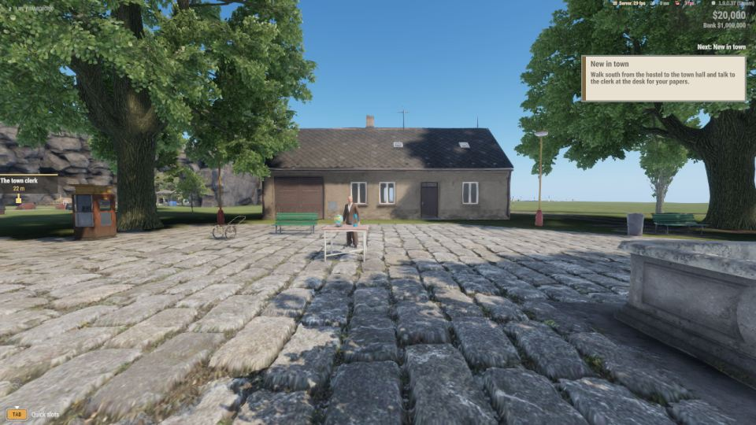

### Row 7, starter car and car lot: partial
The lot stands with its cars, price signs ("Vehicle lot": $105 $1000, UAZ $2500 and so on) and a counter with
"Cut an extra key". The free starter car at the garage counter (F3 says "beside the town hall"; the garage is at
x 238, by the police yard) was not walked, and no car was bought. Filed in #4679.

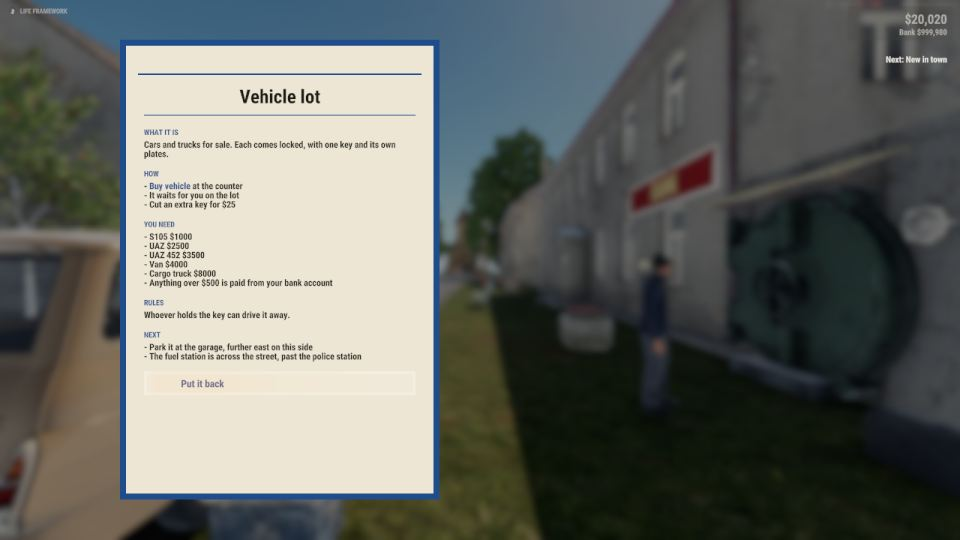
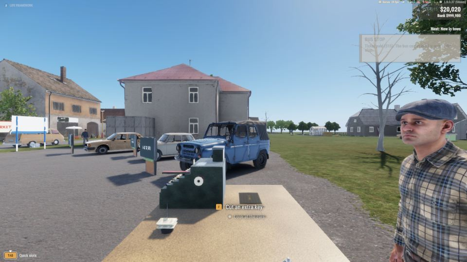

### Row 8, orchard and press: partial
Seven fruit trees offer "Gather apple"; the press stands under a stall with "Make 1 apple juice with 3 apples". After
two gather actions the press said "Needs Apple" and refused (`cannot_perform`): a timed gather may not have finished
in the harness, or it did not yield. Needs a hand check (#4679).

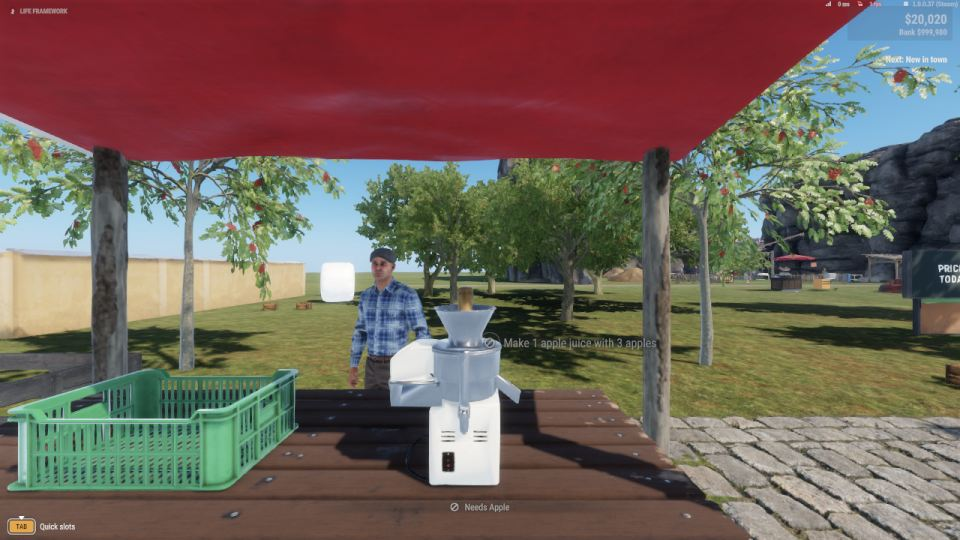

### Row 9, market: pass
"Prices today" lists Apple 5, Plum 4, Wooden plank 6, Cabbage 4, Honey jar 8, Honeycomb 3, Apple Juice 18. The stall
and trader stand; the trader sale needs goods.

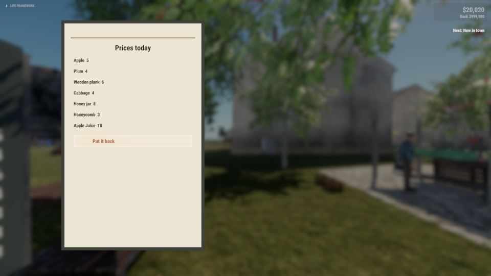

### Rows 10 and 12, mine desk, rocks, pickaxe counter: pass
The mine desk takes the job (the prompt then reads "Quit the job: Mining"). Red ore boulders and granite cliffs
stand at the desk. The supply till opens a shop sheet with Pickaxe $150. Minor (#4680): the Pickaxe row is listed
twice. The iron ore rocks as nodes were not driven (#4679).

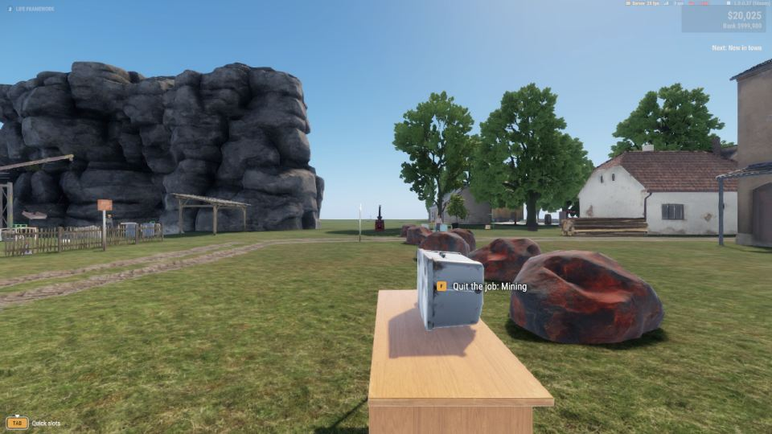
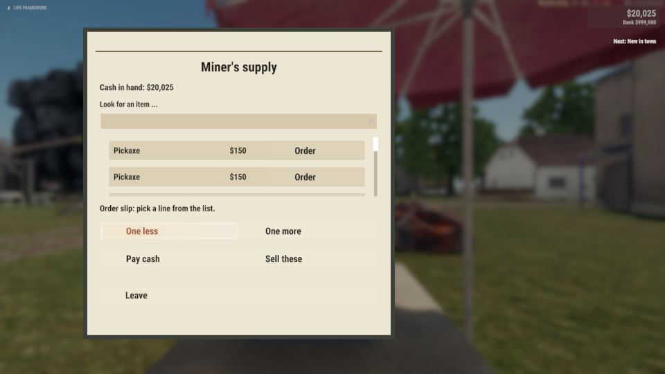

### Row 11, furnace: pass
The furnace offers "Smelt iron ore (3 make a bar)" and, with no ore, "Needs Iron Nugget". Minor wording clash in
#4680.

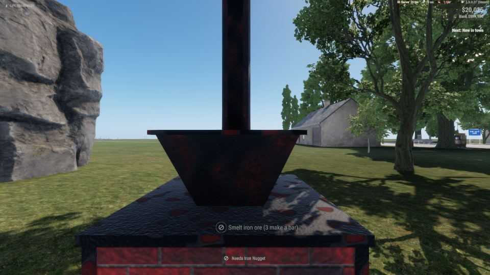

### Row 13, iron buyer: pass
The yard table and its board ("Iron bought here", price per bar, a limit each hour) read; the sale itself needs bars
(`cannot_perform`, as expected with none).

### Row 14, postal run: pass
Sign-up set `job=PARCEL`; the run started (a $25 deposit and "Delivery stop 150 m" on the HUD) and the drop-off
paid $65 ("Delivery, Level 2, Apprentice"). One minute in the session, about 6 for a real player (the 150 m walk).

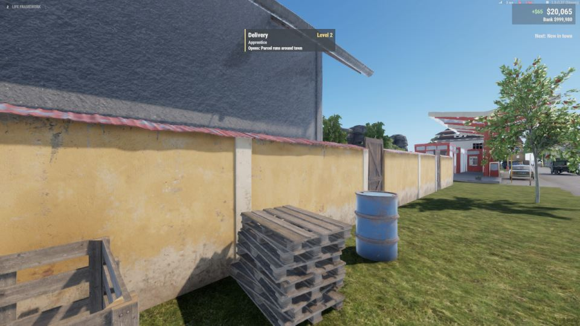

### Row 15, clothing: partial
The shop has mannequins and shelves. A mannequin offers "Buy Turtleneck - Beige: $30", "Buy Pants - Dark Gray: $35",
"Buy whole outfit: $95", and the purchase took $30. The counter's `LF_ShopAction` answered `no_session` from the
harness, so the counter sheet was not seen (#4679).

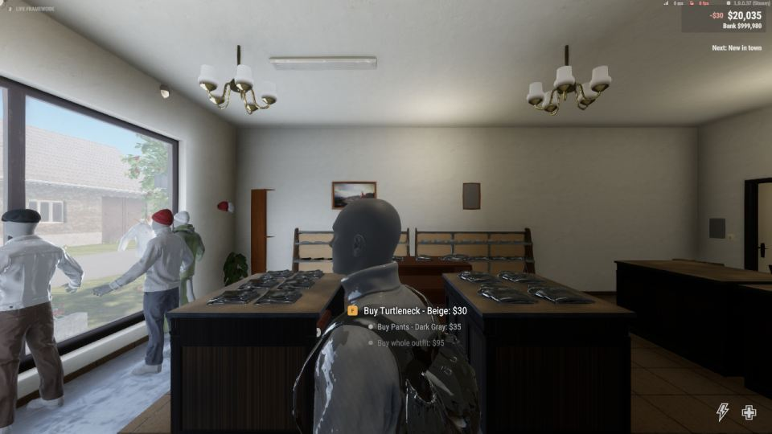

### Row 16, shop counters of existing stores: not walked (#4679)

### Row 17, shops the town has no building for: deferred by the plan (TP-10)

### Rows 18 and 19, map POIs and run chains: not walked (#4679)
The harness cannot open the map. The `parity-data` test covers that the overlays resolve; no one looked at the map.

### Row 20, guide and HUD: pass with the hostel text
The quiz needs a Next click after each answer and four of five right; the island's answers (1 0 2 1 0) pass. The F3
guide opens at page 1 of 5 with a "Set waypoint to the clerk" button. F2 was not walked (#4679).

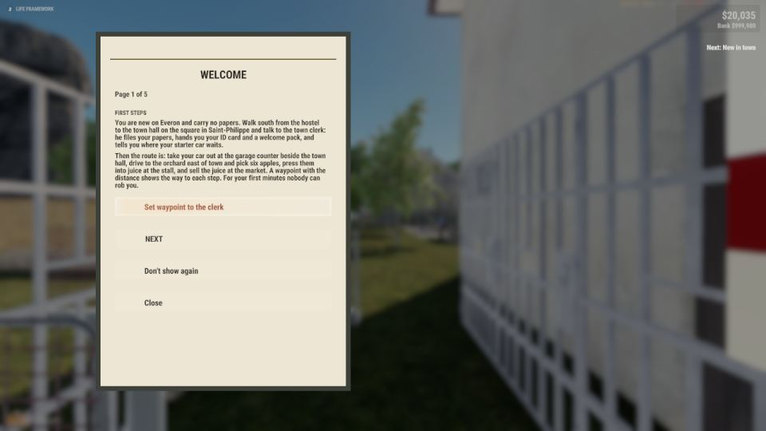

### Row 21, jail doors: not walked (#4679)
The yard was reached through the sign; no door was driven.

### Row 22, bail phone: pass
`Town_Jail_BailPhone` stands on its desk against the yard wall and offers `LF_JailBailAction`.

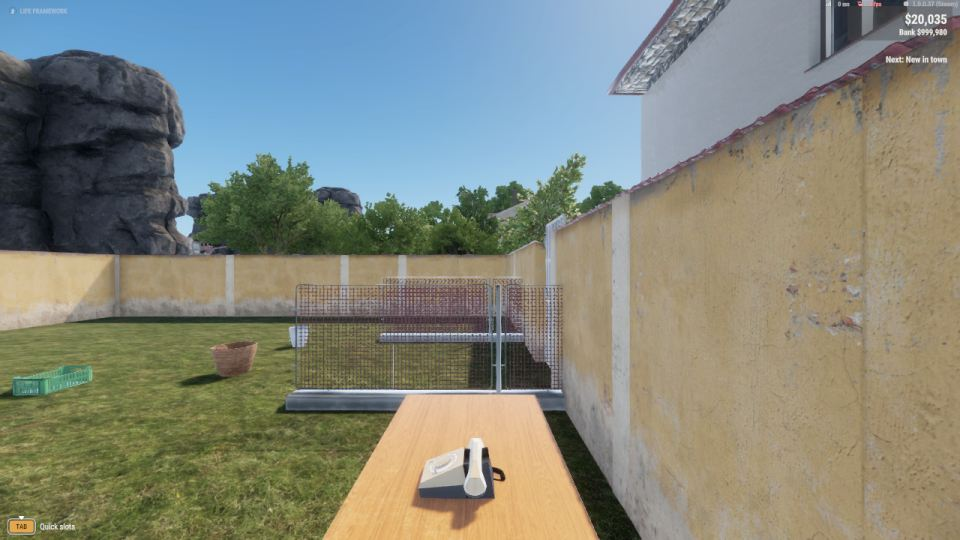

## Counts

| Result | Rows |
|---|---|
| Pass | 1, 2, 3, 9, 10 and 12, 11, 13, 14, 22 (and 20 for the quiz and guide) |
| Partial | 7, 8, 15 |
| Fail | 4 (minor), 5 (major), 6 (major) |
| Not walked | 16, 18, 19, 21 |
| Deferred by plan | 17 |

Blockers 0, majors 4 (#4676, #4677, #4678, #4679), minor and polish 1 (#4680). No French word was seen; no beat
had a pop-up where an object should answer (the shops, the board and the guide are sheets, which the rules allow);
nothing waited more than 15 minutes for a reward.

Also seen: the new-character welcome sheet does not open by itself in a session client (by design, #4645).
