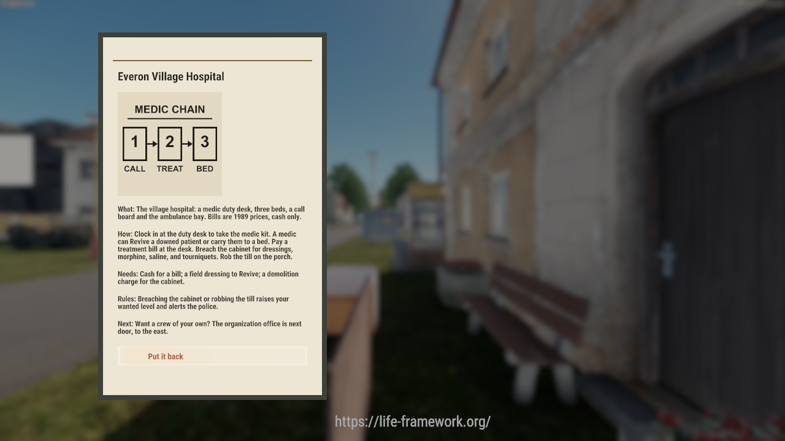

# UI illustration pipeline

Spike for the Development epic [#579](https://github.com/Life-Framework/Life-Framework/issues/579):
can an agent put a custom image or diagram into a sign card, a guide or a map
with no human in the Workbench? Researched and built 2026-11-10/11 on this PC
and `lf-testbox`. Facts here were observed in this repo or in a run, not taken
from memory.

## Answer

Yes. One command goes from an SVG (or PNG) to a texture the game shows:

```
tools\cli ui-image <file.svg|file.png> <name> [--size N]
```

It runs in a worktree, takes the `build` lock, and needs no clicks. The output
is three files in `addons/LifeFramework/Assets/UI/Illustrations/` plus their
`.meta`:

| File | What it is |
|---|---|
| `<name>.tif` | Source raster, uncompressed. Written by the CLI with `sharp` (from `website/node_modules`) |
| `<name>.edds` (+ `.meta`) | The runtime texture the engine loads. Built by Workbench |
| `<name>.imageset` (+ `.meta`) | One image called `full` over the whole texture |

A layout shows it with an `ImageWidget`; script loads it with
`ImageWidget.LoadImageFromSet(0, imageset, "full")`. The widget needs an
explicit `Size w h` in the layout: without it the loaded picture drew about
20 px wide (first in-game shot).

## The route, step by step

1. **Author the diagram as code.** `tools/ui-image/medic-flow.svg.mjs` returns
   an SVG string in the card's paper palette (paper `#E3D9C2`, ink `#1C1A16`).
   Any script that writes an SVG works. HTML is not needed; for a diagram that
   starts as HTML, screenshot it to PNG and pass the PNG.
2. **Rasterise.** `sharp` turns the SVG into a TIFF at the SVG's own pixel size
   (density 72), or a square `--size N`. A PNG source goes through the same
   path. The TIFF is the file the texture `.meta` names as its source. The TIFF
   keeps an SVG's alpha; whether the game draws that alpha through
   `TextureUI.conf` is not proven (see below).
3. **Register the texture without a dialog.** The CLI writes `<name>.edds.meta`
   itself: a `TIFFResourceClass` per platform pointing at
   `Configs/System/ResourceTypes/<platform>/TextureUI.conf` (the GUIDs are in
   `ui-image.mjs`; they were read through the Workbench API). Calling
   `RegisterResourceFile` on a new unsuffixed texture opens a modal dialog and
   hangs a headless Workbench, so the GUID and `.meta` are made by script
   instead.
4. **Build the `.edds` headless.** `tools/ui-image/LF_ImageImportPlugin.c` is a
   `WorkbenchPlugin` for the ResourceManager module. The CLI copies it into the
   gitignored `Scripts/WorkbenchGame/ResourceManager/` and launches
   `Workbench -wbModule=ResourceManager -plugin=LF_ImageImportPlugin
   -lfImage=<tif> -run -exitAfterInit`. The plugin calls
   `ResourceManager.RebuildResourceFile(path, "PC", false)`, which writes the
   `.edds` next to the source. A hung Workbench is killed after
   `LF_UI_IMAGE_TIMEOUT_S` (default 150 s).
5. **Write the imageset.** One `ImageSetDefClass full` covering the texture,
   `RefSize` equal to the pixel size, with a fresh `.meta` GUID on the first
   run and the same GUID on every re-import. Hand written by the CLI; a sheet of several icons is the same file with more
   `ImageSetDefClass` rows.
6. **Register the new resources.** A new `.imageset` or `.layout` makes the
   resource database stale. `session up` and `test` refresh it themselves
   (headless Workbench, about 15 s); `tools\cli rdb` does it by hand.
7. **Use it.** `LF_SignDef` has an optional `m_sImage` (an imageset) and
   `m_sImageName` (default `full`). When set, `LF_SignCatalog.BuildParts` adds
   an `LF_EUIPartKind.IMAGE` part right under the title. `LF_UIScreen` loads
   it into `UI/Layouts/UIKit/LF_UIImage.layout` (a plain `ImageWidget`). Any
   `LF_UIScreen` card can add the same part with `LF_UIPart.CreateImage`, so
   a guide or a map card is not a sign-only feature.

## Example shipped

The hospital sign (`Sign_Hospital` in DebugWorld, `hospital` in
`Configs/Signs/LF_Signs.conf`) shows `medic_flow` under its title: a three-step
CALL, TREAT, BED chain on paper colour so it blends into the card.
Screenshot, a rendering client at 1280 x 720:



Source: `tools/ui-image/medic-flow.svg.mjs`. Regenerate with:

```
node tools/ui-image/render-example.mjs    # writes tmp/ui-image-medic_flow.svg
tools\cli ui-image tmp\ui-image-medic_flow.svg medic_flow
```

## What to know

- **GUIDs.** The `.meta` GUIDs are made once and never change. Re-running the
  CLI for an existing `<name>` keeps the existing `.edds.meta` and rebuilds
  the `.edds` only. Do not rename a texture; every `{GUID}path` breaks.
- **Size.** A 256 x 256 flow diagram is a 262 KB `.tif` and an 11 KB `.edds`.
  The `.tif` is the source of truth and is committed; both are binary
  (`-text` in `.gitattributes`).
- **Platforms.** The `.meta` carries PC, XBOX_ONE, XBOX_SERIES, PS4, PS5 and
  HEADLESS texture classes. Only the PC build is rebuilt by the plugin; the
  other platforms share the PC settings through the same conf.
- **Dedicated server.** The server has no renderer; it loads the imageset but
  draws nothing. The picture is checked only on a rendering client.
- **Readability.** The card is drawn at the client's UI scale. A 256 px
  diagram with 4 px strokes and 20 px labels is the floor; the first picture
  was checked at 1280 x 720 (the shot in the docs folder); a 1080p check is
  still manual.
- **Layout.** `LF_UIImage.layout` is a 256 x 256 `ImageWidget` with 28 px side
  padding. It sits at the left padding edge, in line with the card text; a
  `HorizontalAlign Center` in its slot did not move it. A wide map needs its
  own layout size; that is the first thing to tune when the town map lands.
- **Blending is open.** The shipped diagram has an opaque paper fill
  (`#E3D9C2`), which shows as a slightly darker tile on the card (`#EEE6D4`).
  A transparent re-import was built (the TIFF has alpha 0 outside the ink) but
  not seen in game: the second client boot was refused by the pool, so the
  alpha path through `TextureUI.conf` is unverified. Next step for #579: boot
  a fresh client, check a transparent diagram, and if alpha is dropped either
  match the paper colour to the card or use a UI conf that keeps alpha.
- **Texture cache.** A running client keeps the texture it first loaded.
  Closing and reopening the card shows the old pixels after a re-import; restart
  the client to see the new texture.

## Diagrams from a script

SVG is the right authoring format: a script emits it, `sharp` rasterises it
with no browser, and the output is deterministic, so a diagram change is a
reviewable text diff. Fonts in the SVG are rasterised at build time, so the
game needs no font for them. The first real consumers are the town board (a
map) and the hospital (this flow). Items still open for #579: a style guide
(line weight, palette), and a decision whether to bake the card's paper
texture into the image or keep it transparent.

## Not done / manual

- The in-game check needs a rendering client: join DebugWorld, stand at the
  hospital sign, press the use key, and look at the card.
- No other consumer is wired up.
