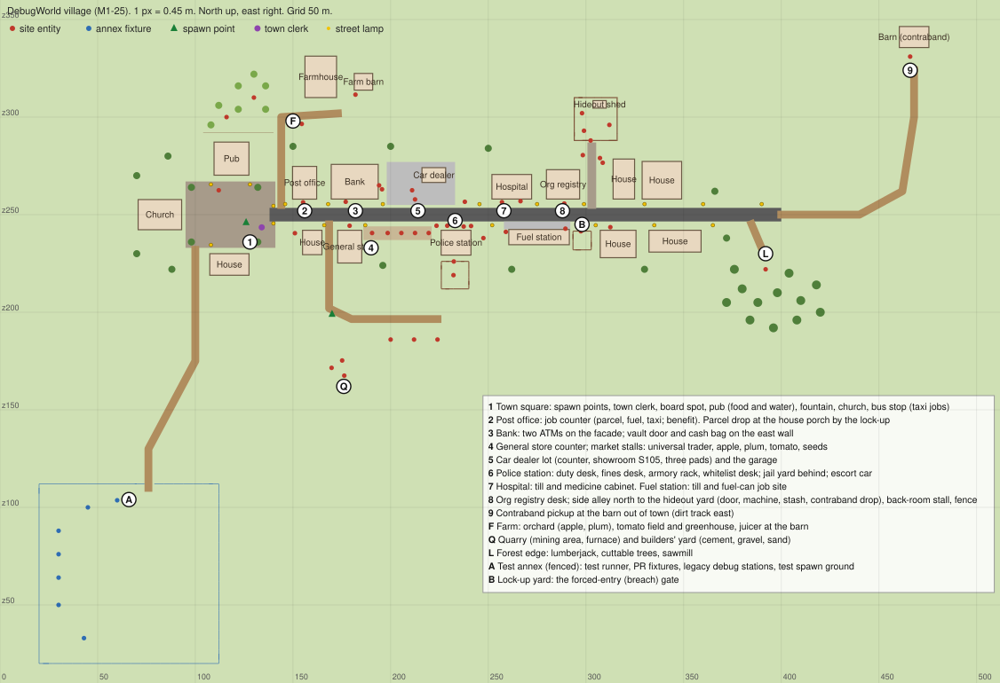

# M1-25: the DebugWorld village

Issue #120. Decisions 2026-11-08 "Every M1 site moves onto one street now" and
"The playtest town is a 1989 Everon village with a test annex"
([decisions](../decisions.md)). The maintainer gave M1-25 authority to rebuild
DebugWorld, not shuffle it.

## What DebugWorld is today

Forty layers on a flat 512 m square (every heightmap sample is 0) covered in the
white grid texture. Sites are tables with an NPC, a kerosene lamp, and a blue
`EL_DebugAreaBoundary` box that spawns survey poles at its corners. They sit in
two clusters: feature stations at x 94..182, z 120..151, and the roadmap row at
z = 120, x 186..243, with entities 3 m apart and no buildings except one garage
shell. Nothing tells a stranger where they are.

Inventory and classification (every layer):

| Class | Layers | Goes to |
| --- | --- | --- |
| Loop site | `Street_*` (Jobs, Bank, Breach, Vehicles, Police, Jail, Hospital, Fuel, Org, Hideout, Contraband), `ATM`, `Shops`, `Police`, `Quests` (clerk), `Gamemode` (spawn points), `TraderChain`, `WhitelistChat`, `Survival` | The street, in arrival order |
| Production chain | `AppleChain`, `PlumChain`, `TomatoChain`, `FarmingChain`, `MiningChain`, `LoggingChain`, `CementChain`, `GravelChain`, `SandChain`, `CrimeChain` | Traders to the market; sources to the farm, quarry, builders' yard, forest edge; the fence to the hideout alley |
| Test fixture / legacy debug station | `Tests` (test runner), `PRFeatures` (plate, lock, siren cars and key crate), `Crimes` (rob safe, rack, tyres), `HousesKeys` (lock and key fixture), `NPCs` (show-ID citizen), `DebugWorldActions` (time and weather globe), `Jobs` (legacy job board) | The fenced test annex, keeping their boundaries |
| World | `default` (world, terrain, light, fog, weather), `Roadmap` (street root), `Factions` (empty) | Unchanged, except the street root moves to the village centre |
| Junk | 23 `EL_DebugAreaBoundary` boxes in village layers, the 60 m roadmap boundary | Deleted |

## The village

One main street runs east-west at z = 250 from the square (x 95) to the edge of
the village (x 400), then a dirt track runs on to a barn. North-side buildings
face south, south-side buildings face north; every front sits 8 m from the
centre line, which leaves a 4.5 m verge for counters and desks between the
asphalt and the facade. Interactables stand in front of their building (a
counter on the porch, an ATM on the bank wall), not inside: floor heights and
interior walls of vanilla buildings cannot be checked without the renderer, and
a counter on the porch is reachable from the street.

Arrival order, west to east (numbers match the map):

| # | Site | Building (vanilla) | Entities (unchanged names) | Position |
| --- | --- | --- | --- | --- |
| 1 | Town square | ChurchSmall_E_01, PubVillage_E_2L01, House_Village_E_1I04t, Fountain_01, BusShed, PhoneBooth, benches, lime trees | civilian spawn, clerk (`QuestGiver_Start`), `SurvivalStation` (pub terrace), `Roadmap_Job_TaxiPad` (bus stop) | 126 0 246; clerk 134 0 243.5 |
| 2 | Post office and job counter | House_Town_E_2I01 | `Roadmap_Job_Depot`; parcel drop `Roadmap_Job_Drop` on a porch by the lock-up | 155.2 0 256.3; drop 312.5 0 243.6 |
| 3 | Bank and ATM | MunicipalOffice_E_01 | `ATM_Debug`, `ATM_Debug_2` on counters; `Roadmap_Bank_Vault` and `Roadmap_Bank_Bag` on the east wall | 177/187 0 256.6; vault 194.1 0 265 |
| 4 | General store and traders | ShopHouse_E_2I01t (food store), market stalls | `Shop_GeneralStore_Debug`; `TraderChainCounter`, `PoliceDutyNPC`, `AppleTrader`, `PlumTrader`, `TomatoTrader`, `FarmerStand` | 179 0 244.3; stalls x 188..220, z 240.6 |
| 5 | Vehicle lot and garage | Workshop_01, asphalt lot, Garage_E_01 (doors to the street) | `Roadmap_Vehicle_Lot` (pads 206 0 257.5 + 8 m steps north), `Roadmap_Vehicle_S105`, `Roadmap_Garage` | 211 0 262.5; garage 238 0 256.6 |
| 6 | Police station and jail | Villa_E_2I01_Police, walled jail yard behind it | `Roadmap_Police_Desk` (duty), `Roadmap_Police_Armory`, police spawns (the old `PoliceStation` and `WhitelistStation` tables moved to the annex in M1-22); `Roadmap_Jail_Cell`, `Roadmap_Jail_Door` (in the yard wall), `Roadmap_Escort_Car` | desk 229.9 0 238.6 (under the porch, by the VB sign); cell 232.2 0 219 |
| 7 | Hospital and fuel station | House_Town_E_2I03; FuelStation_E_01 | `Roadmap_Hospital_Till`, `Roadmap_Hospital_Cabinet`; `Roadmap_Fuel_Till`, `Roadmap_Job_FuelCan` | 257 0 256.4; till 259 0 241.2 |
| 8 | Org registry, hideout off a side alley | Office_E_01; cobbled alley north to a walled yard with a shed | `Roadmap_Org_Desk`; `Roadmap_Hideout_Door` (yard gate), `_Machine`, `_Stash` in the yard; `Shop_BlackMarket_Debug`, `CrimeTrader_Debug`, `CrimeFurnace_Debug`, `Roadmap_Breach_Charge` in the alley | 288.9 0 255.7; gate 302.4 0 288 |
| 9 | Contraband pickup | Barn_E_01 at the end of the east track; crates, lamp, parked van | `Roadmap_Convoy_Start` | 466 0 331 |
| 9b | Contraband drop (M1-14) | Back door of the pub on the square, off the farm lane; kegs, empty crates, lamp | `Roadmap_Convoy_Drop` | 131.5 0 284 |
| B | Lock-up (forced entry) | Brick-walled yard beside the fuel station | `Roadmap_Breach_Door` as its gate | 297.4 0 241.5 |

Outskirts: the farm north of the square (farmhouse, barn with the apple juicer,
orchard with `AppleGatherTree` and `PlumGatherTree`, tomato field and
greenhouse), the quarry and builders' yard south of the street (mining area,
furnace, cement, gravel, sand), and the forest edge east (lumberjack, cuttable
trees, sawmill). Each chain layer moves as a block, so its internal layout,
already validated, does not change.

Test annex: a net-fenced yard at x 20..112, z 20..112, reached by a dirt track
from the square. It holds `Tests.layer`, `PRFeatures.layer`, and the legacy
debug stations with their boundaries, and it covers the open ground where the
world tests spawn their fixtures (60 0 60 to 90 0 91, 48 0 64). Nothing else
stands there.

Ground and light: the terrain material (`Assets/World/GridSurface.emat`, ours)
becomes the vanilla lawn surface (`GrassLawn_01`, grass sound) without clutter,
so grass does not grow through roads and floors. Roads are vanilla road
generators saved as `RoadEntity` splines (asphalt street, cobbled square and
alley, dirt lanes, asphalt lot), the format Overthrow's test island uses.
Street lamps stand on the verges between sites.

New layers: `Village_Roads`, `Village_Buildings`, `Village_Dressing`, `Annex`.

## What moves with it

- `EL_SpawnLocation` positions (town, mine, station, outpost) follow the spawn
  points.
- `QuestGiver_Start` intro area objective centre follows the clerk.
- Tests that pin positions: `EL_Test_ExploitGuardsWorld` (clerk "near" point,
  depot workplace point).
- `agent-box/harness.mjs` selftest pins the old garage, escort car, and z = 120
  row; it checks the new layout instead. The roadmap report's 30 m street rule
  exempts the contraband pickup, which is out of town by design.
- `validate-debugworld-layout` only asks a table to sit inside a boundary when
  its layer has one.
- `docs/features.md` and `docs/playtest.md` site locations.

Nothing is renamed. The vehicle lot's pad offset changes from `0 0 8` to
`-5 0 -5` so bought cars land on the lot, and the convoy markers stop being
`EL_DebugAreaBoundary` entities (no corner poles) and become crates with the
same components.

## Proof

Server side: `tools\cli validate`, `tools\cli test --no-build --tier all`,
`node agent-box/harness.mjs selftest`. Rendering side: agent-box screenshots
and a filmed walk from the square to the barn, checked by eye for floating or
sunken props, white meshes, buildings facing the wrong way, and roads.

## What the rendering pass found (2026-11-08)

Checked from a dedicated-server client on the hidden desktop
(`agent-box/session.mjs up`, `harness.mjs --client 1 shot world`):

- Building fronts: a vanilla building's door side is its local +Z. Every
  street building shows its entrance to the street.
- Roads: asphalt, cobblestone, and dirt `RoadEntity` splines render. The
  concrete-panel and gravel-trail generators did not (the apron drew a stray X),
  so the lot and fuel apron are asphalt and the market ground is dirt.
- `HayBale_01` rendered as a white sphere; it is not used.
- The vault, breach, jail, and hideout doors read as a back door, a yard gate,
  a cell door, and a yard gate.
- NPCs at the stalls and desks stand in underwear on the dedicated client.
  In Workbench play the same NPCs wear uniforms. Not investigated here; filed
  as #150.

Evidence: the `film-evidence` release assets `pr137-m1-25-*.png`.
