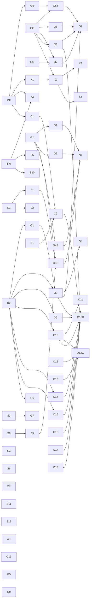

# M4 slice plan: Opening day

The M4 chapter (#1006) cut into slice cards for the roadmap pipeline
(`docs/process/roadmap-pipeline.md`, card format `docs/process/slice-card.md`).
Written 2026-11-14 by the planner; the maintainer's answers to the open questions are in
[Decisions (2026-11-14)](#decisions-2026-11-14). Read it with the [M4 outline](m4-outline.md).

**Gate.** M4 starts when M3 has shipped. Until then nobody dispatches from
`tools\cli slice list 1006 --ready`. On the day M3 closes, that command is the
dispatch queue and every card's brief is `tools\cli slice brief <issue>`.

## Shape

- **One plan under the chapter, not one per epic.** `slice` resolves
  dependencies only inside one plan, and the critical path crosses the epics
  (the trailer needs the GM panel and the plaza boards). The cards are
  sub-issues of #1006; each card names the epic issue it serves.
- **50 slices, 1895 agent-minutes.** 45 were created first
  ([`m4-slices/plan-1006.md`](m4-slices/plan-1006.md), #1258 to #1303). The decisions of 2026-11-14 added 5
  ([`m4-slices/plan-1006-decisions.md`](m4-slices/plan-1006-decisions.md), #1320 to #1324): O17, which was held, and
  R1, C1, C2 and W1, which the answers need. Of the 9 that had been held, O17 is created, S13 to S16 are dropped and M1 to M4
  are deferred past the opening ([`m4-slices/plan-1006-held.md`](m4-slices/plan-1006-held.md)).
- **Widened the same day: 60 slices, 2255 agent-minutes.** The re-cut of 2026-11-14 added 10 cards
  ([`m4-slices/plan-1006-widen.md`](m4-slices/plan-1006-widen.md), #1343 to #1352) and re-pointed 37
  ([Widening the graph](#widening-the-graph)).
- **Wave 3 (2026-11-15): 80 slices.** 20 cards from the gaps the outline and the decisions left
  ([`m4-slices/plan-1006-wave3.md`](m4-slices/plan-1006-wave3.md), #1405 to #1427); see [Wave 3](#wave-3-2026-11-15).
- **Wave 4 (2026-11-15): 103 slices.** 23 cards that start on main today, 20 of them ready at creation
  ([`m4-slices/plan-1006-wave4.md`](m4-slices/plan-1006-wave4.md), #1446 to #1468); see [Wave 4](#wave-4-2026-11-15).
- **Models.** 56 Sonnet (`lf-builder`), 4 Opus (`lf-hard`): O8 and X3 (persistence), S6 (ban record file), S9 (GM RPC,
  replication), plus the independent reviewer on each of those.
- **Enablers first.** K2 lets `host` subcommands live one file each in
  `tools/host/commands/`, so no M4 slice edits `tools/cli.mjs` after it. K1
  gives the generated config schema a merge driver; since the re-cut no M4
  slice waits for it, because CF declares every M4 config section in one slice.

## Already built: not sliced again

| Issue | State | What exists |
|---|---|---|
| #980 game updates never cost a save | merged (#1054, #1164) | `host preflight`, build stamp, `docs/ops/game-updates.md` |
| #306 backup before every session | mostly built | `host start` backs up first, `host stop` saves and backs up, `host backup`, `host restore` (`tools/host/host.mjs`). Missing: rotation (O1) and a restore drill on a copy (O2) |
| #305 session commands | mostly built | `host start/stop/status`; `LF_HostStop` closes gracefully on a stop file. Missing: watchdog, announce, runbook (O3, O14, O16) |
| #803 police application gates | merged (#1184) | playtime, cooldown and trial gates in `LF_PoliceApplications` |
| #804 clip stamp | merged (#1187, #1176) | `Feature/Moderation/LF_ClipStamp*.c`, `docs/player-clips.md` |
| #806 player FAQ | merged (#1176) | `docs/player-faq.md` |
| #915 rules quiz | merged (#1194) | `Feature/Rules/LF_Quiz*.c`, pack `Configs/Rules/LF_Quiz_Everon.conf` |
| #313, #315 incident tools | built in M2 | incident log, GM panel, `/report` flags, admin action log, `BanCommand` hook |
| #379 self-hosted guide | mostly built | `docs/owner/install.md`, `docs/playtest/workshop-host.md`; O19 adds success lines and rollback |
| #380 server-doctor | parts exist | `judgeBootLog` in `tools/release/boot-check.mjs`, `tools/config/check.mjs`; O12 and O13 wrap them |

## Decisions (2026-11-14)

The maintainer answered the open questions (the last two rows on 2026-11-15). They are final unless the maintainer
reopens them; the cards below already follow them.

| Topic | Decision | What it did to the slices |
|---|---|---|
| Rules quiz | A subset of the published rules, written separately; it is not generated from the rules page | S1 writes the full published rules in their own keys and leaves the quiz alone; S2 exports only those rules |
| Alpha gate | A server password only, no account allowlist | S12 says so; no allowlist slice; the password is host-only (C1, C2) |
| Wipes | Any time during the alpha, with 24 hours' notice on Discord; progress is kept from the public launch | O14 refuses a `--wipe` under 24 hours out; O15 and the new W1 policy page carry the rule |
| Discord account linking (#805) | Not in M4 | S13 to S16 dropped |
| Website | Shows the next session time only; no live player count and no status endpoint | G7 reads `sessions.json` only; G8 will not exist; G6 stays an operator tool |
| Police missions (#234) | After the alpha opens | M1 to M4 deferred out of this chapter |
| Town-grid redo (#603) | Not in M4 | Not sliced; nothing depends on it |
| Flagship live `config.json` | In this repo under `server/`, so changes go through PRs | New C1 (the files) and C2 (secrets stay host-only); O17 created |
| In-game day | 2 real hours (12x) | X1 and C1: the flagship config sets a 120-minute accelerated day; the core default stays vanilla |
| Server name | "Life Framework \| Everon 1989 (Alpha)" | G5 and C1 use it exactly |
| Flagship restarts (answered 2026-11-15) | Twice a day, at 06:00 and 18:00 server time, with warnings at 15, 5 and 1 minute | C1 sets `restarts.times` to `["06:00", "18:00"]` and leaves `warningMinutes` at the shipped 15, 5, 1; O5, O6, O6T and O9 test with these values |
| Restart siren (answered 2026-11-15) | No plaza siren: the toast alone is enough. The siren prefab stays in core as an option; the flagship pack must not place one | O7 is toast-only for the flagship (the siren plays only where a server places one); P1 places the two boards and no siren; the trailer shot has no siren; OS stays as the core option |
| Staff at opening | Only the maintainer is an administrator; the staff tools ship with a roster file to fill in later | New R1 (roster file and checker); S3 names nobody |

## Decisions (2026-11-15)

| Topic | Decision | What it did to the slices |
|---|---|---|
| Restart times | 06:00 and 18:00, warned with the toast only | FD (#1405) sets them in `server/flagship/config.json`; O7 (#1266) is on `hold` and O9 (#1268) no longer waits for it; P1 (#1280) places the boards, no siren |
| Trailer | Storyboard and script first; no filming until the maintainer signs off | G2, G3, G3C and G4 (#1293, #1294, #1351, #1295) are on `hold`; SIGNOFF (#1422) and SCRIPT (#1423) are the next trailer cards; no filming card is cut |
| DebugWorld zones | A fenced debug grid for slices' props (`tools\cli grid place`), a polished town touched only by one chapter-close card | No wave-3 card places props except TOWN (#1427), M4's town placement |

A `hold` label keeps a card out of `slice list --ready` until the maintainer lifts it.

## Wave 3 (2026-11-15)

Every card of the first three plan files was an issue and the ready queue had run down, so the planner cut 20 more
from what the M4 outline promises and no card yet covered. `slice new` now checks a plan against the chapter's live
sub-issues, so a card may depend on one as `#N` and must be file-disjoint from the running ones.

| Key | Issue | Slice | Model, tier | Min | Depends |
|---|---|---|---|---|---|
| FD | #1405 | Flagship config carries the decisions, with a check | sonnet T1 | 35 | #1321 |
| PERF | #1406 | `host perf`: CPU, memory, upload for 40 players | sonnet T0 | 40 | |
| DISK | #1407 | `host disk`: backups never fill the drive | sonnet T0 | 30 | |
| READY | #1408 | `host ready`: go or no-go before a session | sonnet T0 | 40 | DISK |
| HIST | #1409 | `host history` from the host's own records | sonnet T0 | 35 | PERF |
| GATE | #1410 | `host gate`: the #555 opening gate | sonnet T0 | 40 | HIST |
| WIPEN | #1413 | `host wipe` needs a notice 24 hours old | sonnet T0 | 30 | #1273 |
| POST | #1414 | `host post` to the Discord webhook | sonnet T0 | 35 | #1273, #1322 |
| PASSROT | #1415 | `host password rotate` for the alpha | sonnet T0 | 30 | #1322 |
| NEXT | #1416 | `host next`: next restart and session | sonnet T0 | 30 | FD |
| LOGFIX | #1417 | Owner log-line-to-fix table | sonnet T0 | 40 | |
| DAYDOC | #1418 | Day-cycle owner page | haiku T0 | 30 | |
| FAQ | #1419 | Player FAQ covers the alpha | haiku T0 | 30 | |
| WSCOPY | #1420 | Workshop copy follows the decisions | haiku T0 | 30 | |
| QUIZMAP | #1421 | Every quiz question tests a published rule | sonnet T1 | 40 | |
| SIGNOFF | #1422 | Trailer sign-off packet | sonnet T0 | 35 | #1352 |
| SCRIPT | #1423 | Trailer script names the features it shows | sonnet T0 | 35 | |
| RYO | #1424 | Every flagship surface links run-your-own | sonnet T0 | 35 | |
| BEATS | #1425 | Opening-day beat sheet for the integration run | haiku T0 | 30 | |
| TOWN | #1427 | Town placement: M4's systems in the polished town (chapter close) | sonnet T1 | 45 | #1280 |

Not sliced: a scripted operator restart (`host restart --in N`) would edit `LF_HostStop` beside the running close
(O8, #1267); cut it once O8 merges.

## Wave 4 (2026-11-15)

The ready queue was down to one card with 18 running. Wave 4 cuts 23 cards, and 20 of them can start at once. A card
that needs an unmerged PR's shape merges that branch in and owns none of its files (LISTING, DRIFT, PORTS, ALPHAPAGE).
Maintainer, 2026-11-15: **no town-pass or placement-cleanup cards** (he fixes the existing placements by hand; the
grid rule and the world-zones guard, #1443, cover new ones), and no video, trailer, filming or storyboard cards.

#1006 reached GitHub's cap of 100 sub-issues after DRIFT. The last six cards are sub-issues of the epics (#230, #231,
#232) and still carry `parent: 1006`; `slice list 1006` reads cards one level down, and `slice new --attach <epic>`
files new ones there.

| Key | Issue | Slice | Model, tier | Min | Depends |
|---|---|---|---|---|---|
| JOINEV | #1446 | Contract: a player spawn is an event on the bus | sonnet T2 | 30 | |
| RECRUIT | #1447 | An approved recruit hears it at the next spawn (beat 4) | sonnet T2 | 40 | JOINEV |
| JOINNOTE | #1448 | The alpha notice at a player's first spawn | sonnet T2 | 40 | JOINEV |
| JNCFG | #1449 | The flagship turns the alpha notice on | haiku T1 | 30 | JOINNOTE, #1405 |
| PRECRUIT | #1450 | Proof verb `recruit-uniform` (beat 4) | sonnet T0 | 45 | |
| PINCIDENT | #1451 | Proof verb `incident-handled` (beat 3) | sonnet T0 | 45 | |
| PERFLOG | #1452 | The server logs a perf line every minute | sonnet T2 | 40 | |
| SAY | #1453 | `host say` puts an operator message on every screen | sonnet T2 | 45 | |
| VERIFY | #1454 | `host verify` checks every backup can be read | sonnet T0 | 35 | |
| OFFSITE | #1455 | `host offsite` copies backups to a second drive | sonnet T0 | 35 | |
| LOGARCH | #1456 | `host logs` archives each session's logs | sonnet T0 | 35 | |
| CRASHPACK | #1457 | `host crashpack` bundles a crash, secrets redacted | sonnet T0 | 35 | |
| APPS | #1458 | `host applications` lists the police queue | sonnet T0 | 30 | |
| ATTEND | #1459 | `host attendance` from the log's joins and leaves | sonnet T0 | 40 | |
| PORTS | #1460 | `host ports` checks the game is reachable | sonnet T0 | 35 | |
| LISTING | #1461 | `host listing` checks the server-browser entry (beat 1) | sonnet T0 | 35 | |
| DRIFT | #1462 | `host drift`: the live config against the repo | sonnet T0 | 30 | |
| SECRETS | #1463 | Validate fails on a committed secret (under #230) | sonnet T0 | 30 | |
| CHEAT | #1464 | One-page session cheatsheet (under #230) | haiku T0 | 30 | |
| OWNERALPHA | #1465 | Owner page: run a password alpha (under #230) | haiku T0 | 30 | |
| STAFFADD | #1466 | `staff add/remove/promote` edit the roster (under #231) | sonnet T0 | 30 | |
| POLICEDOC | #1467 | How to join the police in the alpha (under #231) | haiku T0 | 30 | |
| ALPHAPAGE | #1468 | The site's `/alpha` page, next session time only (under #232) | sonnet T0 | 40 | |

Chapters: M4 has one chapter, #1006, and every epic under it (#230, #231, #232) has cards. Still not sliced: a
scripted operator restart (`host restart --in N`) waits for O8 (#1267). The flat horizon of the flagship world
(`Everon1989Town`, seen in the 2026-11-15 preview shoot) is a terrain question and stays with the maintainer,
like the placements.

## Widening the graph

The first cut was too narrow: with about 12 slices running, `slice list 1006
--ready` showed 3, because most slices waited on a finished predecessor when
they needed only its interface. The re-cut of 2026-11-14 kept file
disjointness (the plan check passes over all 60 cards, running ones included)
and changed no running slice (#1258, #1259, #1279, #1282, #1285, #1287, #1292,
#1296, #1299, #1320). Three moves:

**Contract first.** A small slice lands only the interface, data shape or stub,
and the dependents point at it:

| Contract | Lands | Unblocks | Was waiting for |
|---|---|---|---|
| CF #1343 | The `restarts`, `staff` and `dayCycle` config section classes, one schema regen | O5, S4, X1, C1 | K1 (merge driver), X1 |
| OC #1344 | `LF_OnRestartWarning` and `LF_OnRestartDue` on the bus; ticker and day-cycle stubs; the game-mode start lines | O6 (toast), O7, O8, X2 | O5 then O6 |
| OS #1345 | The siren prefab with an empty `LF_Places` component (a core option; the flagship places none) | O7 | O7 (siren logic) |
| SW #1346 | `LF_StaffWebhook.Send` with a capture seam | S5, S10, S4 | S4 (the real POST) |
| SJ #1347 | `website/content/sessions.schema.json` and fixtures | G7, O14 writes to it | O14 |

**Splits on the long paths.** O6 became the toast (subscriber) and O6T the
ticker; G3 keeps shots five and six and G3C takes the two shots that need P1
and S9; G4E writes the storyboard, captions and end card while G4 only renders
the real clips; O12 and O13 build their parts side by side and O13W wires them.
The siren prefab left O7 (OS above), so placement and the trailer no longer
wait for the restart chain at all. Since the 2026-11-15 decision P1 places no siren
and no longer waits for OS either.

**Docs from the plan.** O16, O17, O18, O19, S7, S11, S12 and W1 are written
from the cards now: a command that has not merged is named in code font exactly
as its card says and marked *(planned)*, never linked. O16R reconciles the
three ops pages with the real `host help` once the commands land, with a
selftest that fails on any name `help` does not list. O15 dropped its O1
dependency (rotation never prunes a tagged backup).

## Slices by epic

Minutes are the card budget. **CP** marks the critical path, **TP** the trailer path just behind it. **B** marks a
release blocker.

### #230 Hosting and ops

| Key | Issue | Slice | Model, tier | Min | Depends |
|---|---|---|---|---|---|
| K1 | #1258 | Config schema merge driver | sonnet T0 | 35 | |
| K2 | #1259 | `host` subcommands one file each | sonnet T0 | 30 | |
| O1 | #1260 | Backup rotation | sonnet T0 | 35 | K2 |
| O2 | #1261 | Restore drill on a scratch profile (B) | sonnet T0 | 45 | K2 |
| O3 | #1262 | Watchdog crash restart (B) | sonnet T0 | 45 | K2, O1 |
| O4 | #1263 | Crash-loop guard and staff alert | sonnet T0 | 30 | O3 |
| O5 | #1264 | Restart schedule from config (CP) | sonnet T2 | 45 | CF |
| O6 | #1265 | Restart warning toast (subscribes to OC) | sonnet T2 | 40 | OC |
| O7 | #1266 | Optional siren at the warnings (flagship: toast only) | sonnet T2 | 45 | OC, OS |
| O8 | #1267 | Save and close at restart time | opus T2, persistence | 30 | OC |
| O9 | #1268 | Proof `restart-cycle` (CP, B) | sonnet T2 | 45 | O3, O6, O6T, O7, O8 |
| O10 | #1269 | `host triage` groups a log | sonnet T0 | 40 | K2 |
| O11 | #1270 | Triage drafts issues | sonnet T0 | 30 | O10 |
| O12 | #1271 | `server-doctor`: mods and verdict | sonnet T0 | 45 | |
| O13 | #1272 | Effective-config library for `server-doctor` | sonnet T0 | 40 | |
| O14 | #1273 | `host announce` and `sessions.json` | sonnet T0 | 40 | K2 |
| O15 | #1274 | Backed-up wipe step | sonnet T0 | 35 | K2 |
| O16 | #1275 | Session runbook, written from the plan | sonnet T0 | 40 | |
| O17 | #1324 | Config-only hotfix page, written from the plan | sonnet T0 | 30 | |
| O18 | #1276 | Rented-box checklist, host-agnostic | sonnet T0 | 40 | |
| O19 | #1277 | Install guide: success lines, rollback | sonnet T0 | 30 | |
| C1 | #1321 | Flagship `config.json` and `server.json` in `server/flagship/` | sonnet T1 | 35 | CF |
| C2 | #1322 | `host config apply`: repo files plus host-only secrets | sonnet T0 | 40 | C1, R1, K2 |
| W1 | #1323 | Wipe policy page | sonnet T0 | 30 | |
| CF | #1343 | Contract: the M4 config sections (`restarts`, `staff`, `dayCycle`) and one schema regen (CP) | sonnet T2 | 40 | |
| OC | #1344 | Contract: restart events on the bus, ticker and day-cycle stubs, the game-mode start lines | sonnet T2 | 40 | |
| OS | #1345 | Contract: the siren prefab with an empty component (TP) | sonnet T2 | 40 | |
| SJ | #1347 | Contract: `sessions.json` schema and fixtures | sonnet T0 | 30 | |
| O6T | #1348 | Restart ticker publishes the warnings (CP) | sonnet T2 | 40 | O5, OC |
| O13W | #1349 | Wire config report and known/new marks into `server-doctor` | sonnet T0 | 30 | O10, O12, O13 |
| O16R | #1350 | Ops pages reconciled with the real host commands | sonnet T0 | 35 | O2, O3, O8, O10, O14, O15, C2, O16, O17, O18 |

### #231 Staff and community

| Key | Issue | Slice | Model, tier | Min | Depends |
|---|---|---|---|---|---|
| S1 | #1279 | Rules and run-your-own sign cards (pack) | sonnet T1 | 40 | |
| P1 | #1280 | Place both boards at the plaza, no siren (TP) | sonnet T1 | 40 | S1 |
| S2 | #1281 | Rules export to the site and Discord | sonnet T0 | 40 | S1 |
| S3 | #1282 | Moderator guide (B) | sonnet T0 | 40 | |
| S4 | #1283 | Staff webhook sender (the real POST) | sonnet T2 | 45 | CF, SW |
| S5 | #1284 | Admin actions and flags relay | sonnet T2 | 35 | SW |
| S6 | #1285 | Ban record file | opus T2, persistence | 45 | |
| S7 | #1286 | Appeals page | sonnet T0 | 30 | |
| S8 | #1287 | Police application staff API | sonnet T2 | 40 | |
| S9 | #1288 | GM panel for applications (B) | opus T2, replication | 45 | S8 |
| S10 | #1289 | Application relay to staff | sonnet T2 | 30 | SW |
| S11 | #1290 | Feedback triage page | sonnet T0 | 30 | |
| S12 | #1291 | Invite-only alpha page (password only) | sonnet T0 | 30 | |
| R1 | #1320 | Staff roster file and checker | sonnet T0 | 35 | |
| SW | #1346 | Contract: `LF_StaffWebhook.Send` with a capture seam | sonnet T2 | 30 | |

S13 to S16 (Discord account linking, #805) are dropped: not in M4.

### #232 Showcase and growth

| Key | Issue | Slice | Model, tier | Min | Depends |
|---|---|---|---|---|---|
| G1 | #1292 | Trailer shot list and scenes | sonnet T0 | 40 | |
| G2 | #1293 | Film shots 1 to 4 | sonnet T1 | 45 | G1 |
| G3 | #1294 | Film shots 5 and 6 (quiz, moderator) | sonnet T1 | 45 | G1 |
| G3C | #1351 | Film shots 7 and 8 (recruit panel, rules board) (TP) | sonnet T1 | 45 | G1, P1, S9 |
| G4E | #1352 | Trailer edit: storyboard, captions, music, end card | sonnet T1 | 40 | G1 |
| G4 | #1295 | Render the cut from the real clips (TP, B) | sonnet T1 | 30 | G2, G3, G3C, G4E |
| G5 | #1296 | Workshop page copy and images | sonnet T0 | 35 | |
| G6 | #1297 | A2S query: `host players` | sonnet T0 | 40 | K2 |
| G7 | #1298 | Servers page: next session time only | sonnet T0 | 35 | SJ |
| G9 | #1299 | Run-your-own block on the site | sonnet T0 | 30 | |

There is no G8: the website shows the next session time only, with no live status publisher.

### Other M4 issues

| Key | Issue | Slice | Model, tier | Min | Depends |
|---|---|---|---|---|---|
| X1 | #1300 | Day cycle config (#129) | sonnet T2 | 45 | CF |
| X2 | #1301 | Apply it through the vanilla time manager | sonnet T2 | 40 | X1, OC |
| X3 | #1302 | Time survives a restart | opus T2, persistence | 40 | X2 |
| X4 | #1303 | Proof `day-rate` | sonnet T2 | 35 | X2 |

M1 to M4 (police calls board, fine call, rank filter, station board, #234) are deferred: they come after the alpha opens, under
the chapter that follows it (cards kept in [`plan-1006-held.md`](m4-slices/plan-1006-held.md)).

#603 (town grid) is not in M4 and is not sliced.

## The DAG

After the re-cut. K2 (#1259) and S8 (#1287) have merged; edges from them are
satisfied.

**Critical path: 4 slices, 170 minutes** (was 7 slices, 290).
CF (40) → O5 (45) → O6T (40) → O9 (45). The trailer chain is S1 (40) → P1
(40) → G3C (45) → G4 (30), 155 minutes, and no longer runs through the restart
code; S9 → G3C → G4 is 120. Every slice now waits on at most one unfinished
contract or one real predecessor, except the proofs (O9), the reconcile pass
(O16R), the wiring (O13W) and the trailer's final renders, which need the real
thing by design.

## Ready queue after the re-cut

`tools\cli slice list 1006 --ready` is the dispatch order (critical path
first). Right after the re-cut, with the ten running slices held running, it
gave 22 ready:

| # | Key | Issue | Kind |
|---|---|---|---|
| 1 | CF | #1343 | contract |
| 2 | OS | #1345 | contract |
| 3 | OC | #1344 | contract |
| 4 | O1 | #1260 | K2 merged |
| 5 | S9 | #1288 | S8 merged |
| 6 | O2 | #1261 | K2 merged |
| 7 | O10 | #1269 | K2 merged |
| 8 | O12 | #1271 | dependency dropped |
| 9 | O14 | #1273 | K2 merged |
| 10 | O16 | #1275 | docs from the plan |
| 11 | O18 | #1276 | docs from the plan |
| 12 | SW | #1346 | contract |
| 13 | O13 | #1272 | split |
| 14 | O15 | #1274 | dependency dropped |
| 15 | O17 | #1324 | docs from the plan |
| 16 | SJ | #1347 | contract |
| 17 | G6 | #1297 | K2 merged |
| 18 | O19 | #1277 | docs from the plan |
| 19 | S7 | #1286 | docs from the plan |
| 20 | S11 | #1290 | docs from the plan |
| 21 | S12 | #1291 | docs from the plan |
| 22 | W1 | #1323 | docs from the plan |

Next to open: O5, X1, S4 and C1 when CF merges; O6, O8 and X2 when OC merges
(X2 also needs X1); O7 when OC and OS merge; P1 when S1 merges; S5 and
S10 when SW merges; G7 when SJ merges; G2, G3 and G4E when G1 merges.

## Steps only a human does

Not cards: the maintainer or a staff member does them, from the pages the
slices write.

- #378: the 0grind trial on the maintainer's account; then the per-host page
  of #379 and the host section of `docs/ops/rented-box.md`.
- #555: invites with the server password, then opening the server (remove the
  password, publish the listing).
- #556: each wipe, announced 24 hours ahead (`host wipe` refuses without a
  typed confirmation); W1 writes the policy text.
- The host's `secrets.json`: the join and admin passwords and the webhook URLs
  (the live `config.json` is public in this repo, so none of them go in it), then
  `host config apply`.
- The maintainer's account identity id in `server/flagship/staff-roster.json`.
- Discord: the appeals, feedback and staff channels, creating the webhooks,
  pinning the rules.
- #313: recruiting the trial moderators and adding them to the roster file.
- #317, #318: publishing the trailer and uploading the Workshop page.
- The chapter's integration run and the batched playtest
  (`tools\cli playtest checklist`) once every card has merged.

## Open questions for the maintainer

No open questions left. The last one was answered on 2026-11-15; see
[Decisions](#decisions-2026-11-14): the flagship restarts at 06:00 and 18:00 server
time with warnings at 15, 5 and 1 minute, and no plaza siren is placed.
