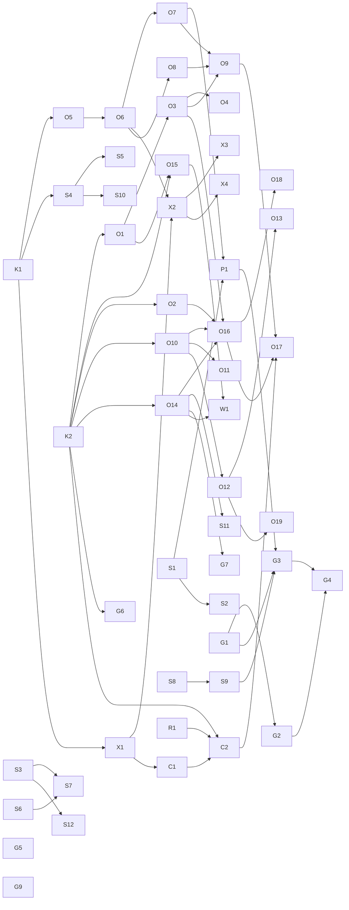

# M4 slice plan: Opening day

The M4 chapter (#1006) cut into slice cards for the roadmap pipeline
(`docs/process/roadmap-pipeline.md`, card format `docs/process/slice-card.md`).
Written 2026-11-14 by the planner; the maintainer's answers to the open questions are in
[Decisions (2026-11-14)](#decisions-2026-11-14). Read it with the [M4 outline](m4-outline.md).

**Gate.** M4 starts when M3 has shipped. Until then nobody dispatches from
`tools\cli slice list 1006 --ready`. On the day M3 closes, that command is the
dispatch queue and every card's brief is `tools\cli slice brief <issue>`.

## Shape

- **One plan under the chapter, not one per epic.** `slice` resolves
  dependencies only inside one plan, and the critical path crosses the epics
  (the trailer needs the GM panel and the plaza boards). The cards are
  sub-issues of #1006; each card names the epic issue it serves.
- **50 slices, 1895 agent-minutes.** 45 were created first
  ([`m4-slices/plan-1006.md`](m4-slices/plan-1006.md), #1258 to #1303). The decisions of 2026-11-14 added 5
  ([`m4-slices/plan-1006-decisions.md`](m4-slices/plan-1006-decisions.md), #1320 to #1324): O17, which was held, and
  R1, C1, C2 and W1, which the answers need. Of the 9 that had been held, O17 is created, S13 to S16 are dropped and M1 to M4
  are deferred past the opening ([`m4-slices/plan-1006-held.md`](m4-slices/plan-1006-held.md)).
- **Models.** 46 Sonnet (`lf-builder`), 4 Opus (`lf-hard`): O8 and X3 (persistence), S6 (ban record file), S9 (GM RPC,
  replication), plus the independent reviewer on each of those.
- **Two enablers first.** K1 gives the generated config schema a merge driver,
  so the slices that add config fields (O5, S4, X1) can
  run side by side. K2 lets `host` subcommands live one file each in
  `tools/host/commands/`, so no M4 slice edits `tools/cli.mjs` after it.

## Already built: not sliced again

| Issue | State | What exists |
|---|---|---|
| #980 game updates never cost a save | merged (#1054, #1164) | `host preflight`, build stamp, `docs/ops/game-updates.md` |
| #306 backup before every session | mostly built | `host start` backs up first, `host stop` saves and backs up, `host backup`, `host restore` (`tools/host/host.mjs`). Missing: rotation (O1) and a restore drill on a copy (O2) |
| #305 session commands | mostly built | `host start/stop/status`; `LF_HostStop` closes gracefully on a stop file. Missing: watchdog, announce, runbook (O3, O14, O16) |
| #803 police application gates | merged (#1184) | playtime, cooldown and trial gates in `LF_PoliceApplications` |
| #804 clip stamp | merged (#1187, #1176) | `Feature/Moderation/LF_ClipStamp*.c`, `docs/player-clips.md` |
| #806 player FAQ | merged (#1176) | `docs/player-faq.md` |
| #915 rules quiz | merged (#1194) | `Feature/Rules/LF_Quiz*.c`, pack `Configs/Rules/LF_Quiz_Everon.conf` |
| #313, #315 incident tools | built in M2 | incident log, GM panel, `/report` flags, admin action log, `BanCommand` hook |
| #379 self-hosted guide | mostly built | `docs/owner/install.md`, `docs/playtest/workshop-host.md`; O19 adds success lines and rollback |
| #380 server-doctor | parts exist | `judgeBootLog` in `tools/release/boot-check.mjs`, `tools/config/check.mjs`; O12 and O13 wrap them |

## Decisions (2026-11-14)

The maintainer answered the open questions. They are final unless the maintainer reopens them; the cards below already
follow them.

| Topic | Decision | What it did to the slices |
|---|---|---|
| Rules quiz | A subset of the published rules, written separately; it is not generated from the rules page | S1 writes the full published rules in their own keys and leaves the quiz alone; S2 exports only those rules |
| Alpha gate | A server password only, no account allowlist | S12 says so; no allowlist slice; the password is host-only (C1, C2) |
| Wipes | Any time during the alpha, with 24 hours' notice on Discord; progress is kept from the public launch | O14 refuses a `--wipe` under 24 hours out; O15 and the new W1 policy page carry the rule |
| Discord account linking (#805) | Not in M4 | S13 to S16 dropped |
| Website | Shows the next session time only; no live player count and no status endpoint | G7 reads `sessions.json` only; G8 will not exist; G6 stays an operator tool |
| Police missions (#234) | After the alpha opens | M1 to M4 deferred out of this chapter |
| Town-grid redo (#603) | Not in M4 | Not sliced; nothing depends on it |
| Flagship live `config.json` | In this repo under `server/`, so changes go through PRs | New C1 (the files) and C2 (secrets stay host-only); O17 created |
| In-game day | 2 real hours (12x) | X1 and C1: the flagship config sets a 120-minute accelerated day; the core default stays vanilla |
| Server name | "Life Framework \| Everon 1989 (Alpha)" | G5 and C1 use it exactly |
| Staff at opening | Only the maintainer is an administrator; the staff tools ship with a roster file to fill in later | New R1 (roster file and checker); S3 names nobody |

## Slices by epic

Minutes are the card budget. **CP** marks the critical path. **B** marks a
release blocker.

### #230 Hosting and ops

| Key | Issue | Slice | Model, tier | Min | Depends |
|---|---|---|---|---|---|
| K1 | #1258 | Config schema merge driver (CP) | sonnet T0 | 35 | |
| K2 | #1259 | `host` subcommands one file each | sonnet T0 | 30 | |
| O1 | #1260 | Backup rotation | sonnet T0 | 35 | K2 |
| O2 | #1261 | Restore drill on a scratch profile (B) | sonnet T0 | 45 | K2 |
| O3 | #1262 | Watchdog crash restart (B) | sonnet T0 | 45 | K2, O1 |
| O4 | #1263 | Crash-loop guard and staff alert | sonnet T0 | 30 | O3 |
| O5 | #1264 | Restart schedule from config (CP) | sonnet T2 | 45 | K1 |
| O6 | #1265 | Restart warning toast (CP) | sonnet T2 | 40 | O5 |
| O7 | #1266 | Plaza siren at the warnings (CP) | sonnet T2 | 45 | O6 |
| O8 | #1267 | Save and close at restart time | opus T2, persistence | 30 | O6 |
| O9 | #1268 | Proof `restart-cycle` (B) | sonnet T2 | 45 | O3, O7, O8 |
| O10 | #1269 | `host triage` groups a log | sonnet T0 | 40 | K2 |
| O11 | #1270 | Triage drafts issues | sonnet T0 | 30 | O10 |
| O12 | #1271 | `server-doctor`: mods and verdict | sonnet T0 | 45 | O10 |
| O13 | #1272 | `server-doctor`: effective config | sonnet T0 | 40 | O12 |
| O14 | #1273 | `host announce` and `sessions.json` | sonnet T0 | 40 | K2 |
| O15 | #1274 | Backed-up wipe step | sonnet T0 | 35 | K2, O1 |
| O16 | #1275 | Session runbook | sonnet T0 | 40 | O2, O3, O10, O14 |
| O17 | #1324 | Config-only hotfix page | sonnet T0 | 30 | O16, O9, C2 |
| O18 | #1276 | Rented-box checklist, host-agnostic | sonnet T0 | 40 | O16 |
| O19 | #1277 | Install guide: success lines, rollback | sonnet T0 | 30 | O12 |
| C1 | #1321 | Flagship `config.json` and `server.json` in `server/flagship/` | sonnet T1 | 35 | X1 |
| C2 | #1322 | `host config apply`: repo files plus host-only secrets | sonnet T0 | 40 | C1, R1, K2 |
| W1 | #1323 | Wipe policy page | sonnet T0 | 30 | O14, O15 |

### #231 Staff and community

| Key | Issue | Slice | Model, tier | Min | Depends |
|---|---|---|---|---|---|
| S1 | #1279 | Rules and run-your-own sign cards (pack) | sonnet T1 | 40 | |
| P1 | #1280 | Place siren and both boards at the plaza (CP) | sonnet T1 | 40 | O7, S1 |
| S2 | #1281 | Rules export to the site and Discord | sonnet T0 | 40 | S1 |
| S3 | #1282 | Moderator guide (B) | sonnet T0 | 40 | |
| S4 | #1283 | Staff webhook sender | sonnet T2 | 45 | K1 |
| S5 | #1284 | Admin actions and flags relay | sonnet T2 | 35 | S4 |
| S6 | #1285 | Ban record file | opus T2, persistence | 45 | |
| S7 | #1286 | Appeals page | sonnet T0 | 30 | S3, S6 |
| S8 | #1287 | Police application staff API | sonnet T2 | 40 | |
| S9 | #1288 | GM panel for applications (B) | opus T2, replication | 45 | S8 |
| S10 | #1289 | Application relay to staff | sonnet T2 | 30 | S4 |
| S11 | #1290 | Feedback triage page | sonnet T0 | 30 | O14 |
| S12 | #1291 | Invite-only alpha page (password only) | sonnet T0 | 30 | S3 |
| R1 | #1320 | Staff roster file and checker | sonnet T0 | 35 | |

S13 to S16 (Discord account linking, #805) are dropped: not in M4.

### #232 Showcase and growth

| Key | Issue | Slice | Model, tier | Min | Depends |
|---|---|---|---|---|---|
| G1 | #1292 | Trailer shot list and scenes | sonnet T0 | 40 | |
| G2 | #1293 | Film shots 1 to 4 | sonnet T1 | 45 | G1 |
| G3 | #1294 | Film shots 5 to 8 (CP) | sonnet T1 | 45 | G1, P1, S9 |
| G4 | #1295 | Cut the trailer (CP, B) | sonnet T1 | 40 | G2, G3 |
| G5 | #1296 | Workshop page copy and images | sonnet T0 | 35 | |
| G6 | #1297 | A2S query: `host players` | sonnet T0 | 40 | K2 |
| G7 | #1298 | Servers page: next session time only | sonnet T0 | 35 | O14 |
| G9 | #1299 | Run-your-own block on the site | sonnet T0 | 30 | |

There is no G8: the website shows the next session time only, with no live status publisher.

### Other M4 issues

| Key | Issue | Slice | Model, tier | Min | Depends |
|---|---|---|---|---|---|
| X1 | #1300 | Day cycle config (#129) | sonnet T2 | 45 | K1 |
| X2 | #1301 | Apply it through the vanilla time manager | sonnet T2 | 40 | X1, O6 (shared start line) |
| X3 | #1302 | Time survives a restart | opus T2, persistence | 40 | X2 |
| X4 | #1303 | Proof `day-rate` | sonnet T2 | 35 | X2 |

M1 to M4 (police calls board, fine call, rank filter, station board, #234) are deferred: they come after the alpha opens, under
the chapter that follows it (cards kept in [`plan-1006-held.md`](m4-slices/plan-1006-held.md)).

#603 (town grid) is not in M4 and is not sliced.

## The DAG

**Critical path: 7 slices, 290 minutes.**
K1 (35) → O5 (45) → O6 (40) → O7 (45) → P1 (40) → G3 (45) → G4 (40). The
next longest are K2 → O1 → O3 → O16 → O18 (190) and S8 → S9 → G3 → G4 (170).
With the pool's parallelism the chapter's code can land in about five hours
of wall clock; the trailer's real-crowd shot and the playtest come after.

## First 25 to start

In this order. The first nine are ready at once; the rest open as K1, K2, S8,
G1, O1, O5, O10 and S4 merge (each 30 to 45 minutes in).

| # | Key | Issue | Opens when |
|---|---|---|---|
| 1 | K1 | #1258 | now |
| 2 | K2 | #1259 | now |
| 3 | S8 | #1287 | now |
| 4 | S1 | #1279 | now |
| 5 | G1 | #1292 | now |
| 6 | S6 | #1285 | now |
| 7 | S3 | #1282 | now |
| 8 | G5 | #1296 | now |
| 9 | G9 | #1299 | now |
| 10 | O1 | #1260 | K2 |
| 11 | O2 | #1261 | K2 |
| 12 | O10 | #1269 | K2 |
| 13 | O14 | #1273 | K2 |
| 14 | G6 | #1297 | K2 |
| 15 | O5 | #1264 | K1 |
| 16 | X1 | #1300 | K1 |
| 17 | S4 | #1283 | K1 |
| 18 | S9 | #1288 | S8 |
| 19 | G2 | #1293 | G1 |
| 20 | O3 | #1262 | O1 |
| 21 | O15 | #1274 | O1 |
| 22 | O6 | #1265 | O5 |
| 23 | O12 | #1271 | O10 |
| 24 | O11 | #1270 | O10 |
| 25 | S5 | #1284 | S4 |

## Steps only a human does

Not cards: the maintainer or a staff member does them, from the pages the
slices write.

- #378: the 0grind trial on the maintainer's account; then the per-host page
  of #379 and the host section of `docs/ops/rented-box.md`.
- #555: invites with the server password, then opening the server (remove the
  password, publish the listing).
- #556: each wipe, announced 24 hours ahead (`host wipe` refuses without a
  typed confirmation); W1 writes the policy text.
- The host's `secrets.json`: the join and admin passwords and the webhook URLs
  (the live `config.json` is public in this repo, so none of them go in it), then
  `host config apply`.
- The maintainer's account identity id in `server/flagship/staff-roster.json`.
- Discord: the appeals, feedback and staff channels, creating the webhooks,
  pinning the rules.
- #313: recruiting the trial moderators and adding them to the roster file.
- #317, #318: publishing the trailer and uploading the Workshop page.
- The chapter's integration run and the batched playtest
  (`tools\cli playtest checklist`) once every card has merged.

## Open questions for the maintainer

One is left. Nothing in the plan assumes an answer.

1. **Restart times** for the flagship once it runs 24/7, and whether the
   plaza siren suits the 1989 village or the toast alone is enough. Until
   answered the flagship config sets no `restarts` list (C1) and O7's siren
   falls back to the toast when no siren is placed.
