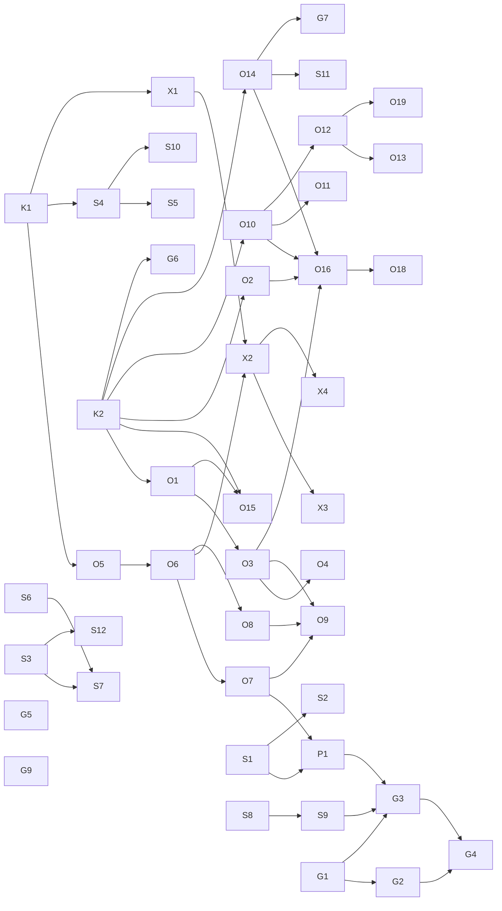

# M4 slice plan: Opening day

The M4 chapter (#1006) cut into slice cards for the roadmap pipeline
(`docs/process/roadmap-pipeline.md`, card format `docs/process/slice-card.md`).
Written 2026-11-14 by the planner. Read it with the [M4 outline](m4-outline.md).

**Gate.** M4 starts when M3 has shipped. Until then nobody dispatches from
`tools\cli slice list 1006 --ready`. On the day M3 closes, that command is the
dispatch queue and every card's brief is `tools\cli slice brief <issue>`.

## Shape

- **One plan under the chapter, not one per epic.** `slice` resolves
  dependencies only inside one plan, and the critical path crosses the epics
  (the trailer needs the GM panel and the plaza boards). The cards are
  sub-issues of #1006; each card names the epic issue it serves.
- **54 slices, 2055 agent-minutes.** 45 are created
  ([`m4-slices/plan-1006.md`](m4-slices/plan-1006.md), #1258 to #1303). 9 are
  held until the maintainer answers a question
  ([`m4-slices/plan-1006-held.md`](m4-slices/plan-1006-held.md)).
- **Models.** 49 Sonnet (`lf-builder`), 5 Opus (`lf-hard`): O8 and X3
  (persistence), S6 (ban record file), S9 (GM RPC, replication), M2 (money),
  plus the independent reviewer on each of those.
- **Two enablers first.** K1 gives the generated config schema a merge driver,
  so the slices that add config fields (O5, S4, X1) can
  run side by side. K2 lets `host` subcommands live one file each in
  `tools/host/commands/`, so no M4 slice edits `tools/cli.mjs` after it.

## Already built: not sliced again

| Issue | State | What exists |
|---|---|---|
| #980 game updates never cost a save | merged (#1054, #1164) | `host preflight`, build stamp, `docs/ops/game-updates.md` |
| #306 backup before every session | mostly built | `host start` backs up first, `host stop` saves and backs up, `host backup`, `host restore` (`tools/host/host.mjs`). Missing: rotation (O1) and a restore drill on a copy (O2) |
| #305 session commands | mostly built | `host start/stop/status`; `LF_HostStop` closes gracefully on a stop file. Missing: watchdog, announce, runbook (O3, O14, O16) |
| #803 police application gates | merged (#1184) | playtime, cooldown and trial gates in `LF_PoliceApplications` |
| #804 clip stamp | merged (#1187, #1176) | `Feature/Moderation/LF_ClipStamp*.c`, `docs/player-clips.md` |
| #806 player FAQ | merged (#1176) | `docs/player-faq.md` |
| #915 rules quiz | merged (#1194) | `Feature/Rules/LF_Quiz*.c`, pack `Configs/Rules/LF_Quiz_Everon.conf` |
| #313, #315 incident tools | built in M2 | incident log, GM panel, `/report` flags, admin action log, `BanCommand` hook |
| #379 self-hosted guide | mostly built | `docs/owner/install.md`, `docs/playtest/workshop-host.md`; O19 adds success lines and rollback |
| #380 server-doctor | parts exist | `judgeBootLog` in `tools/release/boot-check.mjs`, `tools/config/check.mjs`; O12 and O13 wrap them |

## Slices by epic

Minutes are the card budget. **CP** marks the critical path. **B** marks a
release blocker.

### #230 Hosting and ops

| Key | Issue | Slice | Model, tier | Min | Depends |
|---|---|---|---|---|---|
| K1 | #1258 | Config schema merge driver (CP) | sonnet T0 | 35 | |
| K2 | #1259 | `host` subcommands one file each | sonnet T0 | 30 | |
| O1 | #1260 | Backup rotation | sonnet T0 | 35 | K2 |
| O2 | #1261 | Restore drill on a scratch profile (B) | sonnet T0 | 45 | K2 |
| O3 | #1262 | Watchdog crash restart (B) | sonnet T0 | 45 | K2, O1 |
| O4 | #1263 | Crash-loop guard and staff alert | sonnet T0 | 30 | O3 |
| O5 | #1264 | Restart schedule from config (CP) | sonnet T2 | 45 | K1 |
| O6 | #1265 | Restart warning toast (CP) | sonnet T2 | 40 | O5 |
| O7 | #1266 | Plaza siren at the warnings (CP) | sonnet T2 | 45 | O6 |
| O8 | #1267 | Save and close at restart time | opus T2, persistence | 30 | O6 |
| O9 | #1268 | Proof `restart-cycle` (B) | sonnet T2 | 45 | O3, O7, O8 |
| O10 | #1269 | `host triage` groups a log | sonnet T0 | 40 | K2 |
| O11 | #1270 | Triage drafts issues | sonnet T0 | 30 | O10 |
| O12 | #1271 | `server-doctor`: mods and verdict | sonnet T0 | 45 | O10 |
| O13 | #1272 | `server-doctor`: effective config | sonnet T0 | 40 | O12 |
| O14 | #1273 | `host announce` and `sessions.json` | sonnet T0 | 40 | K2 |
| O15 | #1274 | Backed-up wipe step | sonnet T0 | 35 | K2, O1 |
| O16 | #1275 | Session runbook | sonnet T0 | 40 | O2, O3, O10, O14 |
| O17 | held | Config-only hotfix page (Q4) | sonnet T0 | 30 | O16, O9 |
| O18 | #1276 | Rented-box checklist, host-agnostic | sonnet T0 | 40 | O16 |
| O19 | #1277 | Install guide: success lines, rollback | sonnet T0 | 30 | O12 |

### #231 Staff and community

| Key | Issue | Slice | Model, tier | Min | Depends |
|---|---|---|---|---|---|
| S1 | #1279 | Rules and run-your-own sign cards (pack) | sonnet T1 | 40 | |
| P1 | #1280 | Place siren and both boards at the plaza (CP) | sonnet T1 | 40 | O7, S1 |
| S2 | #1281 | Rules export to the site and Discord | sonnet T0 | 40 | S1 |
| S3 | #1282 | Moderator guide (B) | sonnet T0 | 40 | |
| S4 | #1283 | Staff webhook sender | sonnet T2 | 45 | K1 |
| S5 | #1284 | Admin actions and flags relay | sonnet T2 | 35 | S4 |
| S6 | #1285 | Ban record file | opus T2, persistence | 45 | |
| S7 | #1286 | Appeals page | sonnet T0 | 30 | S3, S6 |
| S8 | #1287 | Police application staff API | sonnet T2 | 40 | |
| S9 | #1288 | GM panel for applications (B) | opus T2, replication | 45 | S8 |
| S10 | #1289 | Application relay to staff | sonnet T2 | 30 | S4 |
| S11 | #1290 | Feedback triage page | sonnet T0 | 30 | O14 |
| S12 | #1291 | Invite-only alpha page (Q2 for wording) | sonnet T0 | 30 | S3 |
| S13 to S16 | held | Account link code, `/link`, notify, bot side (#805, Q5) | sonnet | 140 | S4 |

### #232 Showcase and growth

| Key | Issue | Slice | Model, tier | Min | Depends |
|---|---|---|---|---|---|
| G1 | #1292 | Trailer shot list and scenes | sonnet T0 | 40 | |
| G2 | #1293 | Film shots 1 to 4 | sonnet T1 | 45 | G1 |
| G3 | #1294 | Film shots 5 to 8 (CP) | sonnet T1 | 45 | G1, P1, S9 |
| G4 | #1295 | Cut the trailer (CP, B) | sonnet T1 | 40 | G2, G3 |
| G5 | #1296 | Workshop page copy and images (Q7 for the name) | sonnet T0 | 35 | |
| G6 | #1297 | A2S query: `host players` | sonnet T0 | 40 | K2 |
| G7 | #1298 | Servers page: status and next session | sonnet T0 | 40 | O14 |
| G9 | #1299 | Run-your-own block on the site | sonnet T0 | 30 | |

G8, the live status publisher, is not a card yet: it waits on Q8.

### Other M4 issues

| Key | Issue | Slice | Model, tier | Min | Depends |
|---|---|---|---|---|---|
| X1 | #1300 | Day cycle config (#129) | sonnet T2 | 45 | K1 |
| X2 | #1301 | Apply it through the vanilla time manager | sonnet T2 | 40 | X1, O6 (shared start line) |
| X3 | #1302 | Time survives a restart | opus T2, persistence | 40 | X2 |
| X4 | #1303 | Proof `day-rate` | sonnet T2 | 35 | X2 |
| M1 to M4 | held | Police calls board, fine call, rank filter, station board (#234, Q10) | sonnet, M2 opus | 155 | |

#603 (town grid) is not sliced: see Q11.

## The DAG

**Critical path: 7 slices, 290 minutes.**
K1 (35) → O5 (45) → O6 (40) → O7 (45) → P1 (40) → G3 (45) → G4 (40). The
next longest are K2 → O1 → O3 → O16 → O18 (190) and S8 → S9 → G3 → G4 (170).
With the pool's parallelism the chapter's code can land in about five hours
of wall clock; the trailer's real-crowd shot and the playtest come after.

## First 25 to start

In this order. The first nine are ready at once; the rest open as K1, K2, S8,
G1, O1, O5, O10 and S4 merge (each 30 to 45 minutes in).

| # | Key | Issue | Opens when |
|---|---|---|---|
| 1 | K1 | #1258 | now |
| 2 | K2 | #1259 | now |
| 3 | S8 | #1287 | now |
| 4 | S1 | #1279 | now (Q1 confirms the wording) |
| 5 | G1 | #1292 | now |
| 6 | S6 | #1285 | now |
| 7 | S3 | #1282 | now |
| 8 | G5 | #1296 | now (Q7 fills the name) |
| 9 | G9 | #1299 | now |
| 10 | O1 | #1260 | K2 |
| 11 | O2 | #1261 | K2 |
| 12 | O10 | #1269 | K2 |
| 13 | O14 | #1273 | K2 |
| 14 | G6 | #1297 | K2 |
| 15 | O5 | #1264 | K1 |
| 16 | X1 | #1300 | K1 (defaults per Q9) |
| 17 | S4 | #1283 | K1 |
| 18 | S9 | #1288 | S8 |
| 19 | G2 | #1293 | G1 |
| 20 | O3 | #1262 | O1 |
| 21 | O15 | #1274 | O1 |
| 22 | O6 | #1265 | O5 |
| 23 | O12 | #1271 | O10 |
| 24 | O11 | #1270 | O10 |
| 25 | S5 | #1284 | S4 |

## Steps only a human does

Not cards: the maintainer or a staff member does them, from the pages the
slices write.

- #378: the 0grind trial on the maintainer's account; then the per-host page
  of #379 and the host section of `docs/ops/rented-box.md`.
- #555: invites, then opening the server (remove access limits, publish the
  listing).
- #556: the wipe policy text, then each wipe (`host wipe` refuses without a
  typed confirmation).
- Discord: the appeals, feedback and staff channels, the webhook URLs in the
  live `config.json`, pinning the rules.
- #313: recruiting and naming the trial moderators.
- #317, #318: publishing the trailer and uploading the Workshop page.
- The chapter's integration run and the batched playtest
  (`tools\cli playtest checklist`) once every card has merged.

## Open questions for the maintainer

Each one holds the slices named; nothing in the plan assumes an answer.

1. **Rules text.** Are the orientation quiz's rules (#1194: RDM, fear, New
   Life, safe zone) the published server rules, or do you want a fuller rules
   text (the lawless area by name, hold-ups, NLR timing)? Holds S1's wording
   and S2.
2. **Alpha access.** Invite-only by a server password (no code), or by an
   account-uid allowlist checked at join (a new core slice)? Holds S12's
   wording and possibly one card.
3. **Wipe policy.** The notice period (the outline leaves it open), the date
   after which progress is kept, and whether a wipe keeps anything (bank,
   houses). Holds the policy page and the `--wipe` announcement text.
4. **Where the flagship's live `config.json` lives.** A public file in this
   repo (no secrets; webhook URLs set on the host), or a private repo or
   host-only copy? Holds O17.
5. **Discord account linking (#805) in M4?** The spec calls it optional. Yes
   creates S13 to S16 (140 minutes); no closes it for later.
6. **Who the moderators, operators and administrators are** for the roster in
   the moderator guide and the server's admin list (#313).
7. **The flagship's server-browser name and description** (#318).
8. **Live status on the site (#319).** The site is static on Cloudflare Pages,
   so a live player count needs either a small endpoint the host pushes to
   (a Worker and a secret) or nothing live, only the next-session time from
   `sessions.json`. Which? Holds G8.
9. **Day cycle defaults (#129).** The accelerated day length in real minutes
   and the night speed. Until answered X1 ships with the current vanilla
   duration as its default.
10. **Police missions (#234) before opening, or after a live roster exists?**
    The outline places them in M4 because they need a live roster. Holds M1
    to M4.
11. **#603 town grid.** It is in the M4 milestone as pack-world work. Is the
    Everon 1989 town re-laid out before opening, and if so as its own chapter?
    It is not sliced.
12. **Restart times** for the flagship once it runs 24/7, and whether the
    plaza siren suits the 1989 village or the toast alone is enough.
