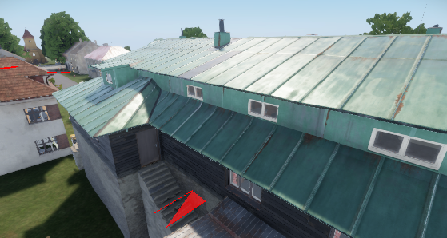
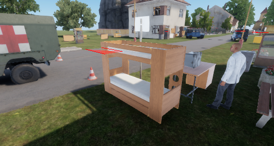
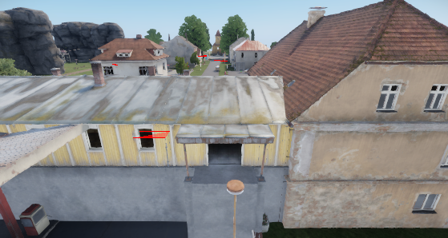

# M5 first night: the hostel

Decision for #1958 (chapter Story: The relocated #1015), under the maintainer's rule for #1758 (2026-11-15):
the first spawn of a brand-new character is in a base-game building that works as a hostel, and only if none
does, a homestay in an ordinary house with an annoying drumming host.

**Decision: hostel. Prefab `MountainHotel_01_green`; the room is the upstairs dormitory.** No homestay.

## The building

| | |
|---|---|
| Prefab | `{39FC44E47347DF5D}Prefabs/Structures/Services/Hotels/MountainHotel_01/MountainHotel_01_green.et` |
| Parent | `MountainHotel_01_base.et` (`SCR_DestructibleBuildingEntity`, `MountainHotel_01.xob`, wooden, large) |
| Furniture set | `Prefabs/Structures/Services/Hotels/MountainHotel_01/Furniture/MountainHotel_01_furniture_01.et`, placed by the green variant at the building origin |
| Size | about 33 x 19 m, 15 m high (`look item` measured 33.1 x 14.9 x 18.9) |
| Room | Upstairs dormitory, floor at +3.4 m from the building origin |
| Beds in the room | 9 `BunkBed_02` (18 berths), 1 `Bed_01`, 1 `BedDouble_02` |
| Other fittings | Coat hooks, wardrobe, notice board, safe, rack, shower and toilet, kitchen, fridge, a sofa and armchair for the common room, a desk with a notebook |
| Signs | Two `SignMountainHotel_01_hornik` signs come with it |

Why it fits: it is a real hotel model with bunk-bed rooms, a hall and a desk, so a relocated arrival reads it as a
hostel at a glance. It is a base-game prefab, so it needs no new mesh, and the first-night beds are the hospital-bed
props from #1965 laid inside it.

## What was checked

`asset_search` for "Hostel" and "Motel" finds nothing; "Dormitory" and "Guesthouse" find only wall signs; "Hotel"
finds the `MountainHotel_01` family and a map icon. `api grep` confirms `MountainHotel_01_green` and `_red` in the
installed game (build 26266485). The pictures come from `tools\cli look item ... --at hospital`.

| Candidate | Verdict |
|---|---|
| `MountainHotel_01_green` | **Chosen.** Hotel, 20 beds, reception fittings |
| `MountainHotel_01_red` | Same building, furniture set 02: 10 bunks plus 2 beds, but an office, stove and punch clock make it read as a staff house. Kept as the alternate |
| `BarracksWooden_USSR_01_*` | Rejected. Bunk beds, but it reads as a military barracks (yellow wooden hut, flags, rifle posters) and the story is a civilian arrival |
| House prefabs (homestay) | Not needed. The fallback only applies when no building fits |

## What the town pass must handle

Card #2125 (draft, label `hold`) places it. Points for that card:

- The lot is about 36 x 22 m. The current village layer holds only houses, a pub and farm buildings; the pass picks
  the plot with `tools\cli place`.
- The dormitory beds are base-game furniture. The first-spawn beds (`LF_FirstSpawnBed`, `LF_FirstSpawnBeds.Resolve`,
  #1965) are separate props, so the pass puts them in the dormitory clear of the bunk collision and checks a
  character can walk from the street to them.
- The building is destructible (`DestructibleBuildingComponent_Wood_Large`). The pass confirms the first night does
  not depend on a building that can collapse, or accepts the ruin as a world event.
- The clerk's welcome (#1756) points to the hotel, so it says "hostel".

## If the maintainer rejects it

Switch to the homestay of #1758: an ordinary town house (for example one of the `House_Town_E_2I0x` two-storey
houses already in `Village_Buildings.layer`), the host's drum loop as an atmosphere sound, and "homestay" in the
clerk's welcome and the first-night beat. Close #2125 and file the house version.
