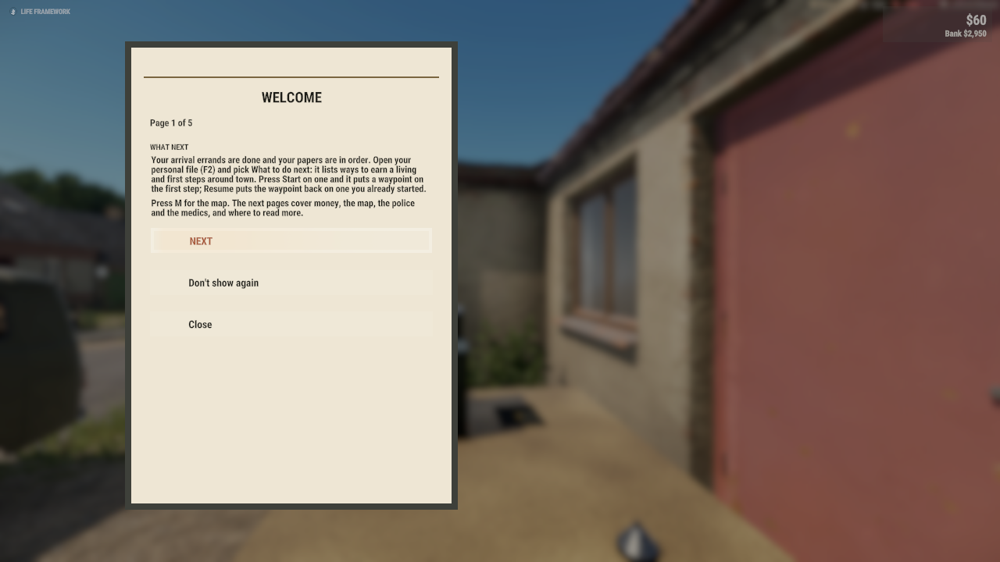
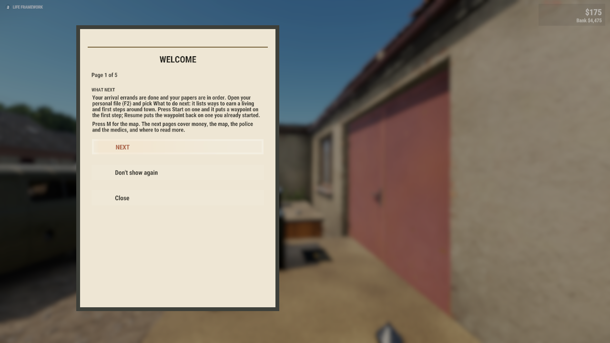
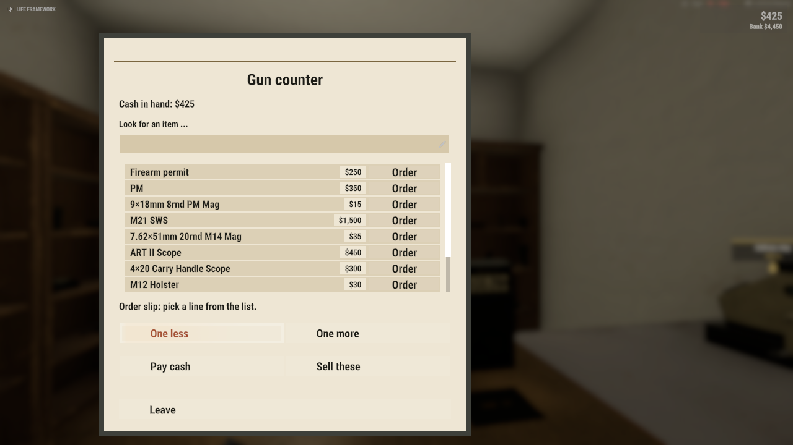
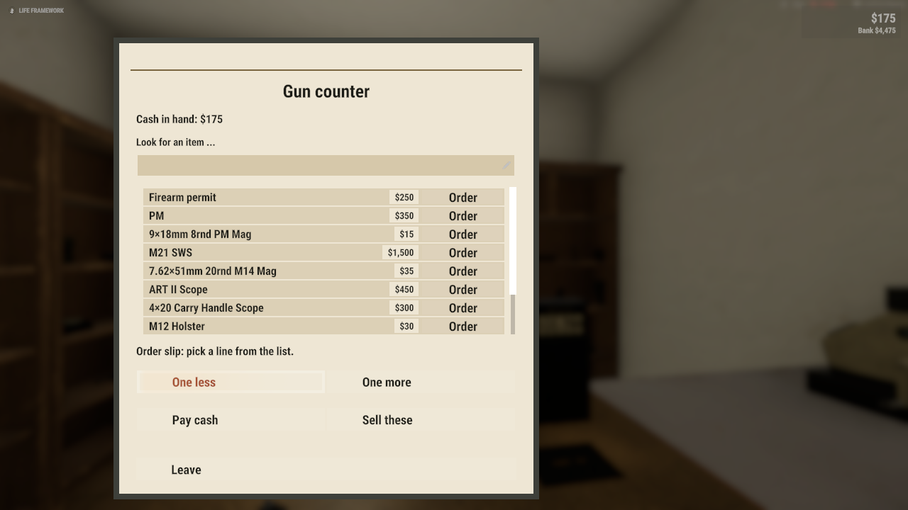
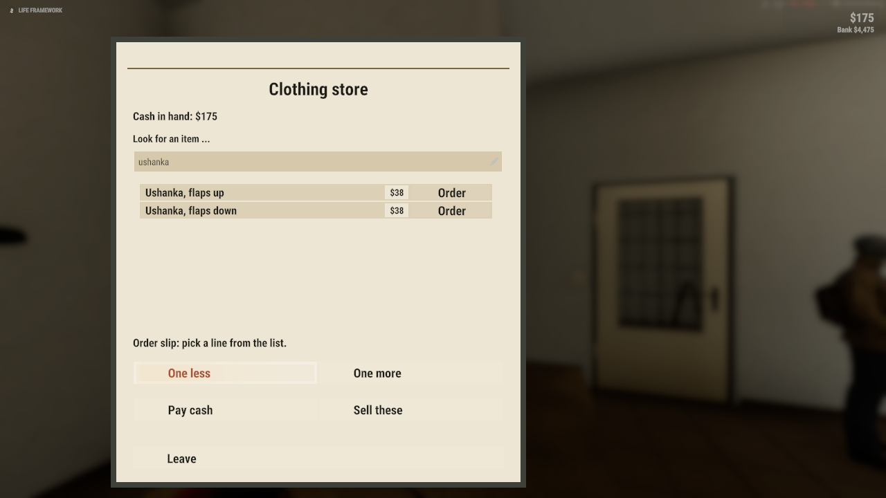

# Restart proof for today's player-visible state (2026-11-27)

**Commit played:** `origin/main` `39c4551a` (compiled-ok), worktree `ws/restart-proof-1127`, no game code changed.
**Session:** `session up --mission island --clients 1 --profile full` (Everon pack, harness build), one real
`session restart` (stop file, SHUTDOWN save, server boots with `-loadSessionSave`, the same client profile rejoins as
the same identity `00bbbddd-5e55-0000-0000-000000000001`), then `session down`. The server logged
`save loaded: version 1000, game build 1.9.0.42, running 1.9.0.42` on the second boot.

## What was set before the restart

1. `harness.mjs --client 1 flow playtest-030-first-two-hours`: 9 of 9 steps pass. The character did the five arrival errands
   (`quests=arrival_done,arrival_garage,arrival_register,arrival_apples,arrival_juice`) and stored the starter car.
2. The starter car (an `EL_T601_beige`) came out of the Saint-Philippe garage, was set beside the garage with `parkat`
   and **unlocked** with `LF_VehicleLockAction` (`lock state -> unlocked`). Unlocked is the non-default state: every
   spawn and retrieve locks the car, so a lock that survives as unlocked was really saved.
3. `send checkpoint 10`, then $4,000 taken out at the bank teller, then cottage `saint-philippe.home.sp-b83` bought at its
   sign (`house saint-philippe.home.sp-b83 bought by ... for 4000`).
4. Signed up at the Saint-Philippe parcel depot and started a run: `deposit 25 taken`, parcel in hand, cash 450 to 425.
5. Read the F3 guide and the gun counter list.

## Results

| What | Before the restart | After the restart | Verdict |
|---|---|---|---|
| Car plate (#5134) | `parked=ZZ_KA_6647`, `seen` on the client: `EL_T601_beige ... plate=ZZ_KA_6647` | Left in the street, so the load impounded it as designed (`impounded ... plate=ZZ KA 6647: left on the street at restart`). Collected at the impound desk for $250: `server applied plate ZZ KA 6647 on (2 plates)`, client `seen`: `plate=ZZ_KA_6647` | **survives** |
| Car lock | `lock=0` (unlocked by the owner) | `lock=0` on the car collected from the impound | **survives** |
| House owner and lock | `house=saint-philippe.home.sp-b83:owned=1:locked=0`, sign `sold=1` | `house ... owner -> '00bbbddd-...0001'`, `apply-lock-state accepted: house=saint-philippe.home.sp-b83 locked=0 owner='00bbbddd-...0001'`, sign `owned=1` | **survives** |
| Gun counter list (#5110) | permit $250, PM $350, PM mag $15, M21 $1,500, M14 mag $35, ART II $450, 4×20 $300, M12 holster $30, PM holster $25, M14 pouch $25, gang radio $60 | identical, line for line (`ui text` compared, only "Cash in hand" differs) | **unchanged** |
| Ushanka at $38 (#5110) | price rule in `LF_ShopPrices_ClothingStore.conf` | the clothing store counter lists both ushankas at $38; one bought: `cash -38 (shop-buy)`, `bought item=...Hat_Ushanka_01_folded.et qty=1 price=38` | **$38** |
| F3 WHAT NEXT (#5125) | page 1 heading `WHAT NEXT`, no Set waypoint button | the same page, same text, no Set waypoint button | **survives** |
| Courier deposit | run live, deposit $25 held, cash 425, bank 4,450 | `restart ended the run of ...: the carried cargo is taken back and deposit 25 refunded to the bank`; cash 425, bank 4,475; job stays `PARCEL` | **refunded, run cleanly ended** |

Pictures (`--profile full`, client 1):

| Before | After |
|---|---|
|  |  |
|  |  |
| |  |

## Notes

- **The gun store ushanka.** Since #5110 the gun store price file only lists the ushanka in `m_aExtraItemPrefabs`; the price
  rule is the clothing store's, and price rules apply by prefab everywhere. The Saint-Philippe gun counter does not sell
  hats, so the price was read and paid at the clothing store counter, the one place a player buys it.
- **A car left in the street goes to the impound at a restart.** This is the designed restart rule
  (`restart/*` in `docs/persistence.md`), not a loss: the record keeps its plate and lock, and the impound desk hands the same
  car back for the fee.
- **Everon homes have no lock toggle, by design.** `LF_HouseLockAction` lives on `EL_Door_Base.et`; an Everon home is a vanilla
  building with an `LF_HouseMarker.et`, whose doors always refuse a stranger and let the owner and key holders in
  (`docs/features/property.md`, "Homes for sale in the real town"). The saved lock flag (0) came back as saved.
- **Ledger wording.** The impound fee is written to the ledger as `vehicle-purchase` (`LF_VehicleOwnership.TakePayment` is shared
  with the purchase path). Server log only, no player sees it; not filed.

## Verdict

**Every checked state survives a real save, server restart and load.** No bug found, nothing fixed, no issue filed.
