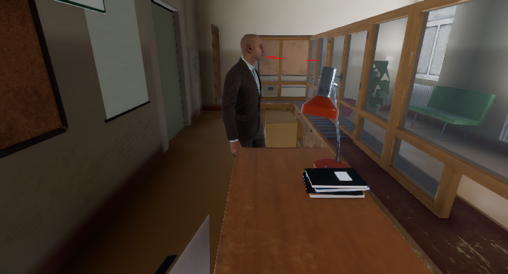
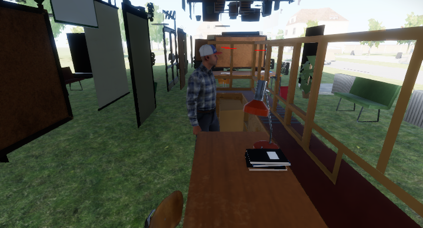

# LF NPC Dresser

A World Editor plugin that dresses NPCs for you. You pick an outfit and it writes the clothes into the
layer, as one edit that Ctrl+Z undoes.

## Use it

1. Open the world in the World Editor and select one or more NPCs (any character with a
   `BaseLoadoutManagerComponent`: our `LF_NpcBaseEntity` NPCs and vanilla characters both work).
2. Run **Plugins > Life Framework > LF NPC Dresser**, or press **Ctrl+Shift+D**.
3. In the dialog:
   - **Outfit preset**: a ready outfit (see below).
   - **Per slot**: a clothing prefab for head, torso, legs, feet, vest or backpack. A slot you pick here
     wins over the preset. A slot left empty keeps what the NPC already wears.
   - **Clear the per-slot picks after dressing**: tick it to start the next NPC from the preset alone.
4. Press **Dress**. **Back to prefab** removes the plugin's overrides from the selected NPCs, so they wear
   their prefab's outfit again. **Cancel** changes nothing.
5. Save the layer as usual (Ctrl+S).

The dialog lists the selected NPCs at the top. If nothing selected has a loadout, it says so and stops.
A pick that is not clothing (no `BaseLoadoutClothComponent`) is refused with a message and nothing changes.
The Workbench log gets one `[LFNpcDresser]` line per run with how many slots each NPC got.

What it writes: on the NPC's entity in its layer, `BaseLoadoutManagerComponent > Slots > <slot> > Prefab`
(and `Enabled 1`, since `Npc_Default_01` ships its Hat slot switched off). The prefab files are never
touched. Slots are found by name (`Hat`, `Jacket`, `Pants`, `Boots`, `Vest`, `Back`, plus common variants),
then by their `AreaType`.

## Presets

A preset is a small `.conf` of class `LF_NpcOutfitPreset`, with a name and one prefab per slot:

```
LF_NpcOutfitPreset {
 m_sName "Mechanic, Everon trucker cap"
 m_Head "{6D08415FD18F2775}Prefabs/Characters/HeadGear/Hat_TruckerCap_01/Hat_TruckerCap_01_everon.et"
 m_Torso "{7F0CD5E5DF17FF15}Prefabs/Characters/Uniforms/Shirt_CottonShirt_01/Shirt_CottonShirt_01_V4_Dirty.et"
 m_Legs "{537FD11C135757AC}Prefabs/Characters/Uniforms/Pants_Trousers_01/Pants_Trousers_01_DarkGrey_Dirty.et"
 m_Feet "{4C6029AB8BF5C044}Prefabs/Characters/Footwear/CombatBoots_Soviet_01_Dirty.et"
}
```

To add one, copy a preset in the Resource Browser (Workbench gives the copy its own GUID), rename it, and
change the slots with the thumbnail pickers. You change data only, no code. The preset picker lists every
`LF_NpcOutfitPreset` conf of every loaded addon.

| Where | What |
|---|---|
| `addons/LifeFramework/Configs/NpcOutfits/` (core) | the framework's roles in its own uniforms: Police, Police with cap, Doctor |
| `addons/LF_Everon1989/Configs/NpcOutfits/` (pack) | 1989 Everon locals: clerk, bank teller and official in suits; store clerk in a shirt or turtleneck; locals in a cotton shirt, a grey turtleneck, or a denim jacket with a knit cap; market trader; farmer; mechanic; quarry worker; fisherman |

**Era guidance (pack presets).** Show what a working local wore in 1989: cotton shirts, turtlenecks,
denim jackets, wool suits, trousers, work boots, flat caps, knit caps, trucker caps and hard hats. Avoid
rustic or antique costume (smocks, waistcoats with watch chains, straw hats) and modern sportswear. The
pack presets reuse the clothing already vetted in `tools/assets/outfits/roles.json`.

## Head-less: `tools\cli npc dress`

The same code runs without the dialog, for the lead or an agent in a worktree:

```
tools\cli npc dress --entity Bank_Teller --preset Configs/NpcOutfits/LF_Outfit_Mechanic.conf [--slot head=<prefab>] [--save] [--proof] [--look x,z] [--remote]
```

It starts a hidden Workbench with the plugin in plan mode (`$profile:lf-npc-dresser/plan.txt`, verbs listed
at the top of the plugin). `--proof` snapshots the slots, dresses, reads them back, runs Edit > Undo,
checks the snapshot, runs Edit > Redo and reads again. `--look x,z` takes `look` pictures before and after
(and saves). `--remote` sends the run to a pool machine with the workbench cap. Results (status, the
Workbench log, the layer diff, pictures) land in `tmp/npc-dress/<id>/`. It refuses the main checkout.

A head-less `--save` re-saves the whole world in Workbench's own format. On DebugWorld that also rewrites
`default.layer`'s BSP and bounds, and in the 2026-11-16 proof the next `look` drew the bank without its
building. That happened only in the pool machine's throwaway copy. Never commit a layer written this way;
the dialog in your own editor, saved with Ctrl+S, is the normal path.

## Proof (2026-11-16, lf-cloud)

`tools\cli npc dress --entity Bank_Teller --preset Configs/NpcOutfits/LF_Outfit_Mechanic.conf --proof --look 175.4,264.4 --remote`
on a scratch copy of DebugWorld: 4 slots written (head, torso, legs, feet; the Hat slot was switched off in
the prefab), each read back. Undo restored the brown suit, M70 hat slot and US boots, and Redo re-applied
the outfit. `done 0`.

| Before | After |
|---|---|
|  |  |

The dialog has not been photographed yet: Workbench play capture draws no Qt windows, and a
`tools\cli wb-shot` of the open dialog needs a visible desktop on a pool machine. Its fields, from top to
bottom: Outfit > Outfit preset; Per slot > Head, Torso, Legs, Feet, Vest, Backpack (thumbnail pickers),
"Clear the per-slot picks after dressing"; buttons Dress, Back to prefab, Cancel.
