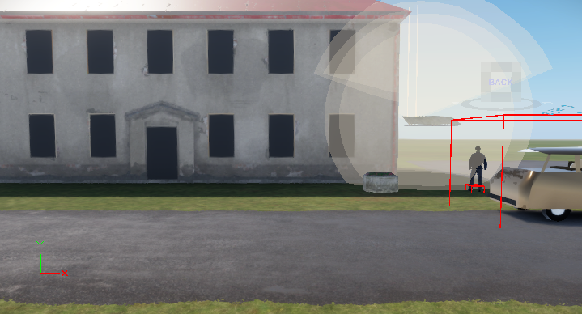
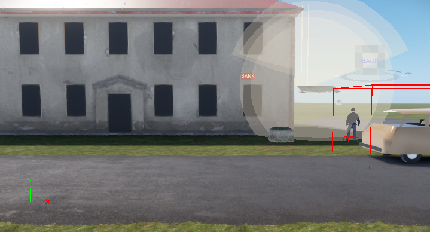
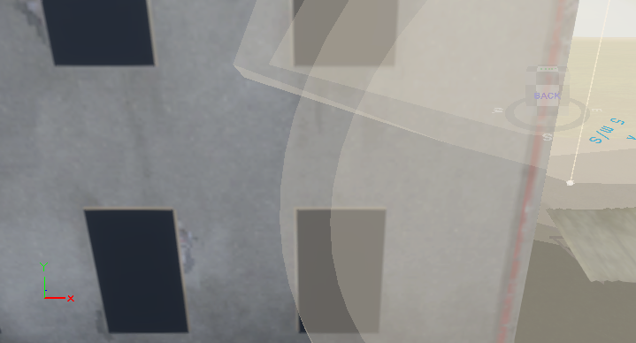
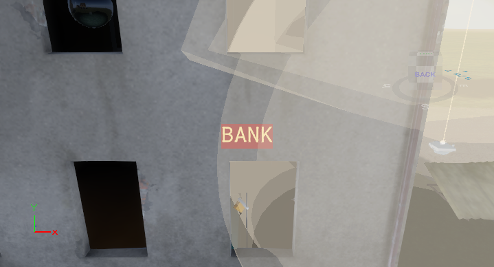

# Seeing and editing signs in the World Editor

A sign's face is printed by `LF_SignComponent` into a render target (`LF_SignFace.emat`,
`$rendertarget`) on a rendering game client. The World Editor's edit view never draws that render
target, so before #1819 a plate or fascia showed nothing there. Now the editor writes the sign's
text on its face as world-space text. This code is Workbench-only: it sits in `#ifdef WORKBENCH`
and the `_WB_` events, and the game never compiles it.

| Before (World Editor, edit mode) | After |
|---|---|
|  |  |
|  |  |

These pictures come from `tools\cli look bank --edit` on lf-cloud. The bank fascia (`LF_Sign_Fascia`, `m_sSignId "bank"`)
shows `BANK` in its lettering colour (`m_vTextColor`) on its paint colour (`m_vPaintColor`).

## What you see

- **Every sign** shows its printed title (the same `FaceText` the game prints: the resolved title in capitals) on the
  centre of its face. A painted sign uses its lettering and paint colours. The paper board and notice use dark ink on
  paper. The text faces the camera and hides when it would be too small to read.
- **The selected sign** shows its id and the whole card instead: the title, then What, How, You need, Rules and Next,
  one line each, with keys resolved.
- **A sign whose id has no titled row** shows the id in red. In the game this sign only logs an error and hides Read.
- **A price board** (`m_sPriceLotShopId`) shows its price only when it can find its lot. Otherwise it shows the red line
  and logs the same error the game would.

## Editing

| You want to change | Where | How |
|---|---|---|
| Which sign a prop is | the entity's `LF_SignComponent`, `m_sSignId` | A combo box that lists every id in `LF_Signs.conf` and the pack overlays. The text updates as soon as the value changes |
| Colours, face area, title box | the same component (`m_vPaintColor`, `m_vTextColor`, `m_vRimColor`, ...) | Edit the value; the preview updates as soon as the value changes |
| The words | `Configs/Signs/LF_Signs.conf` (core) or the pack overlay (`LF_Everon1989/Configs/Signs/`) | Right-click the sign, then **Edit sign text (LF_Signs.conf)**. It opens the config and logs the row id to look for. After you save, right-click and pick **Reload sign text**: it reads the config again and redraws every sign |
| A `#key` title or section | the string table: core `Language/everonlife_localization.st`, pack `LF_Everon1989/Language/` | Append or edit the row, then run `tools\cli regen-localization` (AGENTS.md rule 7). Place names and flavour go in the pack table |

A value without `#` is shown as written, so a server owner can retitle a sign in config without touching a string table.
Core text stays neutral; a town's words belong in the pack.

## Why not the real face

We tried that first. In edit mode `BuildFace` runs: every sign logged `face printed` on lf-cloud on 2026-11-16, so the
widgets were built and bound with `SetRenderTarget`. The faces still drew blank, because the World Editor viewport does
not render the game workspace's render targets. Debug text (`DebugTextWorldSpace.CreateInWorld`, `ONCE` per editor
update) is how vanilla's `EditorCommentEntity` puts words in the editor view, and it is what we use. Play mode
(Workbench play or a client) still shows the real printed face.

## How it works

`LF_SignComponent` (`Scripts/Game/Feature/Signs/`), `#ifdef WORKBENCH`:

- `_WB_GetAfterWorldUpdateSpecs` returns `CALL_WHEN_ENTITY_VISIBLE`, so `_WB_AfterWorldUpdate` runs every editor frame
  only for signs in view. It returns at once in play mode.
- `_WB_OnKeyChanged` reads the changed attributes back from the component source and clears the cached sign.
- `_WB_GetUserEnums("m_sSignId")` lists `LF_SignCatalog.WbIds` (core and pack overlays merged).
- `_WB_GetContextMenuItems` and `_WB_OnContextMenu` add Edit (`Workbench.OpenResource` on the config) and Reload
  (`LF_SignCatalog.WbReload`, then every sign drops its cached text).

`LF_SignCatalog.PlainText` builds the selected sign's lines. It is shared code, but only the editor calls it.

## Limits

- The preview is text, not the printed sheet: the painted rim, the wrapping and font fit are what play mode shows.
- **Edit sign text** opens the config at the top. It cannot jump to the row, so find the row by its `m_sId`.
- A pack overlay that is not in the mission header the editor loads does not change the preview.
